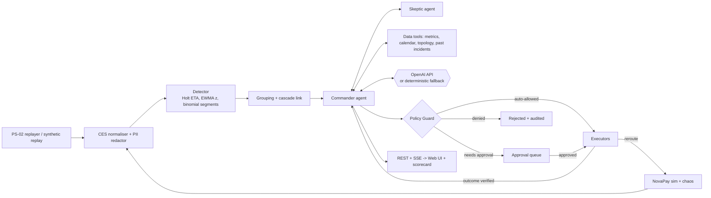
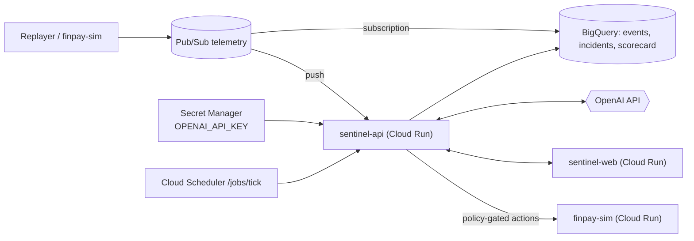

# Architecture

Sentinel runs the same pipeline against three sources: the PS-02 replayer, a densified synthetic replay, and the NovaPay simulator. LLM provider: **OpenAI only**, with a deterministic fallback.

## System flow

## GCP target mapping

## Implemented vs planned

| Capability | Status |
|---|---|
| Detector: Holt ETA, EWMA, binomial segment tests | Implemented |
| Skeptic + Commander with OpenAI and deterministic fallback | Implemented |
| Policy-gated reroute with live recovery verification | Implemented |
| Scorecard computed from CSV | Implemented |
| Recall over 28 incidents + 22 false alarms | Implemented |
| Web UI (live ops, incident trace, approvals) | Implemented |
| GCP deployment | Planned / not yet |
| Pub/Sub and BigQuery adapters | Planned / not yet |
| Security Sentinel | Planned / not yet |
| Log Analyst | Planned / not yet |
| Seeded evaluation mode | Planned / not yet |

Locally everything runs in one process with an in-memory bus and store; the GCP mapping is the deployment target, not a claim of a deployed system.
