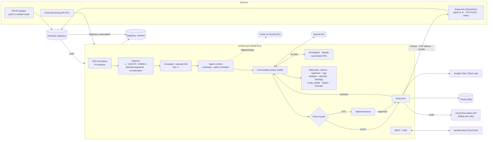
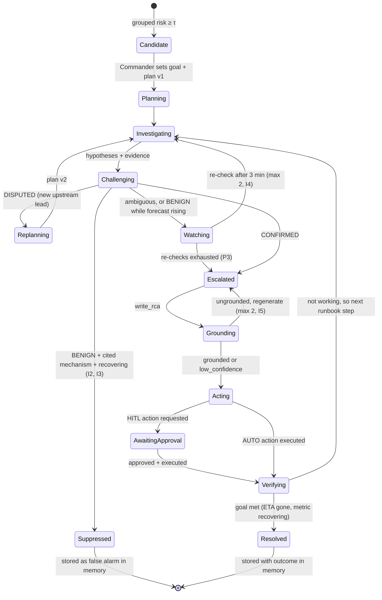

# Sentinel for NovaPay: final plan (PS-02)

> **Status:** final, merged plan. It supersedes `docs/IMPLEMENTATION_PLAN.md` (the "Sentinel / NovaPay" plan, called **Plan S** below) and `docs/foresight_blueprint.md` (the "Foresight" blueprint, called **Plan F** below). Both stay in the repo as background; where they disagree with this document, this document wins.
>
> **For agentic workers:** use superpowers:subagent-driven-development or superpowers:executing-plans and work task by task (§13). Steps use `- [ ]` checkboxes.
>
> **Evidence base:** PS-02 in `docs/hackathon_problem_statements_1.docx`, `docs/EDA_REPORT.md`, `docs/DATA_DESCRIPTION.md`, `analysis/outputs/*`, and `data/ps02_system_telemetry.csv`.

**Goal:** an agentic AIOps system for a fictional Pakistani digital-payments platform, **NovaPay**. It predicts payment-impacting incidents before they breach, uses an adversarial agent to argue false alarms down, writes grounded root-cause summaries linked to past incidents, and takes policy-gated preventive actions. One of those actions visibly fixes a live fault on stage. A scorecard computed (never hard-coded) on held-out data proves lead time, false-positive rate and RCA quality against the dataset's own baseline.

**One-line pitch:** *"On the PS-02 data, a static threshold catches 0 of 28 incidents, and the 95% rule that catches them all is wrong 44% of the time. Sentinel warns minutes earlier, argues away the noise, and arrives with the cause and the fix."*

---

## 1. Evaluation of the two source plans

### 1.1 Method

Each plan was checked three ways:

1. **Against the brief:** the PS-02 technical requirements and evaluation criteria, plus the five judging dimensions that apply to every problem (agentic behaviour, technical depth, MVP completeness, scalability, innovation).
2. **Against the data:** every factual claim about the CSV was re-run against `data/ps02_system_telemetry.csv` and `analysis/outputs/`.
3. **Against the clock:** whether the "Must" scope can actually be built and deployed by three people in the window.

### 1.2 Scores (1 = weak, 5 = strong)

| Dimension | Plan S (Sentinel) | Plan F (Foresight) | Why |
|---|---|---|---|
| Faithful to the PS-02 brief | 4 | 3 | S covers all five PS-02 requirements. F also covers them, but adds requirements that are not in PS-02 (§1.4, F1) and treats them as must-haves. |
| Faithful to the data / EDA | **5** | 2 | S is built on the EDA's findings. F builds an ML layer on features the EDA showed are noise, and its synthetic data favours its own detector (§1.4, F2–F4). |
| Agentic behaviour (judging criterion 1) | 3 | **5** | S runs a fixed Investigator → Skeptic → Commander pipeline. F has a goal-driven Commander that plans, re-plans on conflicting evidence, schedules its own re-checks and verifies outcomes after acting. |
| Evaluation rigour (lead time, FPR, RCA) | **5** | 3 | S has precise matching rules, an ablation ladder, a 10/30 seed split, a sanity gate that must reproduce the EDA, and hard negatives. F has good metric definitions but a 12-incident hold-out and a generator that separates classes by construction. |
| Safety and autonomy design | 4 | **5** | Both gate actions by policy. F adds shadow mode, TTL auto-expiry, post-action verification with auto-rollback, a circuit breaker, a kill switch, and a Tier-0 safety override on the Skeptic. |
| Demo impact | **5** | 4 | S's live reroute makes the success rate recover on screen, which is a real closed loop. F's scale-out of a simulator is less visibly causal, but its credential-stuffing containment is a strong second beat. |
| Feasibility in the window | 2 | 1 | S assumes 8 hours and still has 12 services, 4 sandbox services, Firestore, Vercel and a 9-scenario factory. F assumes 4 hours but lists about 14 "Must" features, 7 agents, 2 ML models, 5 ingestion paths and 8 screens. Neither fits as written. |
| Engineering discipline | **5** | 3 | S is TDD task by task with named tests and a "Review Focus" list of demo-day failure modes. F names only three test files. |
| Business framing and scale story | 4 | **5** | S has PKR protected and local Raast context. F has personas, a hackathon → pilot → market table, and a business model. |

**Verdict: merge.** Neither plan should be executed alone. S has the correct data foundation, evaluation and engineering discipline. F has the stronger agent architecture and safety envelope. Both need large scope cuts. The merged plan below uses S as the chassis and adopts F's agent design and safety envelope, then cuts both down to a P0 core that fits four hours.

### 1.3 Plan S: what to keep, and where it is wrong

**Keep:**
- Utilisation `u` with the lower-is-bad formula. Plan F's `ratio = value/threshold` breaks on success rates.
- Holt time-to-breach with a prediction-interval trigger.
- Binomial tests per segment, which handle the low-volume bank at 03:00.
- The finding that payment incidents begin in one segment (a single partner bank or OTP provider). This is the most fintech-specific idea in either plan.
- Hard negatives N1–N5 and the "a deploy is never a free pass" confounder.
- The scorer's matching rules, the B0 → S3 ablation and the sanity gate that reproduces `rule_baselines.csv`.
- The grounding guardrail with regeneration, the statistical fallback and the PKR impact model.
- The live reroute demo, the Review Focus list and the TDD task structure.

**Problems:**
- **S1. Too big for the window.** 12 services, 8 banks × 3 channels, 4 sandbox services and a traffic job, 3 backend Cloud Run services, Firestore, a BigQuery subscription, Vercel and 9 scenarios with logs, transactions, history and a data card add up to more than 8 hours, never mind 4.
- **S2. Weak on the first judging criterion.** The agent flow is a deterministic pipeline. The judges' first question is "autonomous decision-making, tool use, self-correction or multi-step planning, not just a single LLM call". Re-checks and grounding regeneration count as self-correction, but nothing plans.
- **S3. The CSV is pushed to the side.** The judges ask "Can the solution be demonstrated end-to-end **with the sample dataset**?" S makes the CSV a calibration source and an optional anchor mode. The PS-02 rows must be the primary replay.
- **S4. Vercel puts "deployed on GCP" at risk** and adds CORS and SSE failure modes. The frontend goes on Cloud Run.
- **S5. The detector is over-engineered for the window.** A 4-week minute-of-week median needs history replay into detector state. CUSUM, robust z and consensus overlap, and fitting logistic weights on synthetic seeds adds a moving part that cannot be validated on the day.
- **S6. Small SDK mismatch.** In the OpenAI Agents SDK, output guardrails *trip* (they raise `OutputGuardrailTripwireTriggered`). They do not regenerate. The regenerate loop has to live in our orchestration code.

### 1.4 Plan F: what to keep, and where it is wrong

**Keep:**
- The goal-driven Incident Commander with specialists exposed as tools.
- Visible plan v1 → v2 re-planning, `schedule_recheck` (watch instead of page), and closed-loop verification after acting.
- Grouping and cascade linking, so an alert storm becomes one incident routed to the root-cause owner.
- A Log Analyst for LLM-based detection, which matches the PS-02 requirement for "statistical and LLM-based reasoning".
- The Security Sentinel reliability envelope: shadow mode, TTL, verification and auto-rollback, circuit breaker, kill switch.
- Policy as config, the Common Event Schema, the PII redactor, the Tier-0 safety override and the RCA taxonomy codes.
- A single API service at P0, a hello-world deploy at 0:20, the fallback chain to a template, the "kill the OpenAI key" rehearsal, the scale-path table and the business model.

**Problems** (each verified against the brief or the CSV):
- **F1. Requirements that are not in PS-02.** Plan F §4.1 F11 and §23 say a "dashboard: routing accuracy, throughput, queue depth" is *"required by the brief"* and put it on the never-cut list. That requirement belongs to **PS-01** (document routing), not PS-02. The "Your modules" row in §23 (ticket analytics by department, follow-ups, connectors and so on) is not in PS-02 either. These items move to P2 unless the team confirms they came from somewhere else (§17, Q3).
- **F2. The ML layer contradicts the EDA.** Plan F §2 calls the higher response time and lower user counts in incident rows a "weak but real multivariate signal". The EDA measured p = 0.35 and p = 0.13, showed those columns are independent uniform noise, and found a cross-validated AUC of 0.41–0.48 inside CRITICAL. A gradient-boosted `P(incident)` model trained on data our own generator wrote would only learn the generator back. It is cut. (§6 keeps one optional GCP-native statistical comparison row.)
- **F3. "Per-metric priors matter" is not supported.** `memory_usage` CRITICAL rows are 2 incidents out of 8 (verified), but the χ² test on metric type gives p = 0.59 on n = 50. Hard-coding it would be overfitting.
- **F4. The generator favours the detector by construction.** Every incident gets a precursor ramp, and every false CRITICAL gets "a 1–2 point spike with no ramp, no logs and no corroboration". Any trend detector wins on that data, and a judge who asks "doesn't your generator favour your detector?" gets no answer. Plan S's hard negatives (surges where every signal rises, deploys that *cause* incidents, 20% abrupt failures with no lead) are required.
- **F5. The anchors are not preserved in alert space.** Setting `threshold = median CSV threshold` per series and then pinning the raw `value` changes each pinned row's ratio, because thresholds vary by about 92 units within a series. Rows would change alert band. Anchors must be pinned in **u-space**.
- **F6. The hold-out is too small.** Aug 21–30 contains **12 incidents and 9 false CRITICALs** (verified). That is good for a demo headline but statistically thin. It needs the multi-seed factory and bootstrap CIs behind it.
- **F7. Persistence costs lead time.** "Persist ≥ 2 of 3" delays every alert by at least one tick. It should apply only to spike (z-only) triggers, not to the forecast trigger.
- **F8. Overscoped.** About 14 "Must" features, 7 agents, Isolation Forest plus a GBM, 5 ingestion paths including a Cloud Function, an SLA ladder, user tickets, analytics and 8 screens, all in 4 hours.
- **F9. Minor errors.** The CSV is at `data/`, not `docs/`. `frontend/` and `backend/` don't exist yet (the project was re-initialised). The impact currency default should be PKR for a Pakistani wallet.

### 1.5 Conflicts and how they are resolved

| Topic | Plan S | Plan F | Final decision | Reason |
|---|---|---|---|---|
| Build window | 8 h | 4 h | **Plan for 4 h (P0), with P1 and P2 tiers that fill 6–8 h** | The tiered scope works whichever window is real. Confirm the window (§17, Q1). |
| Agent control flow | Deterministic code graph | LLM Commander plans freely | **Hybrid: the LLM Commander plans inside code-enforced invariants (§7.2)** | Wins the agentic criterion without losing on-stage determinism where it matters (no page without a Skeptic verdict, grounding, policy). |
| Agent runtime | OpenAI Agents SDK | Hand-rolled ReAct (~300 lines) | **OpenAI Agents SDK, specialists via `Agent.as_tool()`** | The SDK provides the tool loop, `max_turns`, structured `output_type` and tracing for free. That is less code to write in four hours than a custom loop. |
| Primary data | Synthetic factory; CSV for calibration | Densified CSV with anchors | **One generator, two modes: `ps02` (CSV-anchored, primary) and `seeded` (scale and statistical power)** | Satisfies "demonstrate with the sample dataset" and gives enough events for honest numbers. |
| Service model | 12 new services + 8 banks × 3 channels | The 8 CSV services renamed to fintech names | **The 8 CSV services (renamed), plus segments on two of them: PaymentGateway × bank (A–E) and NotificationHub × OTP provider** | The CSV replays natively and the segment insight is kept, at a third of the scope. |
| ML models | None | IsolationForest + GBM | **None in P0; an optional BigQuery ML comparison row in P2** | §1.4 F2. |
| Payment routing change | NEEDS_APPROVAL (hero action) | FORBIDDEN | **NEEDS_APPROVAL, only to a healthy target, idempotent, approval expires, one-click revert** | Smart-routing failover is routine practice in payment orchestration, and it is the most convincing closed-loop demo. Ledger and limit changes stay forbidden. |
| Credential-stuffing containment | NEEDS_APPROVAL | AUTO, inside a guard envelope | **AUTO (P1), only inside Plan F's full envelope** | It is reversible and has a TTL, and showing safe autonomy scores points. If it slips, shadow mode still shows the decision. |
| Persistent state | Firestore | In-memory, single instance, write-through to BigQuery | **In-memory + BigQuery write-through; Firestore is a scale step** | One fewer service to provision and debug. |
| Frontend hosting | Vercel (Cloud Run as plan B) | Cloud Run | **Cloud Run** | "Deployed on GCP" without question, and no cross-origin SSE. |
| Embeddings | OpenAI | Vertex `text-embedding-005` | **OpenAI in P0 (one key, already working); Vertex in P1** | Fewer integrations on the critical path. Vertex still appears through the judge model and fallback. |
| Currency | PKR | USD | **PKR, labelled as an estimate** | The event is in Islamabad, and Raast is the local rail. |
| Product name | Sentinel | Foresight (its own §24 calls this a placeholder) | **Sentinel** | Already used in the EDA report and the pitch draft. |
| Pitch length | 7 min | 5 min | **7 min** (from `sentinel_hackathon_plan_1.md`) | Matches the event format we have on record. |

---

## 2. Requirement traceability (what judges score, and where it is met)

| Requirement | Met by | Demo moment | Tier |
|---|---|---|---|
| PS-02: real-time ingestion of metrics, logs and event streams | Pub/Sub push to `sentinel-api`; PS-02 replayer; live `finpay-sim`; CES normaliser | Live Ops feed moving | P0 |
| PS-02: anomaly detection with statistical **and** LLM reasoning | Detector (§6), plus Investigator and Skeptic reasoning on candidates (P0) and the Log Analyst detecting novel log failures (P1) | ETA badge; Skeptic verdict; cert-expiry log signal | P0/P1 |
| PS-02: autonomous actions (alerting, tickets, runbook steps) | Policy Guard + executors (§8) | Ticket + Chat card + runbook | P0 |
| PS-02: NL incident summaries for on-call | Commander RCA contract (§7.5), technical and business versions | Incident page | P0 |
| PS-02: historical pattern correlation | `recall_similar` over the 28 PS-02 incidents, the 22 PS-02 false alarms and generated history | "84% like INC-0007" | P0 |
| Eval: detection lead time | Holt ETA, scorer (§9) | ETA countdown; lead histogram | P0 |
| Eval: false-positive rate | Ablation B1 → S3; Skeptic on/off | Scorecard | P0 |
| Eval: quality of RCA summaries | Top-1 taxonomy accuracy, groundedness %, cross-family LLM judge | Scorecard | P0 / P1 (judge) |
| Judging: agentic behaviour | Goal → plan → tools → re-plan → act → verify, visible in the trace | Plan v1 → v2 diff | P0 |
| Judging: technical depth | Pub/Sub, Cloud Run, BigQuery (+ BQ subscription, `VECTOR_SEARCH`), Secret Manager, Cloud Scheduler, Vertex AI, Cloud Monitoring API | Architecture slide | P0/P1 |
| Judging: MVP completeness with the sample dataset | `ps02` replay mode is the default | Opening replay | P0 |
| Judging: scalability | Detection partitions by service; agents only on grouped candidates; cost per incident measured; scale-path table | Closing slide | P0 |
| Judging: innovation | Segment-level prediction; an adversarial Skeptic; a live reroute that fixes the fault; PKR protected | Act beat | P0 |
| Suggested GCP stack (Vertex AI, BigQuery, Cloud Monitoring API, Pub/Sub, Cloud Functions, Gemini) | All but Cloud Functions in P0/P1; webhook Cloud Function in P2 | Architecture slide | — |

---

## 3. The NovaPay domain

### 3.1 Services (the 8 PS-02 services, renamed for payments)

| CSV service | NovaPay service | Owner team | Tier | Depends on | Segments |
|---|---|---|---|---|---|
| PaymentGateway | **PaymentGateway** (wallet, IBFT, Raast, card) | Payments | 0 | AuthService, LedgerSync, NotificationHub, partner banks | `bank ∈ {BANK_A…BANK_E}` |
| AuthService | **AuthService** (login, sessions, device) | Identity & Security | 0 | CustomerProfile | — |
| NotificationHub | **OTP & NotificationHub** | Digital Channels | 0 (OTP blocks payments) | SMS providers P1/P2 | `provider ∈ {P1, P2}` |
| DataPipeline | **LedgerSync / Settlement** (cut-off 16:00 PKT) | Core Banking Ops | 0 | — | — |
| UserProfileService | **CustomerProfile / KYC** | Onboarding | 1 | — | — |
| SearchAPI | **TransactionSearchAPI** | Digital Channels | 1 | LedgerSync | — |
| AnalyticsDashboard | **FraudRiskAnalytics** | Risk & Compliance | 1 | LedgerSync | — |
| ReportGenerator | **RegulatoryReporting** | Risk & Compliance | 2 | LedgerSync | — |

All values live in `backend/data/services.yaml`. Partner banks and SMS providers are fictional. No real company is impersonated.

### 3.2 Metrics

- **The 7 PS-02 metrics on every service:** `cpu_usage`, `memory_usage`, `disk_io`, `connection_pool`, `queue_depth`, `latency_p99`, `error_rate`. All are higher-is-bad.
- **Segment rate metrics, carrying counts (`n_total`, `n_bad`):**
  - `payment_success_rate` per bank (lower-is-bad, floor 0.97)
  - `issuer_timeout_rate` per bank (higher-is-bad, 0.02)
  - `otp_delivery_rate` per provider (lower-is-bad, floor 0.95)
  - `login_failure_rate` on AuthService (higher-is-bad, 0.08)
- **Context:** `tps` and `gmv_pkr_per_min` per bank, used for impact estimates.

**Utilisation `u`** is the fraction of the error budget used, so 1.0 means the SLO is breached:
- higher-is-bad: `u = value / threshold`
- lower-is-bad: `u = (1 − value) / (1 − floor)`

The bands are taken verbatim from PS-02: NORMAL `u < 0.75`, WARNING `0.75 ≤ u < 0.95`, CRITICAL `u ≥ 0.95`.

### 3.3 Root-cause taxonomy (the label space for RCA scoring)

| Code | Root cause | Precursor shape | Preventive action | Tier |
|---|---|---|---|---|
| RC-BANK | A partner bank's switch is degrading | Step then creep in that bank's latency, then timeouts rise (20–45 min) | **Reroute the bank's IBFT via Raast** (HITL) | P0 |
| RC-DBPOOL | DB pool leak or slow query after a deploy (can cascade AuthService → PaymentGateway, as in the CSV's 08-01 10:38 / 10:59 pair) | Convex rise in pool use, then latency, then errors (10–40 min) | Scale (HITL, real) / rollback (HITL, simulated) | P0 |
| RC-OTP-PROVIDER | SMS provider P1 is degrading | Delivery rate falls, OTP latency rises (10–30 min) | **Fail over to P2** (HITL) | P0 |
| RC-QUEUE | Settlement consumers are under-provisioned, so the cut-off is at risk | Accelerating lag (60–180 min) | Scale consumers (HITL) | P1 |
| RC-AUTH-ATTACK | Credential stuffing | A burst of login failures across many accounts from few sources (5–20 min) | Throttle sources (AUTO, guarded) | P1 |
| RC-MEMLEAK | Memory leak in fraud scoring | Linear memory ramp, then p99 (40–120 min) | Restart (HITL, simulated) | P1 |
| RC-CERT | Expired certificate or config error, with flat metrics | Novel log template only | Ticket + page (found by the Log Analyst) | P1 |
| RC-ABRUPT | Any cause with no precursor (20% of incidents) | None within 1–2 min | Reactive; reported as "no lead possible" | P0 |
| RC-BENIGN | Not an incident (the hard negatives below) | — | Suppress or watch | P0 |

### 3.4 Hard negatives and confounders

These are what keep the evaluation honest (§1.4, F4).

| ID | Hard negative | What it looks like | Benign evidence the tools can find | Tier |
|---|---|---|---|---|
| N1 | Salary day (1st–3rd) or Eid sale surge | TPS, latency, queue and CPU all **ramp together** for 20–40 min | Business calendar | P0 |
| N2 | Scheduled bank maintenance | Timeouts at one bank 01:00–02:00 | Maintenance calendar | P1 |
| N3 | EOD settlement / regulatory report batch | `disk_io` + queue plateau at a known hour | Cron schedule | P0 |
| N4 | Deploy blip | p99 bump for 5–10 min, then recovery | Deploy log + recovering trend | P1 |
| N5 | Transient spike | 1–3 min touch of CRITICAL | Trend already recovering | P0 |
| N6 | **Unexplained noise** | A CRITICAL excursion with **no** benign evidence available | None | P0 |

**Confounders:**
- 25% of RC-DBPOOL and RC-MEMLEAK incidents follow a deploy that *caused* them, so "there was a deploy" is never a free pass.
- 15% of real incidents happen *during* a salary-day surge, so "it's salary day" is never a free pass either.
- RC-ABRUPT makes up 20% of incidents and has no precursor at all.

The scorecard reports **Skeptic-induced misses** as its own row.

---

## 4. Architecture

### 4.1 Deployables (kept small on purpose)

| Unit | GCP service | Responsibility | Tier |
|---|---|---|---|
| `sentinel-api` | Cloud Run, min 1 / **max 1**, CPU always allocated | Pub/Sub push ingest, CES normaliser and redactor, detector, grouping, agent runtime, Policy Guard, executors, REST + SSE, replayer, scorecard | P0 |
| `sentinel-web` | Cloud Run | Next.js UI | P0 |
| `finpay-sim` | Cloud Run | NovaPay sandbox in one process: `/pay` → fraud → ledger pool → rail per bank (mock banks A–E in-process), OTP providers P1/P2, `/login`, a traffic loop, `/chaos/*`, `/admin/{routing,otp,throttle}`. Publishes real measured metrics every 5 s. | P0 |
| Pub/Sub | Pub/Sub | Topic `telemetry` (push → `sentinel-api /ingest/pubsub`; BigQuery subscription → `sentinel.events_raw`); dead-letter topic `telemetry-dlq` | P0 |
| BigQuery `sentinel` | BigQuery | System of record, scorecard source, `VECTOR_SEARCH` | P0 (P1 for vectors) |
| Secret Manager | — | `OPENAI_API_KEY`, `CHAT_WEBHOOK_URL` | P0 |
| Cloud Scheduler | — | `/jobs/tick` every minute (re-check sweeper, TTL sweeper) | P1 |
| Vertex AI | — | Gemini as the RCA judge (a different model family from the generator) and as LLM fallback | P1 |
| Cloud Monitoring API | — | Pulls `finpay-sim` request count and latency, plus the Pub/Sub backlog | P1 |
| `connector-webhook` | Cloud Functions 2nd gen | Alertmanager or Datadog payload → CES → Pub/Sub | P2 |

For local development, everything runs in one process with `InMemoryBus` and in-memory stores, so nobody waits on GCP.

### 4.2 System diagram



### 4.3 Common Event Schema (CES)

Every input is normalised to this shape before anything else reads it. It is Plan F's schema, extended with Plan S's segment, count and provenance fields.

```json
{
  "event_id": "uuid (idempotency key)",
  "ts": "2026-08-01T10:31:00Z",
  "source": "ps02_replay | seeded_replay | finpay-sim | cloud-monitoring | webhook:<vendor>",
  "kind": "metric | log | auth | change | ticket",
  "service": "PaymentGateway",
  "segment_key": "bank=BANK_C | provider=P1 | *",
  "metric": "issuer_timeout_rate",
  "value": 0.031, "threshold": 0.02, "direction": "higher_bad",
  "n_total": 612, "n_bad": 19,
  "attributes": {},
  "redacted": true,
  "seed": 100
}
```

The replayer and the simulator publish **one message per service per tick**, carrying all of that service's metrics.

---

## 5. Data: one generator, two modes

`backend/sentinel/datagen/` produces 1-minute streams of metrics, templated logs, change and calendar events, and ground truth.

| Mode | What it is | Used for |
|---|---|---|
| **`ps02`** (default) | All 500 CSV rows pinned at their timestamps **in u-space**, so each row's alert band is unchanged. Dense series are generated between anchors. Each of the 28 incidents is turned into an episode drawn from §3.3 (onset = the CSV row's timestamp; 20% are RC-ABRUPT). Each of the 22 false CRITICALs is turned into a hard negative drawn from §3.4, **including ramping ones (N1) and unexplained ones (N6)**. The background stays below u = 0.90 except inside injected episodes, so B1 reproduces the CSV's 50 alerts. | The headline demo replay; evaluation on Aug 21–30 (12 incidents, 9 hard negatives) |
| **`seeded`** | The same generator with no anchors: N days, a random episode mix, `--tps` scale. The episode mix is tuned so B1 precision lands at 0.50–0.62, matching the CSV's 0.56. | Statistical power: tune on seeds 0–9, report on seeds 100–129 |

**Generator decisions:**

- **Mapping the CSV onto episodes.** The root-cause code comes from the anchor's metric type, plus a cascade rule for the two CSV pairs that fall within 25 minutes of each other (AuthService → PaymentGateway on 08-01; SearchAPI → UserProfileService on 08-16). The mapping is a fixed seeded table committed to `data/ps02_episode_map.yaml`, so anyone can audit it.
- **Seasonality.** Daily curve in PKT: trough 02:00–06:00, peaks 12:00–14:00 and 20:00–23:00. Salary days are ×1.6 TPS and Eid sale days ×2.2. Everything comes from `data/calendar.yaml`.
- **Rate metrics are binomial.** `n_bad ~ Binomial(n_total, p_t)`, so low-volume segments are realistically noisy.
- **Coupled golden signals.** Latency follows the pool with a 3–10 min lag. Dependants get a sympathetic ramp 5–15 min later, following `services.yaml`.
- **Logs.** Templates per scenario, with masked PII only. Examples: `IBFT BANK_C: ISO8583 0210 RC=91 issuer unavailable`, `HikariPool-1 - Connection is not available, request timed out after 30000ms`, `SMS P1 DLR timeout`, `SSL handshake failed: certificate expired` (P1).
- **History corpus.** Each of the 28 PS-02 incidents and 22 false alarms becomes a short postmortem doc (tagged `source=ps02`). Aug 1–20 docs only go into the corpus during evaluation. Seed 0–9 histories add about 40 more (P1).
- **The time-of-day finding** (EDA §6) is **never** hard-coded. The Historian may surface it as context.
- **Honesty.** Every record carries `source`, the UI labels replays "synthetic replay", and `docs/DATA_CARD.md` (P1) states what is real (the 500 anchors, and the sandbox's measured metrics) and what is generated.

---

## 6. Detection (code, every point, no LLM)

Detection runs per (service, metric, segment) on `u` at 1-minute resolution (5 s for the simulator).

| Component | Decision | Tier |
|---|---|---|
| Baseline | An EWMA of u (λ = 0.05) multiplied by the calendar factor for known events. A minute-of-week median from history is a P2 upgrade. | P0 |
| **Holt time-to-breach** | On u: α = 0.3, β = 0.1, warm-up 10. `eta = (0.95 − level)/trend` when trend > 1e-4 and the result lies in (0, 120]. **Predictive trigger:** a rising streak of at least 5 **and** some h ≤ 30 with `forecast(h) − 1.645·σ·√h ≥ 0.95`. | P0 |
| EWMA z on the residual | Spike when z ≥ 4. **Persistence of 2 of 3 applies to z-only triggers**, not to the predictive trigger (§1.4, F7). | P0 |
| **Binomial segment test** | Alarm when `P(X ≥ n_bad | n_total, p_slo) < 1e-3` **and** `n_total ≥ 30` over a 5-minute window | P0 |
| Corroboration | The fraction of {latency, errors, a dependent service, a segment alarm, a novel log template} that is also abnormal within 5 min | P0 |
| Band | `u ≥ 0.95` (the PS-02 CRITICAL rule, kept as an input) | P0 |
| Risk | `σ(−3 + 1.5·pred + 1.0·eta_term + 1.0·z_term + 0.6·corrob + 1.2·band + 1.3·binom)`, with hand weights. **Only τ is tuned**, by grid search on the train split. | P0 |
| Grouping | Candidates on the same service, or on services linked in the dependency graph, within 10 min merge into one incident. The upstream service is the root and downstream services attach as symptoms. 15-minute cooldown after close. | P0 |
| Feedback | 👎 raises that series' τ by 0.05 (capped at +0.15, half-life 24 h); 👍 on a miss lowers it | P1 |
| GCP-native comparison | BigQuery `AI.DETECT_ANOMALIES` or `ARIMA_PLUS` as a scorecard row | P2 |

**Ablation ladder** (each row appears on the scorecard):

| Config | Rule |
|---|---|
| B0 | `u ≥ 1.0` (classic static alert) |
| B1 | `u ≥ 0.95` (today's monitor, which is the CSV's CRITICAL label) |
| S1 | Holt predictive trigger + band |
| S2 | The full detector + grouping |
| S3 | S2 + agents |
| S3−Sk | S3 with the Skeptic disabled, which shows how much the Skeptic contributes |

---

## 7. Agents

### 7.1 Why this counts as agentic, and where a judge can see it

| Property | In Sentinel | Visible in |
|---|---|---|
| Goal-driven | Each incident gets an explicit goal, e.g. *"Prevent BANK_C payment failures before the forecast breach in ~11 min"*. The Commander works until the goal is met, dismissed or handed to a human. | Goal banner |
| Plans and re-plans | The Commander writes plan v1. When the Skeptic disputes it, a new upstream signal arrives, or an action fails, it writes plan v2. | Plan v1 → v2 diff in the trace |
| Uses tools | Specialists run their own tool loops over real data | Tool calls with arguments and `evidence_id` |
| Takes actions | The Commander chooses the actions and their scope; the Policy Guard allows, blocks or routes to approval | Actions log + guard verdicts |
| Self-corrects | Grounding failures trigger regeneration; ambiguous cases become a watch (`schedule_recheck`) instead of a page | Trace |
| Closes the loop | After acting, it **verifies** (did the ETA disappear? did the success rate recover?) and then stops, escalates or tries the next runbook step | "Verification" step |

### 7.2 The hybrid: the LLM plans, code enforces invariants

The Commander is free to choose its path, but the runtime enforces these rules in code, with a unit test for each:

| # | Invariant | Prevents |
|---|---|---|
| I1 | No page or P1/P2 ticket unless the Skeptic has returned a verdict on this incident (fallback mode excepted) | Skipping the false-positive defence |
| I2 | A BENIGN verdict suppresses only when it cites a benign `evidence_id` **and** the trend is recovering (ETA is `None` or rising). Otherwise the incident becomes a watch. | The Skeptic dismissing a real incident (Plan S Review Focus #5) |
| I3 | Tier-0 with risk ≥ 0.85 can be **downgraded but never suppressed**, and is flagged "low confidence" | Missing a payment outage |
| I4 | At most 2 re-checks (3 min apart), then the Commander must decide; the default is escalation as P3 | Watching forever |
| I5 | Grounding (§7.5): unknown evidence IDs, hypotheses without evidence, or ETA/PKR figures more than 20% off from tool output lead to regeneration (at most 2 times), then the RCA ships with `low_confidence=true` | Hallucinated RCAs |
| I6 | Agents only *request* actions; the Policy Guard decides the mode | LLM-chosen unsafe actions |
| I7 | Any LLM error (429, 5xx, a 20 s timeout, invalid JSON after one retry) produces a deterministic fallback RCA and ticket (`generated_by="statistical-fallback"`). The fallback chain is OpenAI → Vertex Gemini (P1) → template. | Silence. The system degrades to classic alerting, never to nothing. |
| I8 | Budgets: Commander `max_turns=10`, each specialist 6 tool calls, Skeptic 4, 60 s wall-clock per Commander cycle, one Commander run per incident (lock on `incident_id`) | Runaway cost and latency |

### 7.3 Roster

| Agent | Model tier | Decides | Tools | Tier |
|---|---|---|---|---|
| **Commander** | `OPENAI_SMART_MODEL` | Goal, plan and re-plan; severity; root-cause service and routing; which actions with what scope; watch vs act; verification outcome | `investigate`, `challenge`, `analyse_logs` (agents as tools), `recall_similar`, `estimate_impact`, `get_topology`, `list_allowed_actions`, `request_action`, `schedule_recheck`, `write_rca` | P0 |
| **Investigator** | `OPENAI_FAST_MODEL` | Which data to look at; when it has enough evidence | `get_metric_window`, `get_segment_breakdown`, `get_logs` (redacted, with template novelty counts), `get_change_events`, `get_forecast`, `get_topology` | P0 |
| **Skeptic** | `OPENAI_FAST_MODEL` | `CONFIRMED / DISPUTED / BENIGN`, plus `counter_evidence[]` and `what_would_convince_me` | `get_calendar`, `get_change_events`, `get_forecast`, `count_corroborating_signals`, `get_feedback_history` | P0 |
| **Log Analyst** | `OPENAI_FAST_MODEL` | Whether a new or surging log template (more than 5× its baseline, batched every 30 s) is a failure mode; it can raise its own candidate | `get_template_samples`, `get_template_history`, `get_metric_window` | P1 |
| **Security Sentinel** | `OPENAI_FAST_MODEL` | Whether an auth anomaly is an attack; containment scope and TTL; keep, extend once or roll back after verification | `get_auth_stats`, `check_allowlist`, `check_service_health`, `request_action`, `verify_containment` | P1 |
| **Follow-up & Escalation** | `OPENAI_FAST_MODEL` | Per open ticket: remind, escalate early, hold, or propose closing. A code-enforced SLA floor means a breached SLA always escalates. | `list_open_tickets`, `get_sla_status`, `get_metric_window`, `send_reminder`, `escalate` | P2 |

`recall_similar` is a **deterministic tool**, not an agent. Retrieval needs no reasoning, and it saves an LLM hop. It does a metadata pre-filter (same service, same metric family or a dependency neighbour), then top-k = 3 by cosine with a 0.70 cut-off, and returns each hit's past fix and runbook.

**Every tool** returns `{"evidence_id": "<kind>:<hash8>", ...}`. Tools return aggregates and redacted samples, so **no PII ever reaches an LLM**. Phone numbers are masked as `03xx-xxxx123`, and a test enforces that the pattern `03\d{9}` never appears in any prompt.

### 7.4 Incident lifecycle



### 7.5 RCA output contract

The contract is a Pydantic model used as the Commander's `output_type`. It merges Plan F's §7.5 with Plan S's §5.

```json
{
  "incident_id": "INC-2026-1020-004",
  "goal": "Prevent BANK_C payment failures before the forecast breach",
  "headline": "BANK_C IBFT timeouts will breach SLO in ~11 min",
  "severity": "P1",
  "root_cause_service": "PaymentGateway",
  "affected_segment": "bank=BANK_C",
  "eta_minutes": 11,
  "hypotheses": [
    {"code": "RC-BANK", "confidence": 0.82,
     "statement": "BANK_C's switch is degrading: RC=91 issuer-unavailable responses rising since 10:14.",
     "evidence_ids": ["segment:3fa1c2d9", "log:91ab02ee", "forecast:7a1c0b33"]}
  ],
  "similar_incidents": [{"id": "INC-0007", "similarity": 0.84, "fix": "Rerouted via Raast for 40 min"}],
  "runbook_steps": ["..."],
  "impact": {"customers_affected_est": 4100, "pkr_at_risk_per_min": 1250000, "label": "estimate"},
  "actions": [{"type": "reroute_bank", "params": {"bank": "BANK_C", "rail": "RAAST"}, "rationale": "..."}],
  "summary_technical": "≤ 80 words for the on-call engineer",
  "summary_business": "≤ 50 words for the payments-ops lead",
  "comms_draft": {"in_app_banner": "...", "bank_partner_note": "..."},
  "if_ignored": "Projected breach at 10:47; ~6% of IBFT payments fail.",
  "skeptic": {"verdict": "CONFIRMED", "confidence": 0.81},
  "plan_versions": 2,
  "generated_by": "llm | statistical-fallback",
  "low_confidence": false
}
```

---

## 8. Actions and autonomy policy

### 8.1 Matrix

| Action | Mode | Guard conditions | Real or simulated | Tier |
|---|---|---|---|---|
| Create ticket (routed to the root-cause team, symptom team CC'd) | AUTO | — | Real (BigQuery `tickets`) | P0 |
| Post Chat/Slack card | AUTO | P1–P3 | Real webhook | P0 |
| Page on-call | AUTO | P1/P2, at most 6 per team per hour | Mock pager + Chat | P0 |
| Attach RCA, runbook and comms draft | AUTO | — | Real | P0 |
| `schedule_recheck` (silent watch) | AUTO | At most 2 per incident | Real | P0 |
| **Reroute a bank's IBFT via Raast** | HITL | The target rail is healthy (u < 0.75 over the last 5 min); approval expires after 10 min; idempotent; one-click revert | **Real**, in `finpay-sim` | P0 |
| OTP failover P1 → P2 | HITL | P2 is healthy | Real, in `finpay-sim` | P0 |
| Scale service | HITL | Capacity root cause; max instances capped at 5 | **Real** Cloud Run Admin API on `finpay-sim`, plus the sim's worker count | P1 |
| Rollback / restart | HITL | A change event within 30 min (rollback) | Simulated | P1 |
| **Throttle a credential-stuffing source** | AUTO (security) | All of: auth-failure z ≥ 4; at least 20 distinct accounts per source in 5 min; at most 50 sources; at most 2% of login traffic; allowlist respected. TTL 15 min. | Real, at the `finpay-sim` edge | P1 |
| Step-up MFA on targeted accounts | AUTO (security) | At least 5 failures from at least 3 sources in 10 min; **skipped if OTP is degraded**; TTL 30 min | Real, in `finpay-sim` | P2 |
| Close ticket | HITL | Proposed after 15 min back in band | Real | P2 |
| Change ledger balances, delete data, block all logins, change transaction limits, fail over to an unhealthy target, act on anything that is not a sandbox target | **DENY** | — | — | P0 |

### 8.2 Reliability envelope for every AUTO-security and HITL action

These come from Plan F §8.2.

- **Idempotency key:** `hash(type, scope, window)`. A second approval returns HTTP 409 with the same result.
- **Shadow mode:** `SECURITY_AUTONOMY = off | shadow | enforce`. The demo starts in shadow and is switched to enforce on stage.
- **TTL auto-expiry,** run by a sweeper (Cloud Scheduler `/jobs/tick`, P1), so it happens even if an agent crashes.
- **Post-action verification at +60 s, enforced by the guard independently of the agent.** The failure rate must drop by at least 50% **and** legitimate success must stay at baseline − 1% or better. Otherwise the action auto-rolls back and pages a human.
- **Circuit breaker:** at most 5 autonomous security actions per hour. **Kill switch:** one UI toggle plus an env var.
- **Audit:** who, what, why, `evidence_ids` and `rollback_at` go in the `actions` table, with a **Rollback now** button in the UI.

### 8.3 Policy as config

`backend/data/policies.yaml` uses Plan F §8.3's structure, with `reroute_bank` and `otp_failover` added under `hitl` with `require_healthy_target: true`, and `modify_payment_routing` *removed* from `forbidden`. `policy_guard.py` is **the one module that must have a test for every rule.**

---

## 9. Evaluation (the scorecard)

**Splits.** These are constants in `eval/splits.py`, and the scorecard header prints them.
- `ps02` mode: tune on **Aug 1–20**, report on **Aug 21–30** (12 incidents, 9 hard negatives).
- `seeded` mode: tune on **seeds 0–9**, report on **seeds 100–129**.
- Test-split incidents are **never** in the memory corpus during evaluation.

**Matching rules** (from Plan S, with Plan F's cascade extension):
- **Detected:** an alert on the root-cause service, one of its direct dependants, or the incident's segment falls inside `[precursor_start − 30 min, onset + 5 min]`.
- **Lead time:** `onset − first alert`, clipped at 0.
- **False positive:** no onset falls inside `[t − 5, t + 60]` min. Extra alerts for the same incident count as **duplicates, not FPs**.

**Reported per config (B0 … S3−Sk):**
- Recall, precision and FP per service-day, all with **bootstrap 95% CIs**
- Lead time: median, p25 and p75, and % of incidents with lead > 0 (RC-ABRUPT reported separately)
- Alerts per day and pages avoided
- **PKR protected**, as an estimate: `min(lead, duration) × gmv_per_min × failure_rate`
- For S3: tokens, USD per incident, and Skeptic-induced misses

**RCA quality:**
- Top-1 and top-3 accuracy of the `code`, plus root-service accuracy
- Groundedness % (the share of claims whose evidence resolves; target 100%)
- Judge mean (1–5 on correctness, specificity, actionability and concision), scored by **Vertex Gemini** while OpenAI generates, so the judge is a different model family (P1)
- Routing accuracy, i.e. the first assignee team owns the ground-truth root service (P1)

**Sanity gates.** A failing gate is a bug, and nothing gets tuned until it passes.
1. The **CSV bench** on the raw 500 rows reproduces `analysis/outputs/rule_baselines.csv`: B0 TP = 0; B1 TP = 28, FP = 22, precision 0.56.
2. On `ps02` replay, B1 has recall ≈ 1.0 and lead ≈ 0.

**Rule:** `run_eval.py` writes `eval_results` to BigQuery and commits `scorecard.json` as the offline backup. **Never type a number onto a slide that the scorer didn't produce.**

---

## 10. UI (`sentinel-web`, Next.js 16)

Read `frontend/node_modules/next/dist/docs/` before writing code, because Next.js 16 has breaking changes. Status colour always comes with an icon and a text label.

| Screen | Content | Tier |
|---|---|---|
| **Live Ops** (home) | KPI strip (pre-empted today, median lead, FP avoided, open P1/P2, autonomy mode); a service grid with u and status; a **bank heat-strip** (BANK_A–E success rate); "incidents in the making" with **live ETA countdowns**; a PKR-at-risk ticker; the approvals inbox inline | P0 |
| **Incident** | Goal + headline + countdown; technical/business toggle; hypotheses with confidence bars and clickable evidence chips; Skeptic verdict + counter-evidence; similar incidents; actions with **Approve / Reject**; comms draft; 👍/👎; **agent trace timeline** (goal → plan v1 → tool calls → challenge → plan v2 → guard verdicts → verification), streamed live | P0 |
| **Scorecard** | The ablation table with CIs; a lead-time histogram; Skeptic on/off; RCA quality; PKR protected; cost per incident; a "raw PS-02 CSV" panel (0/28 → 28/28 at 0.56) | P0 |
| **Demo control** | Replay (mode, seed, speed); chaos buttons `bank_c_slow`, `ledger_pool_leak`, `otp_p1_down`, `cred_stuffing` (P1), `report_batch`, `reset`; a live success-rate chart; kill switch; shadow/enforce toggle | P0 |
| Security | Auth-failure chart; active containments with a TTL countdown and **Rollback** | P1 |
| Data card | What is real and what is generated; the episode map; per-mode counts | P1 |
| Analytics / Platform ops | MTTD/MTTA/MTTR, pre-emptive ratio, department filter; throughput, Pub/Sub backlog, agent latency | P2 |

**API** (`sentinel-api`):
- Ingest and streaming: `POST /ingest/pubsub`, `GET /events` (SSE, with metric points throttled to 10/s per service and a 15 s heartbeat)
- Incidents and actions: `GET /incidents`, `GET /incidents/{id}`, `POST /actions/{id}/{approve|reject|rollback}`, `POST /feedback`
- Scorecard and demo control: `GET /scorecard`, `POST /demo/replay`, `POST /demo/chaos/{fault}`
- Policy and jobs: `GET|PUT /policy`, `POST /jobs/tick` (OIDC)

---

## 11. Repository layout

```
backend/
  pyproject.toml            # fastapi[standard], openai-agents (pin at 0:00), openai, google-cloud-{pubsub,bigquery,run,secret-manager,monitoring,aiplatform}, numpy, pandas, scipy, pydantic>=2, pydantic-settings, pyyaml
  data/                     # services.yaml, calendar.yaml, policies.yaml, allowlists.yaml, ps02_episode_map.yaml, runbooks/*.md
  prompts/                  # commander.md, investigator.md, skeptic.md, log_analyst.md, security.md
  sentinel/
    config.py  schemas.py  topology.py  bus.py  redact.py
    datagen/                # calendar.py, episodes.py, generator.py (modes ps02|seeded), corpus.py, exporters.py
    detect/                 # holt.py, ewma.py, binom.py, corroborate.py, risk.py, grouping.py, engine.py
    agents/                 # runtime.py (invariants, watch scheduler, fallback), commander.py, specialists.py, tools.py, grounding.py, llm.py
    memory/                 # store.py (in-memory cosine | BQ VECTOR_SEARCH)
    actions/                # policy_guard.py, executors.py (ticket, chat, page, sim_admin, cloudrun_scale), audit.py
    impact/                 # business.py
    eval/                   # splits.py, scorer.py, ablation.py, csv_bench.py, rca_eval.py, run_eval.py
    api/                    # main.py, sse.py, routes/*
  tests/                    # mirrors the package
sim/                        # finpay-sim: one FastAPI app (pay, login, banks, otp, traffic loop, chaos, admin, emitter)
frontend/                   # Next.js 16: / · /incidents/[id] · /scorecard · /demo · /security (P1) · /data (P1)
infra/                      # bootstrap.sh (idempotent), deploy.sh, bq_schema.sql
data/ps02_system_telemetry.csv
analysis/                   # EDA (done)
docs/                       # this plan, EDA, data description, ARCHITECTURE.md, DATA_CARD.md
```

---

## 12. Execution plan

### 12.1 Global constraints

- Python ≥ 3.12 with `uv`; Node ≥ 20.9.
- **Model IDs live only in env vars:** `OPENAI_FAST_MODEL`, `OPENAI_SMART_MODEL`, `OPENAI_EMBED_MODEL`, `VERTEX_MODEL`. Confirm the current IDs on the providers' own pages in the first 20 minutes. **Never use a `gemini-2.5-*` ID** (Plan S cites its Vertex retirement on 20 Oct 2026, which is today).
- LLM calls happen only on grouped candidates and log-novelty batches, never per data point.
- Commit at least every 30 minutes with meaningful messages. `.env` stays local, and secrets go in Secret Manager.

### 12.2 Timeline for a 4-hour build with 3 people

| Time | A: data, detection, eval | B: agents, actions | C: sim, UI, infra |
|---|---|---|---|
| **0:00–0:20** | **Together:** freeze `schemas.py` (CES, Candidate, RCA, Action), `services.yaml`, the taxonomy and the API routes from this doc. Confirm model IDs. | (same) | `infra/bootstrap.sh` (APIs, Pub/Sub, BigQuery, secrets); **deploy hello-world `sentinel-api` and `sentinel-web` to Cloud Run** |
| **0:20–1:30** | Task 2 generator (`ps02` mode: RC-BANK, RC-DBPOOL, RC-OTP, RC-ABRUPT, N1, N3, N5, N6); Task 3 detector | Task 5 tools + memory; Task 6 runtime + Commander/Investigator/Skeptic against **fixture candidates**, including a re-plan on a disputed fixture | `finpay-sim` (banks A–E, OTP P1/P2, chaos, admin routing, emitter); UI shell for Live Ops + Incident (with trace) on **mock SSE** |
| **1:30** | **Checkpoint 1:** one fixture incident runs locally from candidate → RCA → policy → ticket. | | |
| **1:30–2:30** | Task 4 grouping + engine; Task 9 scorer + CSV bench (**sanity gates pass**); replayer → Pub/Sub | Task 7 grounding; Task 8 Policy Guard + executors (ticket, Chat, reroute, OTP failover); wire the runtime to the detector | Scorecard + Demo control pages; wire the UI to the real API; deploy `finpay-sim` |
| **2:30–3:00** | **End-to-end on the Cloud Run URLs:** `ps02` replay, plus `bank_c_slow` → approve reroute → recovery. Fix the top 3 bugs. | | |
| **3:00** | 🧊 **Feature freeze** | | |
| **3:00–3:30** | Tune τ on the train split only, then run the final eval on Aug 21–30 + seeds 100–129; commit `scorecard.json` | Tighten prompts on the demo scenarios; **kill the OpenAI key and confirm the fallback demo still works** | README, `ARCHITECTURE.md` (Mermaid → PNG), slides, **backup recording (labelled as a recording)** |
| **3:30–4:00** | **Rehearse the 7-minute demo twice, then submit** | | |

With **two people**, merge lane C's UI into B and its infra into A, and cut to the never-cut list.

### 12.3 If the window is longer than 4 hours

Add these in order. Each must be green end-to-end before the next one starts.

1. Security Sentinel + throttle with the full envelope, in shadow → enforce (P1)
2. Log Analyst + RC-CERT scenario (P1)
3. Vertex Gemini judge + fallback; LLM-judge rubric (P1)
4. Real Cloud Run scale action; RC-QUEUE scenario (P1)
5. Seeded-mode history corpus in BigQuery `VECTOR_SEARCH`; data card page; feedback loop (P1)
6. Cloud Monitoring connector; Cloud Scheduler `/jobs/tick` (P1)
7. Follow-up & Escalation agent; step-up MFA; analytics; webhook Cloud Function; BigQuery ML comparison row (P2)

### 12.4 Cut order and never-cut

**Cut from the top first:**
1. P2 items
2. The seeded mode's eval breadth (report Aug 21–30 only, and say so)
3. The scale action (keep reroute)
4. OTP failover (keep reroute)
5. Grouping across services (keep within-service dedup)
6. The Demo control page (move its buttons onto Live Ops)

**Never cut:**
- Holt ETA (lead time) and binomial segment detection
- The Commander's re-plan and `schedule_recheck` (the agentic proof)
- The Skeptic with I1–I3 (FPR)
- Grounded RCA + `recall_similar` (RCA quality, historical correlation)
- The Policy Guard with tests
- The live reroute closed loop
- The scorecard with sanity gates
- The `ps02` replay mode
- Deployment on GCP

---

## 13. Tasks (TDD: tests first, run red, implement, run green, commit)

The unit tests use `FakeLLM`, `InMemoryBus` and in-memory stores. Only steps marked *live* touch GCP or OpenAI.

### Task 1 (P0): Scaffold, schemas, topology, bus, redactor
**Files:** `backend/pyproject.toml`, `sentinel/{config,schemas,topology,bus,redact}.py`, `.env.example`, and the Next.js scaffold in `frontend/`.
- [ ] Tests:
  - `test_u_higher_bad`: value 68.46 with threshold 71.39 gives u ≈ 0.95896.
  - `test_u_lower_bad`: 0.955 with floor 0.97 gives u ≈ 1.5.
  - `test_blast_radius_ledgersync_includes_reporting`.
  - `test_bus_backpressure`.
  - `test_redact_msisdn_pan_cnic`: the PAN case is Luhn-checked.
- [ ] Implement, get green, commit `feat: scaffold, schemas, topology, bus, redactor`.

### Task 2 (P0): Generator, `ps02` mode first
**Produces:** `build(mode, seed, days, window) -> Dataset` with `metrics, logs, events, ground_truth`; `corpus(split) -> list[MemoryDoc]`; `replay(ds, bus, speed)`.
- [ ] Tests:
  - `test_deterministic`.
  - `test_anchors_preserved_in_u_space`: all 500 rows are present, u matches to 1e-6, and every row keeps its alert band.
  - `test_b1_reproduces_csv_on_ps02_mode`: 50 alert episodes.
  - `test_onset_at_anchor`.
  - `test_precursor_rises`: Spearman ρ ≥ 0.7 on non-abrupt episodes.
  - `test_abrupt_share`: about 20% of episodes are RC-ABRUPT.
  - `test_n1_ramps_like_an_incident`: guards against construction bias.
  - `test_n6_has_no_benign_evidence`.
  - `test_binomial_counts_consistent`.
  - `test_salary_day_multiplier`.
  - `test_no_pii_in_logs`.
- [ ] P1: `seeded` mode plus `test_b1_precision_calibrated` (in [0.50, 0.62] over 5 seeds × 7 days).
- [ ] Commit.

### Task 3 (P0): Detector primitives
**Produces:** `HoltState`, `EwmaZ`, `binom_alarm`, `corroboration`, `risk`.
- [ ] Tests:
  - `test_eta_linear_ramp`: u = 0.70 + 0.005t gives an ETA within 3 of 21.
  - `test_eta_none_flat_high` and `test_eta_none_decreasing`.
  - `test_binom_low_volume_quiet`: n = 4, bad = 1 gives no alarm.
  - `test_binom_real_degradation`: n = 600, bad = 40, p = 0.02 gives an alarm.
  - `test_persistence_only_on_z_triggers`.
- [ ] Commit.

### Task 4 (P0): Engine and grouping
**Produces:** `DetectorEngine(config ∈ {B0,B1,S1,S2}).process(event) -> list[Candidate]`; `group(candidates, topology) -> list[IncidentCandidate]`.
- [ ] Tests:
  - `test_b0_silent_on_ps02`.
  - `test_s1_leads_on_bank_episode`: at least 10 min of lead.
  - `test_segment_found_when_hidden_in_aggregate`: BANK_C at 12% while the platform is at 1.5%.
  - `test_salary_surge_low_risk_or_flagged`.
  - `test_cascade_groups_auth_to_payment` (the 08-01 pair).
  - `test_dedup_cooldown`.
- [ ] Commit.

### Task 5 (P0): Tools, memory and impact
- [ ] Tests:
  - `test_every_tool_returns_evidence_id`: matches `^[a-z_]+:[0-9a-f]{8}$`.
  - `test_segment_breakdown_ranks_bank_c_first`.
  - `test_calendar_reports_salary_day`.
  - `test_logs_redacted`.
  - `test_recall_prefers_same_code`.
  - `test_eval_corpus_excludes_test_split`.
  - `test_pkr_protected_caps_lead_at_duration`.
- [ ] Commit.

### Task 6 (P0): Agent runtime and Commander/Investigator/Skeptic
**Produces:** `async run_incident(c, src, mem, llm) -> IncidentResult` (verdict, rca, actions, trace, plan_versions, rechecks, tokens, cost_usd). Specialists are wired via `Agent.as_tool()`, and I1–I8 are enforced in `runtime.py`.
- [ ] Tests, one per invariant, all on FakeLLM:
  - `test_i1_no_page_without_skeptic`.
  - `test_i2_benign_needs_evidence_and_recovery`.
  - `test_i3_tier0_high_risk_not_suppressed`.
  - `test_i4_two_rechecks_then_p3`.
  - `test_i7_openai_errors_fall_back`, covering 429, a timeout and bad JSON.
  - `test_i8_budgets`.
  - `test_replan_on_disputed`: plan_versions == 2.
  - `test_no_pii_in_prompts`.
- [ ] *Live:* `uv run python -m sentinel.agents.runtime --mode ps02 --episode INC-0001 --live` prints the RCA, the trace and the cost.
- [ ] Commit.

### Task 7 (P0): Grounding
- [ ] Tests:
  - `test_unknown_evidence_id`.
  - `test_hypothesis_without_evidence_dropped`.
  - `test_eta_mismatch_over_20pct`.
  - `test_pkr_must_match_impact_tool`.
  - `test_regenerate_twice_then_low_confidence`: the loop lives in runtime code, not in an SDK guardrail (§1.3, S6).
- [ ] Commit.

### Task 8 (P0): Policy Guard and executors
- [ ] Tests:
  - `test_ticket_chat_auto`.
  - `test_reroute_needs_approval`.
  - `test_reroute_denied_to_unhealthy_target`.
  - `test_approve_twice_409_idempotent`.
  - `test_ledger_and_limits_denied`.
  - `test_non_sandbox_target_denied`.
  - `test_approval_expires`.
  - P1: `test_throttle_preconditions`, `test_throttle_caps_escalate`, `test_allowlist_never_throttled`, `test_verify_fail_auto_rollback`, `test_circuit_breaker`, `test_kill_switch`, `test_shadow_mode_logs_only`.
- [ ] Commit.

### Task 9 (P0): Scorer, ablation and CSV bench
- [ ] Tests:
  - `test_lead_time_definition`: onset 10:30 and first alert 10:16 give 14.
  - `test_late_alert_zero_lead`.
  - `test_outside_window_fp`.
  - `test_duplicates_not_fp`.
  - `test_cascade_dependant_counts_as_detection`.
  - `test_csv_bench_matches_eda`.
  - `test_split_constants_printed`.
- [ ] Run `uv run python -m sentinel.eval.ablation --mode ps02 --split test --configs B0,B1,S1,S2`. **Gate:** B1 recall ≈ 1 and lead ≈ 0.
- [ ] Commit.

### Task 10 (P0): API, SSE and replayer
- [ ] Tests:
  - `test_sse_throttle_and_heartbeat`.
  - `test_pubsub_push_roundtrip`.
  - `test_event_id_dedupe`.
- [ ] Commit.

### Task 11 (P0): `finpay-sim`
**Behaviour:**
- `/pay` → fraud → a ledger pool semaphore (20) → the rail chosen by `routing[bank]`.
- `/chaos/{bank_c_slow, ledger_pool_leak, otp_p1_down, report_batch, cred_stuffing, reset}`.
- `/admin/{routing, otp, throttle, workers}`.
- A traffic loop running at 20–80 payments per second.
- Measured metrics emitted every 5 s.

- [ ] Tests:
  - `test_reroute_restores_success_rate`: under `bank_c_slow`, switching the rail brings the success rate back above 0.97 within 60 s of simulated time.
  - `test_otp_failover`.
- [ ] Commit.

### Task 12 (P0): Frontend
Build the 4 P0 screens from §10.
- [ ] `npm run lint && npm run build` passes.
- [ ] Screenshot each view.
- [ ] Commit.

### Task 13 (P0): Infrastructure and live acceptance
- [ ] `infra/bootstrap.sh` (idempotent) and `infra/deploy.sh`. Each Cloud Run service gets a least-privilege service account. Only `sentinel-api` may call `finpay-sim /admin/*` and the Cloud Run Admin API, scoped to `finpay-sim`.
- [ ] *Live acceptance:*
  - (a) `ps02` replay of the 08-01 AuthService → PaymentGateway episode produces one grouped incident routed to Identity & Security, with plan v2 in the trace.
  - (b) A salary-day N1 episode is argued down with the calendar cited.
  - (c) `bank_c_slow` produces a candidate with an ETA; approving the reroute makes the success rate recover on the live chart within about 1 minute, and the trace shows a verification step.
  - (d) With the OpenAI key revoked, (c) still produces a fallback ticket.
- [ ] Commit, write the README (run, deploy, synthetic-data honesty note) and `docs/ARCHITECTURE.md`.

---

## 14. Demo script (7 minutes)

| Min | Beat | On screen |
|---|---|---|
| 0:00 | "Customers give a failing payment about **6 minutes**; the average outage lasts **84**. On the PS-02 data, a static threshold caught **0 of 28** incidents." | Scorecard → raw CSV panel |
| 0:40 | "Lower it to 95% and you catch all 28, but **44% of pages are false**, and nothing in a single row separates them (AUC ≈ 0.45). What's missing is *context*, and gathering context is the agents' job." | Same panel |
| 1:10 | Meet NovaPay: the 8 PS-02 services as a Pakistani wallet with 5 partner banks and Raast. "We replay **your 500 rows**, densified between anchors that we never alter." | Data card / architecture |
| 1:40 | **Predict + re-plan:** replay 08-01. The PaymentGateway pool ETA counts down; the Skeptic **disputes** because AuthService is also degrading; the Commander **re-plans**, finds the upstream pool leak, and routes the P1 to Identity & Security with a grounded RCA and "84% like INC-0007". | Live Ops → Incident trace (plan v1 → v2) |
| 3:00 | **Noise killed:** a salary-day surge, where every signal ramps, is argued down with the calendar cited. The "FP avoided" counter goes up. | Alert feed |
| 3:30 | **Act, live:** press `bank_c_slow`. Platform success is still 98.6%, but only the BANK_C strip turns amber, and an ETA of ~11 min appears. A Chat card arrives; approve **reroute BANK_C → Raast**. Success recovers, and the Commander **verifies** and closes its goal. | Demo → Chat → Live Ops |
| 4:50 | (P1) **Safe autonomy:** `cred_stuffing`. The Security Sentinel throttles on its own, verification passes, and a TTL countdown and Rollback button appear. "The agent decides; the guard holds a veto." | Security |
| 5:30 | **Prove:** the ablation B1 → S3 with CIs on the held-out data, lead median and % > 0, Skeptic on/off, RCA top-1 and groundedness, PKR protected (estimate), and USD per incident. | Scorecard |
| 6:20 | **Scale and business:** agents run only on grouped candidates; detection partitions by service; the hackathon → pilot → market path; SaaS priced per monitored service for wallets, PSPs and banks. | Slide |

Sources for the opening numbers are the ones Plan S cites: FreedomPay × Dynatrace and Payments Dive (outage cost), and SBP PS Review Q3FY26 (Raast volume).

---

## 15. Q&A preparation

- **"Your data is synthetic."** The 500 PS-02 rows are kept exactly (in u-space), and everything between them comes from a seeded, committed generator. The sample has about 9 points per series, so lead time can't be measured on it, and we show that. The sandbox is a real running system with real faults and real fixes.
- **"Doesn't your generator favour your detector?"** Hard negatives ramp just like incidents, some false alarms have no benign explanation at all, 20% of incidents are abrupt, and deploys and salary days coincide with real incidents. We report Skeptic-induced misses and % with lead > 0.
- **"Did you overfit?"** We tuned only τ, on Aug 1–20 and seeds 0–9. Every number comes from Aug 21–30 and seeds 100–129, with CIs, and the split is printed on the scorecard.
- **"Is it safe for an AI to reroute payments?"** Only with approval, only to a healthy target, idempotent, expiring, audited and reversible in one click. Ledger and limit changes are denied outright.
- **"What if OpenAI is down?"** The fallback chain goes to Gemini and then to a deterministic template. We rehearsed it with the key revoked.
- **"Privacy?"** Tools return aggregates and redacted samples, a test blocks MSISDNs from prompts, and secrets live in Secret Manager.
- **"Cost?"** The detector is O(1) per point, and LLM cost scales with grouped candidates. The scorecard shows measured USD per incident.

---

## 16. Risks

| Risk | Mitigation |
|---|---|
| Scope overrun (the main risk in both source plans) | P0 / P1 / P2 tiers, checkpoints at 1:30 and 2:30, freeze at 3:00 with no exceptions |
| A late deploy failure | Hello-world on Cloud Run at 0:20; deploy after every merge |
| Model IDs or SDK changes on the day | IDs in env vars, a smoke test at 0:20, the SDK pinned to the version on PyPI at 0:00 |
| LLM latency or rate limits on stage | Fast model for the specialists, budgets (I8), streaming UI, fallback (I7) |
| The free-planning Commander does something odd on stage | Invariants I1–I8; prompts tightened on the exact demo episodes; backup recording |
| The tiny hold-out (12 incidents) | Bootstrap CIs, plus seeded mode for volume. Say it out loud. |
| Venue network | Full local mode (InMemoryBus) on a laptop, plus the labelled recording and the committed `scorecard.json` |
| Tuning on test data by accident | Split constants in code, printed on the scorecard |

---

## 17. Open questions (owner: team lead; answer before 0:20)

1. **Build window: 4 hours or 8?** Plan F assumes 4 and Plan S assumes 8. This plan's P0 is sized for 4. If the window is 8, execute §12.3 in order.
2. **Team size and lanes.** This plan assumes 3 people (§12.2 covers 2).
3. **Where did "routing accuracy / throughput / queue depth" and the "your modules" list come from?** They are not in PS-02 (routing accuracy is PS-01's). If an organiser or mentor asked for them, move Platform Ops and Analytics from P2 to P1.
4. **Google Chat or Slack** for the on-call card? Google Chat is the GCP-native default.
5. **GCP region.** `us-central1` has the widest Vertex availability; `asia-south1` has the lowest latency from Islamabad.

---

## Appendix A: what was dropped and why

| Dropped | From | Why |
|---|---|---|
| IsolationForest + GBM `P(incident)` | F | Trained on our own synthetic labels, it is circular, and on the real CSV it is a coin flip (EDA §4) |
| Per-metric priors (`memory_usage`) | F | χ² p = 0.59; not a real effect |
| Spike-only false-positive traps | F | They separate the classes by construction; replaced by N1–N6 |
| 12-service graph, 8 banks × 3 channels, 4 sandbox services | S | Scope; the 8 CSV services plus 2 segmented dimensions keep the insight |
| Firestore flags, Vercel, separate detector and agent services | S | Moving parts with no judging payoff in the window |
| CUSUM, robust z (in addition to EWMA z), the 4-week seasonal median, fitted risk weights | S | Overlapping detectors and a lack of history in the window; τ is the only tuned knob |
| A Historian *agent* | F | Retrieval is deterministic; a tool saves an LLM hop |
| "Routing accuracy / throughput / queue depth" as never-cut | F | It is PS-01's requirement, not PS-02's (§17, Q3) |
| Hand-rolled ReAct runtime | F | The Agents SDK provides the loop, budgets, schemas and tracing |
