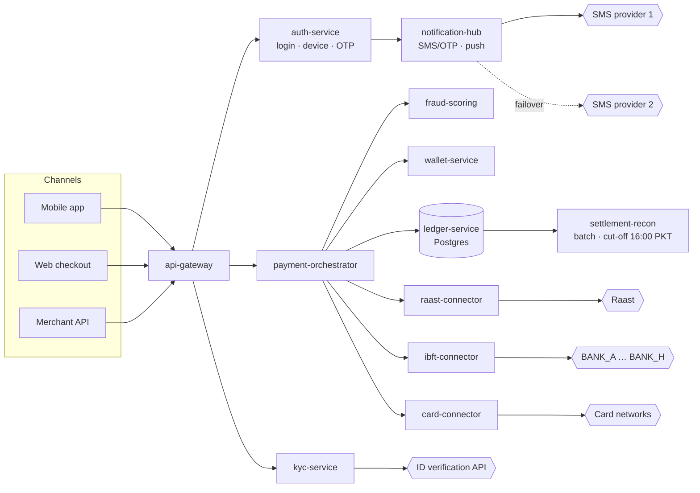
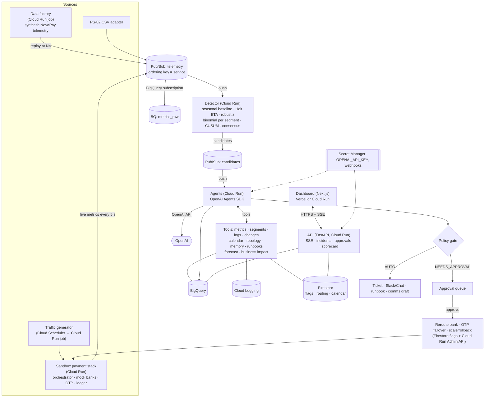
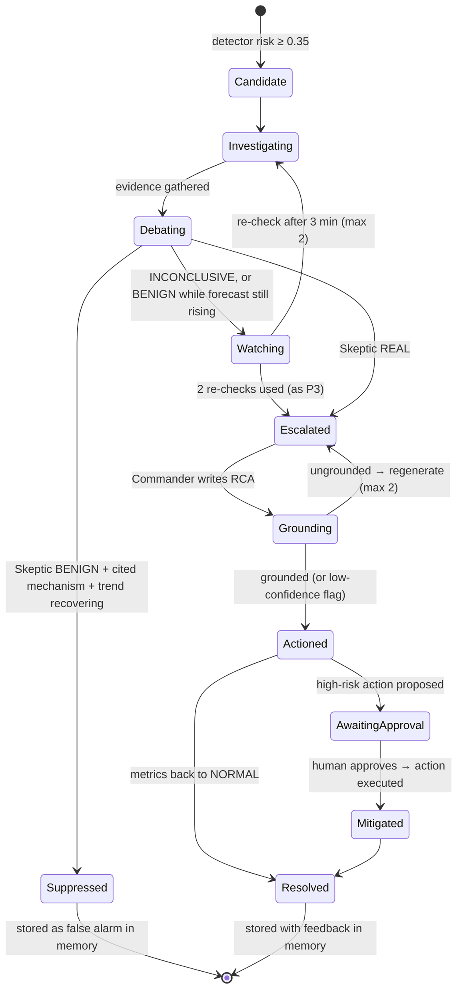
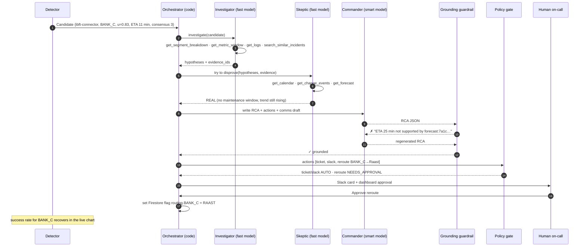
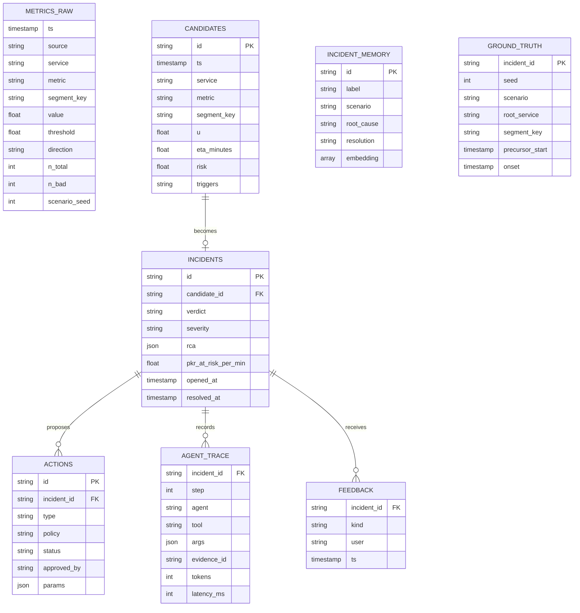
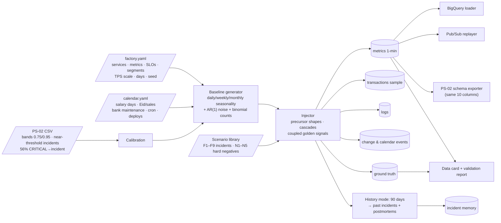
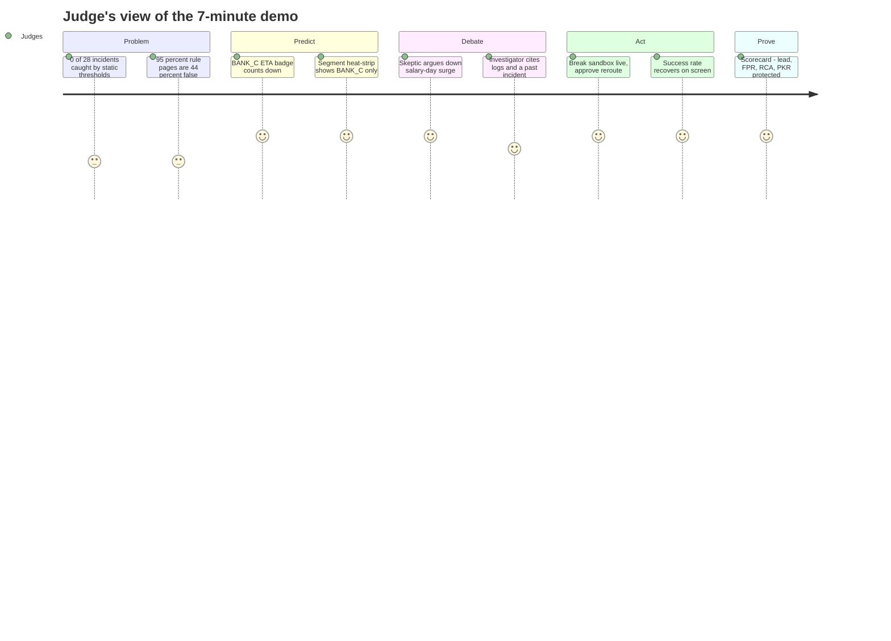

# Sentinel for Payments: PS-02 Implementation Plan

> **For agentic workers:** REQUIRED SUB-SKILL: use superpowers:subagent-driven-development (recommended) or superpowers:executing-plans to implement this plan task by task. Steps use checkbox (`- [ ]`) syntax for tracking.

**Goal:** Build and deploy an agentic AIOps system for a digital-payments platform. It forecasts payment failures before customers feel them, argues its own alerts down to cut false pages, and takes grounded, policy-gated preventive actions, such as rerouting traffic away from a degrading partner bank or failing OTP delivery over to a backup provider. A live scorecard proves lead time, false-positive rate, RCA quality and the PKR protected.

**Architecture:** A config-driven **synthetic data factory** generates realistic payment-platform telemetry: metrics, transactions, logs, change events and an incident history with ground truth. It is calibrated to the PS-02 dataset and scaled up. A **real sandbox payment stack** on Cloud Run, including mock partner banks and an OTP provider, provides live telemetry and real fault injection. Both stream through Pub/Sub into a cheap, seasonality-aware **statistical detector**: utilisation and error budget, Holt time-to-breach, robust z, binomial tests per bank and segment, CUSUM and consensus. Only *candidates* reach a multi-agent graph (OpenAI Agents SDK): the **Investigator** gathers evidence with tools, the **Skeptic** tries to disprove the alert, and the **Commander** writes a grounded RCA, a customer-comms draft and policy-gated actions. Everything lands in BigQuery, and a Next.js dashboard (on Vercel or Cloud Run) shows the live ops view, the agent debate and the scorecard.

**Tech Stack:** Python 3.12 + uv, FastAPI, OpenAI Agents SDK (`openai-agents`) on OpenAI API credits, GCP (Cloud Run, Pub/Sub with push and BigQuery subscriptions, BigQuery with `VECTOR_SEARCH`, Firestore, Secret Manager, Cloud Scheduler, Cloud Logging/Monitoring, optional Cloud SQL Postgres and Vertex AI), Next.js 16 / React 19 + shadcn/ui + Recharts, deployed on Vercel or Cloud Run.

**Spec:** PS-02 in `docs/hackathon_problem_statements_1.docx`, plus the team decisions recorded below. Evidence base: `docs/EDA_REPORT.md` and `docs/DATA_DESCRIPTION.md`.

### Team decisions this plan implements

| Decision | Consequence in this plan |
|---|---|
| The **OpenAI API** is the primary LLM; GCP credits pay for the platform | Agents use the OpenAI Agents SDK, with model IDs only in env vars. Vertex AI Gemini is an *optional* fallback behind the same interface. |
| **Backend on GCP**, frontend on Vercel (optional) or GCP | API, detector, agents, data factory and sandbox run on Cloud Run. The frontend deploys to Vercel by default, with a Cloud Run Dockerfile as plan B. |
| **Fintech domain** | A fictional Pakistani digital wallet and payment gateway, **"NovaPay"**, with fictional partner banks `BANK_A`…`BANK_H` and the public rails it connects to (Raast, IBFT switch, card networks). No real company is impersonated. |
| **The data can be synthesized or scaled; the solution should not revolve around the CSV** | The CSV becomes a *calibration and compatibility* source. The main data is the synthetic data factory (Task 2), and the CSV schema remains an export format, so the original dataset still runs through the system. |
| Mermaid for diagrams | Every diagram below is Mermaid. |

---

## 0. Why this wins

### 0.1 The problem, made concrete for fintech

* Pakistan's digital payments now carry **92% of retail transactions**. Raast alone processed about **742 M transactions (≈ Rs 23 trn) in Jan–Mar 2026** ([SBP PS Review Q3FY26](https://www.sbp.org.pk/psd/pdf/PS-Review-Q3FY26.pdf), [Profit](https://profit.pakistantoday.com.pk/2026/06/27/cashless-shift-accelerates-as-digital-channels-handle-92percent-of-pakistans-retail-payments-in-q1-of-fy26)). When a wallet or gateway degrades, customers fail to pay *immediately*.
* Consumer patience during a payment outage is **about 6 minutes**, while the average outage lasts **84 minutes**. US retail and hospitality put **$44.4 bn a year** of sales at risk from payment failures ([FreedomPay × Dynatrace UK](https://corporate.freedompay.com/about-us/press-release/payment-outages-threaten-1-6-billion-in-uk-retail-hospitality-sales), [Payments Dive, US](https://www.paymentsdive.com/news/payment-outages-cost-44b-lost-sales-annually/810481/)). In payments, *reactive* monitoring is too late by definition.
* Payment incidents often begin **in one slice**: a single partner bank's timeouts, one OTP provider, one card BIN under attack. They are invisible in platform-wide averages until they spread.

### 0.2 What the PS-02 data taught us, and why it still matters

Our EDA (`docs/EDA_REPORT.md`) gives the opening line of the pitch and the design principles:

1. **Static thresholds catch 0 of 28 incidents.** Every incident happened at 95–99.6% of its threshold, never above it. → Sentinel detects in *utilisation / error-budget space* and forecasts the time to breach.
2. **The "95% rule" catches all 28 but is wrong 44% of the time, and nothing in a single row separates real from false.** The cross-validated AUC inside CRITICAL is 0.41–0.48. → False-positive reduction needs *context*, which is the agents' job.
3. **The CSV has no temporal continuity:** about 9 points per series over 30 days. → Lead time needs continuous data with ground-truth onsets, which is why we built the data factory. Our synthetic data keeps the CSV's alert bands (0.75 / 0.95) and its "near-threshold incident" property, and can export to the CSV schema.

### 0.3 Mapping every judging criterion to something on screen

| Criterion | What judges see | Tasks |
|---|---|---|
| **Detection lead time** (PS-02) | ETA badges ("BANK_C IBFT timeouts breach SLO in ~11 min"), a lead-time histogram against today's monitor, and a settlement *cut-off* forecast | 3, 4, 10 |
| **False-positive rate** (PS-02) | An ablation table (B0 static → B1 95% band → S1 forecast → S2 segments + consensus → S3 + Skeptic). The Skeptic visibly argues down a salary-day surge and a scheduled bank maintenance window. | 4, 7, 10 |
| **RCA quality** (PS-02) | Top-1 root-cause accuracy against ground truth, a groundedness % (every claim cites evidence), and an LLM-judge rubric | 7, 8, 10 |
| **Agentic behaviour** | 10 tools, a multi-step plan, an adversarial self-check, self-scheduled re-checks, a regenerate-on-ungrounded guardrail, a feedback loop, and approval-gated actions. All of it appears in the Trace view. | 6–9 |
| **Technical depth** | Pub/Sub → Cloud Run → BigQuery, a BigQuery subscription (no ingest code), `VECTOR_SEARCH` memory, Firestore feature flags, Secret Manager, IaC scripts, and binomial detection per segment | 2–9, 12 |
| **MVP completeness** | One click: generate or replay → detect → debate → ticket + Slack/Chat + reroute → scorecard | All P0 |
| **Scalability** | The data factory scales with `--tps` and `--days`. Agents run only on candidates. Pub/Sub ordering keys per service. Connectors for Cloud Monitoring, Prometheus and Datadog. Tokens and cost per incident are measured. | 2, 4, 10, 12 |
| **Innovation and impact** | A **preventive action that actually fixes the problem live**: the agent flips smart-routing away from a degrading bank and the success rate recovers on screen. Also "PKR protected" as the business metric, and honest dual benchmarking. | 9, 11 |

---

## Global Constraints

- Python ≥ 3.12 with `uv`. Node ≥ 20.9. Before writing frontend code, read `frontend/node_modules/next/dist/docs/`, because Next.js 16 has breaking changes.
- **LLM IDs only via env vars:** `OPENAI_FAST_MODEL` (small, cheap tier, for Investigator and Skeptic), `OPENAI_SMART_MODEL` (flagship tier, for Commander and Judge) and `OPENAI_EMBED_MODEL`. Confirm the current IDs on OpenAI's models and pricing page in the first 30 minutes; third-party listings in October 2026 disagree. The optional Vertex fallback uses `VERTEX_MODEL`. **Never a `gemini-2.5-*` ID**, since those retire on Vertex on 20 Oct 2026.
- **Utilisation `u` is the fraction of the error budget used, so that 1.0 means breaching the SLO:**
  - higher-is-bad metric: `u = value / threshold`
  - lower-is-bad metric (success rates, delivery rates): `u = (1 − value) / (1 − slo_floor)`
- **Bands, taken verbatim from the PS-02 data:** NORMAL `u < 0.75`, WARNING `0.75 ≤ u < 0.95`, CRITICAL `u ≥ 0.95`. The ETA target is **0.95**.
- **Synthetic-data honesty:** every synthetic record carries `source ∈ {"factory","sandbox","ps02_csv"}`, and the UI always labels replayed data "synthetic replay". Money amounts are synthetic PKR, and "PKR protected" is labelled as a model estimate.
- **No PII ever reaches the LLM.** Tools return aggregates and redacted samples (masked MSISDN or account as `03xx-xxxx123`).
- LLM calls happen only for detector candidates, never per data point.
- Every RCA claim cites at least one `evidence_id` returned by a tool, enforced as an output guardrail (Task 8).
- **Action policy:**
  - AUTO: ticket, Slack/Chat message, runbook, status-banner *draft*
  - NEEDS_APPROVAL: reroute bank traffic, OTP provider failover, scale, rollback, rate-limit or block
  - DENY: anything touching ledger balances, and anything targeting a factory-only (non-sandbox) service
- **Train/eval split:** factory seeds 0–9 for fitting and tuning, and seeds 100–129 for every reported number.

## Review Focus

These are the failure modes most likely to bite during the demo that no unit test naturally covers. Each has a test added in its owning task.

1. **A low-volume segment** (BANK_H at 03:00, 4 transactions per minute) produces 1 failure in 4, so the raw rate is 25%. A naive rule fires, but the binomial detector must not fire on such small n. Test in Task 3.
2. **A known calendar surge** (salary day on the 1st, an Eid sale) raises TPS, latency and queue depth together. The seasonal baseline plus the calendar must hold back the candidate, or the Skeptic must argue it down citing the calendar. Tests in Tasks 4 and 7.
3. **The OpenAI API errors** (429, 5xx, timeout, bad JSON). The graph must ship a deterministic "statistical-fallback" RCA and never drop the alert. Test in Task 7.
4. **Approval clicked twice, or a reroute while the backup rail is also degraded.** The action must be idempotent, and the policy must refuse to fail over to an unhealthy target. Test in Task 9.
5. **The Skeptic dismisses a real incident.** A BENIGN verdict while the forecast is still rising forces a re-check, and Skeptic-induced misses are reported on the scorecard. Test in Task 7.

---

## 1. The NovaPay domain model

### 1.1 Services and dependencies



Twelve internal services plus external dependencies. The 8 PS-02 service names map onto this graph (for example AuthService → auth-service, PaymentGateway → payment-orchestrator, NotificationHub → notification-hub, DataPipeline → settlement-recon), so CSV rows can be replayed into it.

### 1.2 Metric catalogue (synthetic SLOs)

| Metric | Level | Direction | Threshold / SLO | Notes |
|---|---|---|---|---|
| `payment_success_rate` | orchestrator × bank × channel | lower-bad | floor 0.97 | Binomial (counts tracked) |
| `issuer_timeout_rate` | ibft-connector × bank | higher-bad | 0.02 | Binomial; the bank-degradation precursor |
| `latency_p99_ms` | every service | higher-bad | per service (orchestrator 1,200) | |
| `error_rate_5xx` | every service | higher-bad | 0.01 | Binomial |
| `db_pool_utilisation` | ledger, wallet | higher-bad | 1.0 (in-use/size) | Same metric as PS-02 `connection_pool` |
| `consumer_lag` | settlement-recon, notification-hub | higher-bad | 50k msgs | Same metric as PS-02 `queue_depth` |
| `otp_delivery_rate` | notification-hub × provider | lower-bad | floor 0.95 | Binomial |
| `login_failure_rate` | auth-service | higher-bad | 0.08 | Credential-stuffing signal |
| `small_auth_decline_rate` | card-connector × BIN | higher-bad | 0.15 | Card-testing signal |
| `settlement_eta_vs_cutoff_min` | settlement-recon | lower-bad | 0 min slack | A *deadline* forecast |
| `recon_mismatch_count` | settlement-recon | higher-bad | 0 | Integrity; any value > 0 is P1, human only |
| `cpu_usage`, `memory_usage`, `disk_io` | every service | higher-bad | per service | Infra (PS-02) |
| `tps`, `gmv_pkr_per_min` | orchestrator × bank | context | — | Drive the business-impact numbers |

### 1.3 Scenario library (incidents with ground truth)

| ID | Scenario | Precursor (lead opportunity) | Root cause | Preventive action |
|---|---|---|---|---|
| F1 | **Partner bank degradation** | BANK_x p99 creeps up, then timeouts rise (20–45 min) | External bank switch | **Reroute** BANK_x IBFT via Raast (approval) and notify the bank NOC |
| F2 | **Ledger DB pool exhaustion** | Pool utilisation rises after a deploy with a slow query (10–40 min) | Deploy | **Rollback** (approval) and raise pool size |
| F3 | **OTP provider degradation** | Delivery rate falls and OTP latency rises (10–30 min) | SMS provider 1 | **Fail over** to provider 2 (approval) |
| F4 | **Fraud-scoring memory leak** | Memory ramps, then p99 rises, then orchestrator timeouts (40–120 min) | Leak in model server | Restart (approval) and fall back to rules with lower limits |
| F5 | **Settlement cut-off miss** | Consumer lag growth means the ETA passes 16:00 (60–180 min) | Under-provisioned consumers | **Scale consumers** (approval) and warn finance ops |
| F6 | **Card-testing attack** | Spike in small-value authorisations from a few BINs or IPs with high declines (5–15 min) | Attack | **Velocity rule and rate-limit** (approval), plus a security ticket |
| F7 | **Credential stuffing** | Login failure rate rises across many accounts from a narrow ASN set (5–20 min) | Attack | CAPTCHA step-up and an IP block (approval) |
| F8 | **Recon mismatch drift** | Mismatch count goes from 0 to 1 to 3 | Duplicate posting bug | Page finance and engineering (human only) |
| F9 | **Abrupt failure** (20% of incidents) | None, within 1–2 min | Any | Reactive; reported as "no lead possible" |

**Hard negatives** (they look like incidents but aren't) are what the Skeptic and the calendar are for:

| ID | Hard negative | Signals | Benign evidence available to tools |
|---|---|---|---|
| N1 | **Salary day / Eid sale surge** | TPS, latency, lag and CPU all rise | Business calendar |
| N2 | **Scheduled partner-bank maintenance** | BANK_x timeouts at 01:00–02:00 | Bank maintenance calendar (traffic already routed) |
| N3 | **EOD settlement batch** | Lag and disk I/O plateau | Cron schedule |
| N4 | **Deploy blip** | p99 bump for 5–10 min, then recovery | Deploy log and recovery trend |
| N5 | **Transient spike** | 1–3 min touch of CRITICAL | Trend already recovering |

**Confounder:** 25% of real F2 and F4 incidents follow a deploy that *caused* them. "There was a deploy" is never a free pass.

---

## 2. Architecture

### 2.1 System overview



For local development everything runs in one process with `InMemoryBus`, a local memory store and a local flag store, so nobody waits on GCP.

### 2.2 Candidate lifecycle



### 2.3 Agent interaction (one incident)



### 2.4 Data model (BigQuery dataset `sentinel`)



---

## 3. Synthetic data factory (the data foundation)



**Decisions:**

* **Seasonality.** Daily profile in PKT: trough 02:00–06:00, peaks 12:00–14:00 and 20:00–23:00. Weekly: Friday afternoon dip, weekend evening peak. Monthly: salary days (1st–3rd) at ×1.6 TPS. Calendar spikes: Eid sale days at ×2.2 TPS. All values come from `calendar.yaml`.
* **Scale knobs.** `--tps` (default 150 average TPS platform-wide), `--days` (default 30 for eval, 90 for history), `--segments` (8 banks × 3 channels), and resolution of 1 minute. The default produces about 4–6 M metric rows per 30 days, which is fine for BigQuery. `--tps 2000 --days 90` is the "scale" demo.
* **Rate metrics are binomial.** Each minute stores `n_total` and `n_bad` per segment, generated as `n_bad ~ Binomial(n_total, p_t)`. This is what makes low-volume segments realistically noisy (Review Focus #1).
* **Calibration to PS-02.** Alert bands are 0.75 / 0.95. Incident onsets are defined at u = 0.95, and most peak below 1.0, reproducing the "static thresholds catch nothing" property. The mix of hard negatives to incidents is tuned so that the B1 (95% band) precision on factory data lands between 0.5 and 0.6, matching the CSV's 0.56. The `--ps02-anchors` mode embeds all 500 CSV rows at their timestamps (u preserved exactly), mapped to NovaPay services.
* **Precursor shapes** by scenario (F1–F9 durations as in §1.3): linear (leak), convex (pool), step-and-creep (bank latency), accelerating (lag), burst (attack). Golden signals are coupled with a lag of 3–10 min, and dependants show cascades with a lag of 5–15 min, following `SERVICE_GRAPH`.
* **Logs.** Templated, realistic lines per scenario, such as `IBFT BANK_C: ISO8583 0210 RC=91 issuer unavailable`, `HikariPool-1 - Connection is not available, request timed out after 30000ms`, `SMS provider P1 DLR timeout`, and `velocity: BIN 4xxxxx 37 declines/60s`. Masked PII only.
* **History mode.** 90 days containing about 40 resolved incidents and about 60 dismissed false alarms, each with a short postmortem and a runbook. This seeds the Historian. The 28 PS-02 incidents and 22 PS-02 false alarms are included as tagged docs (`source="ps02_csv"`).
* **Data card.** `uv run python -m sentinel.datafactory.card --seed 100` writes `docs/data_card_seed100.md` with row counts, scenario mix, B1-precision check and plots. Judges can audit the synthetic data.

---

## 4. Detection (statistical layer, every point)

All maths runs per (service, metric, segment_key) on u at 1-minute resolution.

| Component | Decision |
|---|---|
| **Seasonal expectation** | `expected_u(t)` = median of u at the same minute-of-week over the previous 4 weeks (history mode), × the calendar multiplier for known events. Residual `r = u − expected_u`. Falls back to EWMA when there is less than 1 week of history (sandbox). |
| **Holt time-to-breach** | On u: α = 0.3, β = 0.1, warm-up 10. `eta(0.95)` = `(0.95 − level)/trend` minutes when trend > 1e-4 and the result lies in (0, 120], else `None`. Trigger: rising streak ≥ 5 **and** some h ≤ 30 with `forecast(h) − 1.645·σ·√h ≥ 0.95`. |
| **Deadline forecast** | `settlement_eta_vs_cutoff_min` = projected completion from the lag drain rate minus the cut-off. Triggers when the projected slack is below 0 with 90% confidence. |
| **Robust z** | On the residual r: EWMA mean and variance with λ = 0.05. Spike when z ≥ 4. |
| **Binomial segment test** | For rate metrics: alarm when the one-sided binomial tail `P(X ≥ n_bad | n_total, p_slo) < 1e-3` **and** `n_total ≥ 30` over a 5-minute window. This handles BANK_H at 03:00. |
| **CUSUM** | On r: k = 0.01, h = 0.08 |
| **Consensus** | Per service over a 5-minute window: the number of distinct signals in an anomalous state (z ≥ 2.5, CUSUM, predictive trigger or binomial alarm) |
| **Risk** | `σ(w·[pred, eta_term, z_term, cusum, consensus_term, band, binom])`, fitted by logistic regression on seeds 0–9 with the label "incident on this service within 60 min". Default hand weights: (−3, 1.5, 1.0, 0.8, 0.6, 1.2, 1.0, 1.3). |
| **Emit** | `risk ≥ 0.35`, one open candidate per (service, metric, segment), cooldown 15 min, and feedback offset δ ∈ [−0.15, 0.15] (noise +0.05, missed −0.05, half-life 24 h) |

**Ablation configs:**

| Config | Rule |
|---|---|
| B0 | `u ≥ 1.0` |
| B1 | `u ≥ 0.95` (today's monitor) |
| B2 | robust z only |
| S1 | Holt + band |
| S2 | S1 + seasonal + binomial segments + CUSUM + consensus + risk |
| S3 | S2 + agents (Skeptic decides) |

---

## 5. Agents (OpenAI Agents SDK)

* **Runtime.** `openai-agents` (pin the version found on PyPI at 0:00). There are three `Agent`s: Investigator (`OPENAI_FAST_MODEL`, max 6 tool calls), Skeptic (`OPENAI_FAST_MODEL`, max 4) and Commander (`OPENAI_SMART_MODEL`). The orchestration in `graph.py` is deterministic Python following the state machine in §2.2, which is easier to debug on stage and makes the flow explicit. Structured outputs come from Pydantic `output_type`. Grounding is an **output guardrail** on the Commander. SDK tracing is on, and our own `agent_trace` is written to BigQuery.
* **The `LLM` protocol** has two adapters: `OpenAIAgentsRuntime` (default) and `VertexGeminiRuntime` (optional fallback, uses GCP credits), selected by `SENTINEL_LLM=openai|vertex`.
* **Tools (10).** Each returns `{"evidence_id": "<kind>:<hash8>", ...}`:
  - `get_metric_window(service, metric, segment, minutes)`
  - `get_segment_breakdown(service, metric, by="bank"|"channel"|"bin")`
  - `get_service_snapshot(service)`
  - `get_forecast(service, metric, segment)`
  - `get_change_events(service, minutes)` (deploys and config)
  - `get_calendar(ts)` (salary day, sale, bank maintenance, cron)
  - `get_logs(service, minutes, min_level="WARN")` (redacted)
  - `search_similar_incidents(fingerprint, text, k=3)`
  - `get_topology(service)` (upstream, downstream and blast radius)
  - `estimate_business_impact(service, segment, minutes)` (TPS, GMV per minute, customers affected)
* **Prompts, in short:**
  - **Investigator:** "Senior payments SRE. Gather evidence first; check which segment is affected; cite evidence_ids."
  - **Skeptic:** "Prove this is NOT an incident. Check the calendar (salary day, sale, bank maintenance), cron, deploy blip, transient spike. Answer BENIGN only with a cited benign mechanism AND a recovering trend."
  - **Commander:** "Write for an on-call engineer at 3 a.m. and for the payments-ops lead. Produce RCA JSON, a customer-comms draft and actions chosen from the runbook. Every claim cites evidence_ids."
* **RCA schema.** `title`, `severity P1|P2|P3`, `summary ≤ 80 words`, `eta_minutes`, `affected_segment`, `customers_affected_est`, `pkr_at_risk_per_min`, `hypotheses[{cause, root_service, scenario, confidence, evidence_ids[]}]`, `similar_incidents[{id, similarity, resolution}]`, `actions[{type, params, rationale}]`, `comms_draft` (an in-app banner and a bank-partner note), `if_ignored`.
* **Fallback.** On a 429, 5xx, a 20-second timeout or invalid JSON (after one retry), build a deterministic RCA from detector features and the top memory hit, with `generated_by="statistical-fallback"`.

---

## 6. Team plan and timeline

The plan assumes **three people** for about **8 build hours**. With two people, merge C into A and B. Tags: **P0** the demo needs it, **P1** wins points, **P2** polish.

```mermaid
gantt
  title Build day (hh:mm from start)
  dateFormat HH:mm
  axisFormat %H:%M
  section A · Data & detection
  T1 scaffold (shared)                  :a1, 00:00, 30m
  T2 data factory F1,F2,F3,N1–N5         :a2, after a1, 120m
  T3–T4 detector                         :a3, after a2, 90m
  T10 scorecard B0–S2                    :a4, after a3, 60m
  T10 S3 + RCA eval                      :a5, after a4, 60m
  section B · Agents & actions
  OpenAI IDs + SDK smoke test            :b1, 00:00, 30m
  T5–T6 impact model, tools, memory      :b2, after b1, 90m
  T7–T8 agent graph + guardrail          :b3, after b2, 90m
  T9 actions + policy + Slack            :b4, after b3, 60m
  Feedback loop + memory growth          :b5, after b4, 60m
  section C · Sandbox, UI, infra
  T12 GCP bootstrap script              :c1, 00:00, 30m
  T11 dashboard on mock SSE              :c2, after c1, 90m
  T12 sandbox stack + chaos              :c3, after c2, 90m
  Wire UI to API, deploy all             :c4, after c3, 90m
  section All
  Feature freeze · tune on seeds 0–9 · scorecard on 100–129 :crit, f1, 06:00, 30m
  Slides · diagram · backup recording    :f2, after f1, 60m
  Rehearse ×2 · submit                   :f3, after f2, 30m
```



**Cut order** (cut from the top first):
1. P2 polish
2. Vertex fallback
3. BigQuery `AI.DETECT_ANOMALIES` comparison
4. F6, F7 and F8 scenarios
5. Cloud SQL (use an in-process pool instead)
6. Rollback action (keep reroute)
7. LLM-judge rubric (keep top-1 and groundedness)
8. Feedback loop

**Never cut:** Holt ETA, segment detection, the Skeptic, the reroute action, the scorecard, and the live chaos demo.

---

## 7. Repository layout

```
backend/
  pyproject.toml                    # fastapi[standard], openai-agents, openai, google-cloud-{pubsub,bigquery,firestore,logging,run,secret-manager}, numpy, pandas, scipy, pydantic>=2, pydantic-settings, pyyaml
  sentinel/
    config.py  schemas.py  topology.py  bus.py
    datafactory/
      factory.yaml  calendar.yaml   # all tunables
      calibrate.py                  # PS-02 CSV → calibration + anchors
      baseline.py                   # seasonality, AR(1), binomial counts
      scenarios.py                  # F1–F9, N1–N5 generators (pure functions)
      generator.py                  # build(seed, days, tps, window) → Dataset
      history.py                    # 90-day history → memory docs + postmortems
      exporters.py                  # bq_load(), parquet(), to_ps02_csv(), replay(bus, speed)
      card.py                       # data card / validation report
    detect/
      seasonal.py  holt.py  robust.py  binom.py  cusum.py  consensus.py  engine.py  weights.json  fit_weights.py
    memory/  seed.py  store.py
    agents/  tools.py  prompts.py  runtime.py  graph.py  grounding.py
    actions/ policy.py  notify.py  tickets.py  flags.py  cloudrun.py
    impact/  business.py            # GMV/min, customers affected, PKR protected
    eval/    scorer.py  ablation.py  rca_eval.py  csv_bench.py  scorecard.json
    api/     main.py  detector_main.py  agents_main.py
  tests/                            # mirrors package
sandbox/                            # live NovaPay sandbox (real faults, real actions)
  orchestrator/main.py              # /pay → fraud → ledger pool → rail (reads Firestore routing flags)
  mockbank/main.py                  # BANK_A..C ISO-8583-ish JSON endpoints with /chaos
  otp/main.py                       # 2 SMS providers with /chaos
  traffic/main.py                   # Cloud Run job: realistic payment mix
  Dockerfile(s)
frontend/                           # Next.js 16: Live Ops · Incident · Trace · Scorecard · Chaos · Data card
infra/   bootstrap.sh  bq_schema.sql  deploy.sh  vercel.json (optional)
analysis/                           # PS-02 EDA (done)
docs/                               # EDA, data description, this plan, ARCHITECTURE.md, data cards, pitch
```

---

## 8. Tasks

Every task ends with passing tests and a commit. Tests live under `backend/tests/` in a layout that mirrors the package. The unit tests use `FakeLLM`, `InMemoryBus` and local stores. GCP and OpenAI are touched only in steps marked *live*.

### Task 1 (P0): Scaffold, settings, schemas, topology, bus

**Files:** `backend/pyproject.toml`, `sentinel/{config,schemas,topology,bus}.py`, `tests/test_schemas.py`, `tests/test_bus.py`, `.env.example`. Restore the Next.js scaffold in `frontend/`.

**Produces:**
- `TelemetryPoint`: `ts, source, service, metric, segment_key: str = "*", value, threshold, direction: Literal["higher_bad","lower_bad"], n_total: int | None, n_bad: int | None, scenario_seed: int | None`, with the property `u`.
- `Candidate`: `id, ts, service, metric, segment_key, u, eta_minutes: float | None, z, consensus, cusum, band, binom, risk, triggers: list[str]`.
- `Evidence`, `Verdict`, `RCA` (the §5 schema), `Action`, `Ticket`, `TraceStep`.
- `SERVICE_GRAPH: dict[str, list[str]]` (the §1.1 edges) and `blast_radius(service) -> list[str]`.
- The `Bus` protocol, and `InMemoryBus(maxsize=10_000)`, which blocks when full.

- [ ] Step 1: Write the tests.
  - `test_u_higher_bad`: value 68.46, threshold 71.39 gives u ≈ 0.95896.
  - `test_u_lower_bad`: success 0.955 with floor 0.97 gives `u == pytest.approx(1.5)`.
  - `test_blast_radius_ledger_includes_recon`.
  - `test_bus_backpressure`: with maxsize 2, the third publish blocks.
- [ ] Step 2: `cd backend && uv run pytest -q`. Expected: FAIL.
- [ ] Step 3: Implement. `Settings` reads `GCP_PROJECT, GCP_REGION, OPENAI_API_KEY, OPENAI_FAST_MODEL, OPENAI_SMART_MODEL, OPENAI_EMBED_MODEL, SENTINEL_LLM, SENTINEL_MEMORY, SENTINEL_FLAGS, REPLAY_SPEED=60, SLACK_WEBHOOK_URL, CHAT_WEBHOOK_URL, SANDBOX_BASE_URL, FRONTEND_ORIGIN` (for CORS on Vercel).
- [ ] Step 4: PASS. Step 5: commit `feat: scaffold, schemas, topology, bus`.

### Task 2 (P0 for F1, F2, F3 and N1–N5; P1 for F4–F9): Synthetic data factory

**Files:** `sentinel/datafactory/*` and `tests/datafactory/test_generator.py`.

**Produces:**
- `build(seed: int, days: int = 1, tps: float = 150, window: tuple[datetime, datetime] | None = None, ps02_anchors: bool = False) -> Dataset`. `Dataset` has `metrics: pd.DataFrame` (METRICS_RAW columns), `transactions: pd.DataFrame`, `logs`, `events`, `ground_truth`.
- `history(seed, days=90) -> list[MemoryDoc]`.
- `to_ps02_csv(ds) -> pd.DataFrame` (exactly the 10 PS-02 columns).
- `replay(ds, bus, speed)`.

- [ ] Step 1: Write the tests (1 simulated day, seed 1).
  - `test_deterministic`: the same seed gives equal frames.
  - `test_ground_truth_onset_at_095`: for each incident, u first reaches ≥ 0.95 at `onset` (±1 min).
  - `test_precursor_rises`: for F1, `issuer_timeout_rate` u over the precursor has Spearman ρ ≥ 0.7.
  - `test_hard_negatives_recover`: N1–N5 drop below 0.90 within 45 minutes of the episode's end.
  - `test_binomial_counts_consistent`: `0 ≤ n_bad ≤ n_total` and `value == n_bad / n_total` (or 1 − that for lower_bad).
  - `test_salary_day_tps_multiplier`: mean TPS on day 1 of the month is ×1.6 ± 0.1 versus mid-month.
  - `test_b1_precision_calibrated`: on 5 seeds × 7 days, B1 precision is in [0.45, 0.65].
  - `test_ps02_export_schema`: `to_ps02_csv` has exactly the 10 PS-02 columns, and its alert_level obeys the 0.75 / 0.95 bands.
  - `test_ps02_anchors_preserved`: with `ps02_anchors=True`, all 500 CSV rows appear with u to 1e-6.
  - `test_no_pii_in_logs`: no 11-digit MSISDN pattern `03\d{9}` appears in logs.
- [ ] Step 2: FAIL. Step 3: implement according to §3. Step 4: PASS.
- [ ] Step 5 (*live*): run `uv run python -m sentinel.datafactory.generator --seed 100 --days 30 --out bq` and `... card --seed 100`, then read the data card.
- [ ] Step 6: commit `feat: synthetic NovaPay data factory calibrated to PS-02`.

### Task 3 (P0): Detector primitives

**Files:** `sentinel/detect/{seasonal,holt,robust,binom,cusum}.py` and `tests/detect/test_primitives.py`.

**Produces:**
- `HoltState(alpha=.3, beta=.1, warmup=10)` with `.update(u)`, `.forecast(h)`, `.eta(target=.95) -> float | None`, `.predictive_trigger(target=.95, horizon=30, z=1.645) -> bool`.
- `SeasonalBaseline.expected(series_key, ts) -> float`.
- `EwmaZ(lam=.05)` with `.update(r) -> float`.
- `binom_alarm(n_bad, n_total, p_slo, alpha=1e-3, min_n=30) -> bool`.
- `Cusum(k=.01, h=.08)` with `.update(x) -> bool`.

- [ ] Step 1: Write the tests.
  - `test_eta_linear_ramp`: u = 0.70 + 0.005t for t = 0..29 gives `eta` within ±3 of 21.
  - `test_eta_none_flat_high`: 30 points at 0.97 ± 0.002 give `None`.
  - `test_eta_none_decreasing`.
  - `test_binom_low_volume_quiet` (Review Focus #1): n = 4, bad = 1, p = 0.02 gives `False`.
  - `test_binom_real_degradation`: n = 600, bad = 40, p = 0.02 gives `True`.
  - `test_seasonal_removes_daily_peak`: a pure seasonal series gives |residual| < 0.02.
  - `test_z_spike` and `test_cusum_drift` (as in the earlier version: drift fires within 60 steps, and stationary noise over 500 steps does not fire).
- [ ] Steps 2–4: FAIL, then implement according to §4, then PASS. Step 5: commit.

### Task 4 (P0): DetectorEngine

**Files:** `sentinel/detect/{consensus,engine,fit_weights}.py`, `weights.json`, `tests/detect/test_engine.py`, and `sentinel/api/detector_main.py`.

**Produces:**
- `DetectorEngine(config: Literal["B0","B1","B2","S1","S2"], weights=None, calendar=None)` with `.process(p) -> list[Candidate]`, `.close(cid, ts)`, `.apply_feedback(service, metric, segment, kind, ts)`, and `.snapshot()` / `.restore()`.
- A Cloud Run handler `POST /push` (Pub/Sub push) that publishes to `candidates` and snapshots state to GCS every 60 s.

- [ ] Step 1: Write the tests.
  - `test_b0_silent_on_ps02_rows`: 0 candidates.
  - `test_b1_matches_critical_band_on_ps02_rows`: 50 candidates.
  - `test_s1_leads_on_f1`: the first S1 candidate comes ≥ 10 minutes before onset on the seed-1 F1 incident.
  - `test_s2_segment_catches_bank_hidden_in_aggregate`: BANK_C timeouts at 12% while the platform-wide rate is 1.5% gives a candidate with `segment_key="bank=BANK_C"`.
  - `test_salary_day_surge_suppressed_by_seasonal` (Review Focus #2): N1 on seed 1 gives no S2 candidate, or one with risk < 0.35.
  - `test_dedup_cooldown`: u held at 0.97 for 60 minutes gives 1 candidate, and the next comes ≥ 15 minutes after close.
  - `test_feedback_decay`: as in §4.
  - `test_push_roundtrip` (InMemoryBus).
- [ ] Steps 2–4: FAIL, then implement, then PASS.
- [ ] Step 5 (P1): run `uv run python -m sentinel.detect.fit_weights --seeds 0-9`, then commit `weights.json`.
- [ ] Step 6: commit `feat: detector engine (seasonal, segments, consensus, risk)`.

### Task 5 (P0): Business impact model

**Files:** `sentinel/impact/business.py` and `tests/impact/test_business.py`.

**Produces:**
- `impact(segment_tps: float, avg_ticket_pkr: float, failure_rate: float, minutes: float) -> Impact`, with `failed_txns`, `gmv_at_risk_pkr` and `customers_affected_est`.
- `pkr_protected(lead_minutes, incident_minutes, gmv_per_min) -> float`, which uses `min(lead, incident_duration)` and is labelled an estimate.

- [ ] Steps 1–4: tests first, covering a zero failure rate (gives 0), linear scaling, and lead capped at duration. Then implement and get PASS. Step 5: commit.

### Task 6 (P0): Tools and incident memory

**Files:** `sentinel/agents/tools.py`, `sentinel/memory/{seed,store}.py`, `tests/agents/test_tools.py`, `tests/memory/test_store.py`.

**Consumes:** `Dataset` (Task 2), Task 5, Firestore and BigQuery clients (prod).

**Produces:**
- A `DataSource` protocol (`FactorySource(ds)` and `GcpSource(bq, logging, firestore)`), and the 10 tools from §5.
- `IncidentMemory.add(doc)` and `.search(fingerprint, text, k=3) -> list[MemoryHit]`, backed by BigQuery `VECTOR_SEARCH` or local cosine. Embeddings use `OPENAI_EMBED_MODEL` (live) or a hash stub (tests).

- [ ] Step 1: Write the tests.
  - `test_every_tool_returns_evidence_id`: matches `^[a-z_]+:[0-9a-f]{8}$`.
  - `test_segment_breakdown_ranks_bank_c_first_during_f1`.
  - `test_calendar_reports_salary_day`.
  - `test_logs_are_redacted`.
  - `test_memory_seed_counts`: the 50 PS-02 docs plus the history docs.
  - `test_search_prefers_same_scenario`: an F1-shaped query returns an F1 doc first.
- [ ] Steps 2–4: FAIL, then implement, then PASS. Step 5: commit.

### Task 7 (P0): Agent graph (Investigator, Skeptic, Commander)

**Files:** `sentinel/agents/{prompts,runtime,graph}.py`, `tests/agents/test_graph.py` (FakeLLM) and `sentinel/api/agents_main.py`.

**Produces:**
- `async run_investigation(c: Candidate, src: DataSource, mem: IncidentMemory, llm: LLM) -> InvestigationResult`, with `verdict, rca | None, actions, trace, rechecks, tokens, cost_usd`.
- `LLM` protocol implementations: `OpenAIAgentsRuntime` and `VertexGeminiRuntime` (P2).

- [ ] Step 1: Write the tests.
  - `test_real_path_grounded_rca`.
  - `test_benign_with_calendar_suppresses_and_stores_false_alarm` (Review Focus #2).
  - `test_benign_overridden_when_forecast_rising` (Review Focus #5).
  - `test_inconclusive_twice_escalates_p3`.
  - `test_openai_errors_fall_back` (Review Focus #3): 429, timeout and bad JSON each give `generated_by == "statistical-fallback"`.
  - `test_tool_budgets` (≤ 6 and ≤ 4 calls).
  - `test_no_pii_in_prompts`: the captured FakeLLM inputs contain no `03\d{9}`.
- [ ] Steps 2–4: FAIL, then implement according to §5, then PASS.
- [ ] Step 5 (*live*): run `uv run python -m sentinel.agents.graph --seed 100 --scenario F1 --live`, which prints the RCA, the trace, tokens and cost.
- [ ] Step 6: commit `feat: agent graph on OpenAI Agents SDK`.

### Task 8 (P0): Grounding guardrail

**Files:** `sentinel/agents/grounding.py` and `tests/agents/test_grounding.py`.

**Produces:** `check_grounding(rca: RCA, evidence: dict[str, dict]) -> list[str]`, wired as the Commander's output guardrail. It allows up to 2 regenerations, then ships with `low_confidence=True`.

- [ ] Step 1: Write the tests.
  - `test_unknown_evidence_id`.
  - `test_hypothesis_without_evidence`.
  - `test_root_service_absent_from_evidence`.
  - `test_eta_mismatch_over_20pct`.
  - `test_pkr_figure_must_match_impact_tool`.
- [ ] Steps 2–4: FAIL, then implement, then PASS. Step 5: commit.

### Task 9 (P0): Actions, policy and flags

**Files:** `sentinel/actions/{policy,notify,tickets,flags,cloudrun}.py` and `tests/actions/test_policy.py`.

**Produces:**
- `decide(action, severity, blast_radius, target_health) -> "AUTO"|"NEEDS_APPROVAL"|"DENY"`.
- `notify(rca, url)` (Slack and/or Google Chat).
- `create_ticket(rca, candidate) -> Ticket`.
- `set_route(bank, rail)`, `set_otp_provider(p)` and `set_velocity_rule(bin, limit)` (Firestore flags, read by the sandbox).
- `scale(service, min, max)` and `rollback(service, revision)` (Cloud Run Admin API, sandbox services only).
- `execute(action_id)`, which is idempotent.

- [ ] Step 1: Write the tests.
  - `test_ticket_notify_auto`.
  - `test_reroute_needs_approval`.
  - `test_reroute_denied_when_target_rail_unhealthy` (Review Focus #4).
  - `test_execute_idempotent` (Review Focus #4): a second execute is a no-op that returns the same result.
  - `test_ledger_actions_denied`.
  - `test_factory_only_service_actions_denied`.
- [ ] Steps 2–4: FAIL, then implement, then PASS. Step 5: commit.

### Task 10 (P0 for B0–S2, P1 for S3 and RCA): Scorecard

**Files:** `sentinel/eval/{scorer,ablation,rca_eval,csv_bench}.py`, `tests/eval/test_scorer.py`, and the committed output `scorecard.json`.

**Event matching:** an incident is detected if an alert on the same service (and segment, where the incident has one) falls in `[precursor_start − 30, onset + 5]` min. Lead is `onset − first alert`, clipped at 0. An alert is a false positive if no onset falls in `[t − 5, t + 60]` min. Extra alerts for the same incident count as duplicates, not FPs.

**Reported per config:**
- recall, precision, FP per service-day
- lead median, p25 and p75, and % with lead > 0
- alerts per day and pages avoided
- **PKR protected** (Task 5)
- for S3: tokens and USD per incident, and Skeptic-induced misses

**RCA metrics:** top-1 and top-3 accuracy of `(root_service, scenario)`, groundedness %, and the judge mean (1–5).

- [ ] Step 1: Write the tests.
  - `test_lead_time_definition`: onset 10:30, alert 10:16 gives 14.
  - `test_late_alert_zero_lead`.
  - `test_outside_window_fp`.
  - `test_duplicates_not_fp`.
  - `test_csv_bench_matches_eda`: B0 TP = 0; B1 TP = 28, FP = 22, precision 0.56, matching `analysis/outputs/rule_baselines.csv`.
- [ ] Steps 2–4: FAIL, then implement, then PASS.
- [ ] Step 5: Run `uv run python -m sentinel.eval.ablation --configs B0,B1,B2,S1,S2 --seeds 100-129`. **Sanity gate:** B1 recall should be ≈ 1.0 with lead ≈ 0. If not, fix the scorer or the factory before tuning anything.
- [ ] Step 6 (P1, *live*): run `--configs S3 --seeds 100-102`, then `rca_eval`.
- [ ] Step 7: commit `feat: scorecard with lead time, FPR, RCA quality, PKR protected`.

### Task 11 (P0): API and dashboard

**Files:** `sentinel/api/main.py`, `tests/api/test_api.py`, and under `frontend/src/app/`: `page.tsx` (Live Ops), `incidents/[id]/page.tsx`, `trace/[id]/page.tsx`, `scorecard/page.tsx`, `chaos/page.tsx`, `data/page.tsx` (data card), plus `frontend/src/lib/api.ts`. Read the Next.js 16 docs first.

**API endpoints:**
- `GET /events` (SSE): points are throttled to ≤ 10 per second per service; candidate, verdict, incident and action events are sent unthrottled.
- `GET /incidents` and `GET /incidents/{id}`.
- `POST /actions/{id}/approve`.
- `POST /feedback`.
- `GET /scorecard`.
- `POST /replay/start {seed, scenario?, speed}`.
- `POST /chaos/{fault}` (proxies to the sandbox).
- `GET /datacard/{seed}`.

CORS allows `FRONTEND_ORIGIN` (the Vercel domain).

**Views** (status colour always comes with an icon and a label):
1. **Live Ops:** a service map (Mermaid-like graph rendered with React Flow, or a grid) showing u and status. A **bank heat-strip** shows BANK_A…H success rates. ETA badges, a "PKR at risk/min" ticker, and an alert feed showing the Skeptic's outcome.
2. **Incident:** an RCA card, hypotheses with confidence bars, evidence chips, a **Debate** panel (Investigator against Skeptic), similar incidents, the actions list with Approve buttons, the comms draft, and feedback buttons.
3. **Trace:** each agent step with its tool, args, evidence_id, tokens and latency.
4. **Scorecard:** the ablation table, a lead-time histogram, PKR protected, RCA quality and cost per incident, plus an "On the PS-02 CSV" panel (0/28 → 28/28 at 0.56).
5. **Chaos:** buttons for `bank_c_slow`, `ledger_pool_leak`, `otp_p1_down`, `card_testing` and `reset`, with a live success-rate chart.

- [ ] Step 1: Write the API tests `test_sse_throttle` and `test_approve_once_409`.
- [ ] Steps 2–4: FAIL, then implement, then PASS. Run `npm run lint && npm run build`.
- [ ] Step 5: run `/run` locally and screenshot each view.
- [ ] Step 6: commit.

### Task 12 (P0): Sandbox stack, infrastructure and deployment

**Sandbox** (real behaviour, so real faults and real fixes):
- `orchestrator /pay` → `fraud` → acquires a ledger pool slot (an in-process semaphore of size 20 in P0; Cloud SQL Postgres pool in P1) → calls the rail chosen by the Firestore flag `routing.<bank>`.
- `mockbank` (BANK_A–C) with `/chaos/slow` (+50 ms per 10 s, then timeouts) and `/chaos/reset`.
- `otp` with providers P1 and P2, `/chaos/p1_down`, and delivery receipts.
- `traffic` Cloud Run job: 20–80 payments per second with a mix of banks and channels, and small-value card bursts in `card_testing` mode.
- Every 5 s, the sandbox publishes real measured metrics (`source="sandbox"`) to Pub/Sub and writes structured logs to Cloud Logging.

- [ ] Step 1: `infra/bootstrap.sh`, which must be idempotent:
  - enables run, pubsub, bigquery, firestore, logging, secretmanager, cloudscheduler, plus aiplatform (optional)
  - creates the topics `telemetry` and `candidates`
  - creates the BigQuery subscription `telemetry-to-bq` → `sentinel.metrics_raw`, and push subscriptions to the detector and the agents
  - creates the BQ tables from `bq_schema.sql`
  - creates Firestore in Native mode
  - creates the secrets `OPENAI_API_KEY`, `SLACK_WEBHOOK_URL` and `CHAT_WEBHOOK_URL`
  - creates a Cloud Scheduler job for traffic
- [ ] Step 2: `infra/deploy.sh` deploys `detector` (min-instances 1, CPU always allocated), `agents`, `api`, `sandbox-orchestrator`, `sandbox-mockbank`, `sandbox-otp` and the `traffic` job, each with a least-privilege service account. Only the agents' service account may write Firestore flags or call the Cloud Run Admin API on `sandbox-*`. Frontend: run `vercel deploy` with `NEXT_PUBLIC_API_URL`, or as plan B, deploy `frontend` to Cloud Run.
- [ ] Step 3 (*live* acceptance):
  - Replay seed 100, scenario F1. Within about 3 real minutes there should be a BANK_C candidate with an ETA, a Skeptic REAL verdict, a ticket and a Slack card.
  - Replay the N1 salary-day episode. It should be suppressed or argued down, with the calendar cited.
  - Press `bank_c_slow` on the sandbox. A live candidate should follow; approve the reroute and see the BANK_C success rate recover in the live chart within about 1 minute.
- [ ] Step 4 (P1): add a Cloud Monitoring connector for sandbox metrics (the "plugs into your existing monitoring" story).
- [ ] Step 5 (P2): add a BigQuery `AI.DETECT_ANOMALIES` (TimesFM) scheduled query as a "GCP-native batch detector" comparison row.
- [ ] Step 6: commit. Write `docs/ARCHITECTURE.md` (the Mermaid diagrams from §2) and the README (run, deploy, synthetic-data honesty note).

---

## 9. Demo script (7 minutes)



| Min | Beat | On screen |
|---|---|---|
| 0:00 | "Customers give a failing payment about **6 minutes**; outages last **84**. Your PS-02 data shows why monitoring is late: **static thresholds caught 0 of 28 incidents.**" | Scorecard → PS-02 panel |
| 0:45 | "Lower it to 95% and you catch all 28, but **44% of pages are false**, and no single-row model separates them (AUC 0.45). Context is what's missing." | Same panel |
| 1:15 | Meet NovaPay. We **scaled the PS-02 data into a realistic payment platform**: 12 services, 8 partner banks, salary days, Eid sales, bank maintenance windows, and a ground truth you can audit (data card). | Data card, architecture |
| 2:00 | **Predict:** replay a BANK_C degradation. The ETA badge reads "~11 min" while platform success is still 98.6% and only the BANK_C strip turns amber. | Live Ops |
| 2:45 | **Debate:** the Investigator cites `RC=91` logs and a similar past incident. The Skeptic checks the maintenance calendar and finds nothing, so the verdict is REAL. Meanwhile a salary-day surge is **argued down** with the calendar cited. | Incident → Debate, alert feed |
| 3:45 | **Act, live:** press `bank_c_slow` on the real sandbox. A candidate appears, then the RCA and a Slack card. Approve **reroute BANK_C → Raast**, and the success rate recovers on screen. | Chaos, Slack, Live Ops |
| 5:00 | **Prove:** the ablation (B1 → S3: FP per service-day down, lead median and %>0), RCA top-1 and groundedness, **PKR protected** (estimate) and USD per incident. | Scorecard |
| 6:00 | **Scale and business:** agents run only on anomalies; Pub/Sub partitions; connectors for Cloud Monitoring, Prometheus and Datadog; the `--tps 2000` data factory run; a SaaS for wallets, PSPs and banks priced per monitored service. | Slide |

**Backup:** a full labelled recording, plus `scorecard.json` committed so the scorecard renders without network access.

## 10. Q&A preparation

- **"Your data is synthetic."** Yes, on purpose, and it's auditable. The PS-02 sample has about 9 points per series over 30 days, so lead time can't be measured on it, and we show that. Our factory is calibrated to its properties (bands, near-threshold incidents, a 56% CRITICAL→incident rate), can embed all 500 CSV rows, and exports back to its schema. The sandbox is a real running system with real faults and real fixes. Numbers are reported on seeds we never tuned on.
- **"Doesn't your generator favour your detector?"** We built hard negatives on purpose: salary-day surges where *every* signal rises, deploys that *cause* incidents, and 20% abrupt failures where no lead is possible. We report % with lead > 0 and Skeptic-induced misses.
- **"Is it safe to let an AI reroute payments?"** Only with approval, only to a healthy target, idempotent and audited. Ledger actions are denied outright. Low-risk actions (ticket, Slack, drafts) are autonomous.
- **"What about data privacy?"** Tools return aggregates and redacted logs, a test enforces that no MSISDN reaches the LLM, and secrets live in Secret Manager.
- **"What does it cost?"** The stats layer is O(1) per point, and LLM cost scales with candidates. The scorecard shows measured USD per incident.
- **"Why OpenAI on GCP?"** That's the credits we were given, and the `LLM` interface also runs Gemini on Vertex. Everything else is GCP-native.

## 11. Submission checklist

- [ ] Live links: dashboard (Vercel or Cloud Run), API (Cloud Run), sandbox (Cloud Run)
- [ ] GitHub repo with README, architecture (Mermaid), data card, and the synthetic-data honesty note
- [ ] Slides (PDF): problem, EDA finding, NovaPay, architecture, demo, scorecard, scale and business
- [ ] Architecture diagram showing the agents and how they interact (§2.1 and §2.3, exported as PNG for the slides)
- [ ] Backup recording, labelled as such
- [ ] Team name and members
- [ ] Frequent, meaningful commits

## 12. Risks

| Risk | Mitigation |
|---|---|
| OpenAI model naming is changing (GPT-6 tiers reported in Oct 2026) | IDs only in env vars, a smoke test at 0:00, statistical fallback, and Vertex as an optional second provider |
| OpenAI rate limits during the demo | The fast model for 2 of the 3 agents, tool budgets, async processing, and a fallback RCA |
| Venue Wi-Fi | Full local mode (InMemoryBus, local stores) on a laptop, plus the labelled recording |
| The factory becomes the whole project | P0 covers F1–F3 and N1–N5 only. Other scenarios are P1. Freeze at 6:00. |
| Tuning on eval seeds by accident | The seed split is a constant in `ablation.py`, and the scorecard header prints the seeds used |
| Vercel ↔ Cloud Run CORS or SSE issues | `FRONTEND_ORIGIN` allow-list, SSE heartbeat every 15 s, and the Cloud Run frontend as plan B |

---

## Sources consulted

- PS-02 statement and judging dimensions: `docs/hackathon_problem_statements_1.docx`; EDA: `docs/EDA_REPORT.md`
- Pakistan digital payments: [SBP PS Review Q3FY26](https://www.sbp.org.pk/psd/pdf/PS-Review-Q3FY26.pdf), [Profit, 27 Jun 2026](https://profit.pakistantoday.com.pk/2026/06/27/cashless-shift-accelerates-as-digital-channels-handle-92percent-of-pakistans-retail-payments-in-q1-of-fy26), [Express Tribune](https://tribune.com.pk/story/2615321/electronic-payments-reach-37b-transactions)
- Cost of payment outages: [FreedomPay × Dynatrace (UK)](https://corporate.freedompay.com/about-us/press-release/payment-outages-threaten-1-6-billion-in-uk-retail-hospitality-sales), [Payments Dive (US, $44.4 bn)](https://www.paymentsdive.com/news/payment-outages-cost-44b-lost-sales-annually/810481/)
- OpenAI Agents SDK: [OpenAI, "The next evolution of the Agents SDK"](https://openai.com/index/the-next-evolution-of-the-agents-sdk/), [PyPI stats](https://pepy.tech/projects/openai-agents). Model and pricing landscape (unverified third-party, so confirm on the day): [mem0](https://mem0.ai/library/llms-and-models/openai-api-pricing), [usagepricing](https://www.usagepricing.com/blueprint/activity/openai-2026-10-05-gpt-6-api-launch)
- Vertex AI model versions (Gemini 2.5 retirement): [Google Cloud docs](https://docs.cloud.google.com/vertex-ai/generative-ai/docs/learn/model-versions)
- BigQuery TimesFM / `AI.DETECT_ANOMALIES`: [Google Cloud docs](https://docs.cloud.google.com/bigquery/docs/reference/standard-sql/bigqueryml-syntax-ai-detect-anomalies)
- Prior art on LLM root-cause agents: [RCAgent](https://arxiv.org/abs/2310.16340), [MicroRCA-Agent](https://arxiv.org/html/2509.15635v1)
