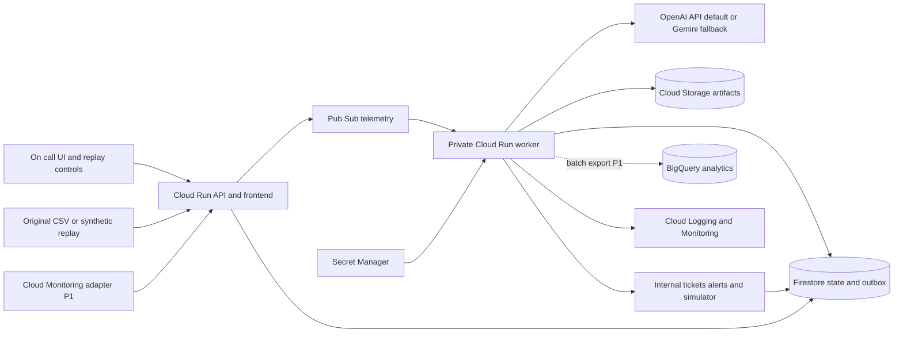
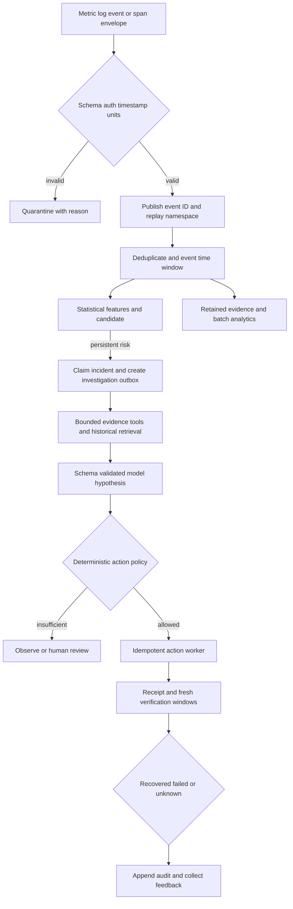
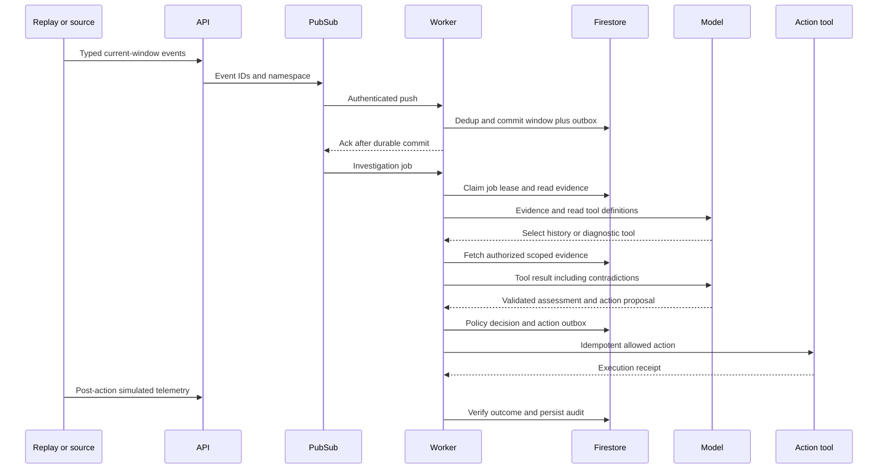
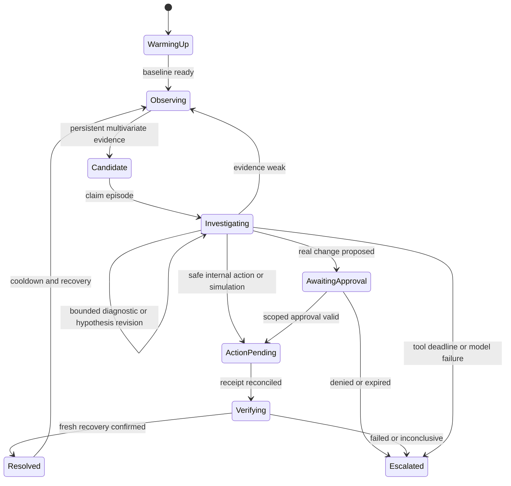

# Architecture and contracts

Default proposed deployment: **two Cloud Run services**, Pub/Sub, Firestore, Cloud Storage and Secret Manager. The API service also serves a small frontend. The private worker runs detector/investigation/action handlers. One backend codebase can build both roles. BigQuery is an optional analytical sink after the core cycle; a live Cloud Monitoring adapter follows the replay adapter. This package contains no deployed service.

## High level architecture



## Detailed data flow



## Incident sequence



Pub/Sub push is an at-least-once boundary; [exactly-once delivery applies to pull](https://docs.cloud.google.com/pubsub/docs/exactly-once-delivery). Do not promise exactly-once transport. Follow Google's [authenticated push tutorial](https://docs.cloud.google.com/run/docs/tutorials/pubsub). Persist a dedup record and outbox atomically; an outbox sweeper republishes unsent jobs after a crash. Publisher duplicates are harmless when job IDs are stable. The sweeper is an explicit authenticated scheduled request, not an unawaited background thread on request-billed Cloud Run. Jobs are resumable and short; no HTTP acknowledgement depends on a complete LLM investigation.

## Agent lifecycle



## Component decisions

| Component | Responsibility / necessity | Alternative and deployment | Scaling, cost and failure |
|---|---|---|---|
| Cloud Run API/frontend | Auth, ingestion, UI, read APIs and replay controls | Vercel UI adds CORS/auth boundary; single GCP UI simplest | Start min 0/max 3; cold start and request costs; client shows freshness |
| Cloud Run worker | Statistical windows, bounded investigator, actions and verification | Functions could handle events but separate runtime adds packaging work | Start max 3, concurrency 8; latency and model fanout dominate; cap outbound calls |
| Pub/Sub | Buffer telemetry/jobs and retry delivery | Direct HTTP is simpler prototype but weak burst/recovery story | Publish/delivery bytes, duplicate/order hazards; separate telemetry/jobs subscriptions and DLQ |
| Firestore | Episode state, dedup, outbox, actions, tickets and casebook | Cloud SQL offers relational constraints but adds setup/connection management | Reads/writes, hot keys and transaction contention; per-service/time buckets, bounded transactions |
| Cloud Storage | Versioned replay files, reports and evidence bundles | Store tiny fixture in image for emergency demo | Bytes/operations/retention; unavailable object blocks replay, do not fabricate completion |
| Secret Manager | Server-side model key, version pinned | Workload identity for GCP; no frontend secret | Access errors prevent model use; deterministic fallback; grant secret-specific accessor |
| Cloud Logging/Monitoring | Health, errors, lag, action and model-call counters | Local logs alone cannot demonstrate cloud reliability | Log volume/cardinality; sample normal events, keep action audit complete |
| Cloud Scheduler | Outbox sweep and verification wakeup | Explicit replay requests can drive demo-only verification | Small scheduled traffic, duplicate invocation; OIDC and idempotent handlers |
| BigQuery P1 | Partitioned offline telemetry and evaluation analytics | Cloud Storage + local evaluation sufficient MVP | Query bytes/storage/ingestion; not hot incident state; pipeline must survive export failure |
| Monitoring API P1 | Retrieve project-scoped real resource metrics | Replay first; OpenTelemetry collector when needed | Quotas and freshness; read-only adapter, backoff and source timestamps |
| Vertex/Gemini fallback | Alternate inference route | OpenAI default | Project/location access, tokens, rate limits; avoid adding a second model to every event |

No Dataflow, GKE, Cloud SQL, vector database or Workflows is justified for this initial workload. Add a dedicated stream processor only after load and hot-key tests demonstrate the current approach cannot meet windowing/fan-in requirements. Firestore per-event dedup/state is a small-MVP design, not a claim to process bank-scale telemetry economically.

## LLM route decision

Default **OpenAI GPT-5.4 mini** using the Responses API, strict function schemas for read tools and a strict structured assessment. The [official model page](https://developers.openai.com/api/docs/models/gpt-5.4-mini) lists function calling and structured output. Pin a tested snapshot after account smoke testing; the documented `gpt-5.4-mini-2026-03-17` is a candidate, not verified account access. [Structured outputs](https://developers.openai.com/api/docs/guides/structured-outputs) help enforce shape; application validation still checks grounding, refusal/incomplete responses and action eligibility.

Fallback **Gemini 3.8 Flash through the currently documented GCP model surface**, subject to project/location availability and exact model ID verification. Google's Vertex URLs now redirect to Gemini Enterprise Agent Platform documentation: preserve the organizer term Vertex AI in the submission, but follow current endpoint docs. [Function calling](https://docs.cloud.google.com/vertex-ai/generative-ai/docs/multimodal/function-calling) and [structured output](https://docs.cloud.google.com/vertex-ai/generative-ai/docs/multimodal/control-generated-output) require a provider adapter with the same application-side validator.

| Option | Strength for this MVP | Cost/latency/quality caveat | Decision |
|---|---|---|---|
| OpenAI primary | Credits, typed tools and straightforward external API | No measured quality or latency advantage here; external egress/provider boundary | Default pending bake-off |
| Gemini on GCP | GCP identity and fewer external-account boundaries | Location/availability and schema behavior must be tested; vendor claims are not our measurements | Practical fallback |
| Selective hybrid | Could reserve stronger model for hard contradictions | Doubles integration and failure analysis; do not invoke both routinely | P2 only if bake-off shows benefit |

Bake-off on the same 12 evidence packs, blind human rubric and identical output contract; record p50/p95 latency, refusals, schema errors, groundedness, tokens and billed cost. Choose the cheaper route that passes quality/reliability gates and meets observed latency needs. Model selection here is an engineering default, not an empirical ranking. If both fail, preserve detection and issue a deterministic evidence summary marked `model_unavailable`; this does not satisfy the final LLM-reasoning demonstration gate.

## Persistence and repository

Firestore collections scoped under `tenants/demo`: `events/{namespace:event_id}` (dedup + TTL), `windows/{service:metric:minute}` (features/version), `incidents/{id}`, `outbox/{job_id}`, `actions/{idempotency_key}`, `tickets/{episode_id}`, `history/{case_id}`, `feedback/{id}`, `audit/{append_id}`. Store version, timestamps, source IDs and policy/model versions. Incident writes use optimistic versions; immutable audit writes record actor and request ID. Application audit in Firestore is not a tamper-proof compliance archive. P1 exports to restricted storage with retention policy. Index incident status/detected time, outbox status/next attempt and history service/resolved time. Exempt bulky evidence text from indexes. Retain short window data for 7 days, raw artifacts 30 days and action/audit records 90 days as demo assumptions; production retention requires organizational policy.

BigQuery P1 tables: `telemetry` partition event date, cluster service/metric; `incident_evaluations` partition run date; `action_outcomes` partition action date. Operational record keys support merge/dedup; streaming exports may arrive late. Queries require date bounds and maximum bytes billed.

Proposed application layout (not present implementation):

```text
app/api/             auth, ingest, incident/replay routes
app/worker/          normalize, windows, detector, investigator
app/tools/           metrics, history, context, runbooks, actions
app/policy/          permissions, idempotency, verification
app/storage/         Firestore and artifact adapters
web/                 overview, incident, action, evaluation, replay
infra/               build, IAM, topics, deployment configuration
tests/               integration, fault handling, policy boundaries
```

This package's actual `src/` contains only analysis/generation utilities. Typed [event schema](../contracts/telemetry_event.schema.json), [assessment schema](../contracts/incident_assessment.schema.json) and [API contract](api_contract.md) define the implementation boundary.

## Failure handling

Malformed event → quarantine and acknowledge durable rejection. Transient store/publish error → non-2xx delivery retry; bounded exponential backoff with jitter. Pub/Sub [dead-letter topics](https://docs.cloud.google.com/pubsub/docs/dead-letter-topics) capture repeated failures; configure service-agent permissions and monitor backlog. Poison event replay requires a corrected version and audit. Store outage → no action; retry ingestion. Model timeout → deterministic alert and resumable investigation; one repair attempt for malformed output within the existing two-turn budget. Missing history → explicit no-match. Action timeout → unknown outcome and reconcile, not blind repeat. Partial incident state → version/lease prevents simultaneous transitions. Expired lease permits resume using same idempotency keys. Pipeline failure never becomes a healthy status.
