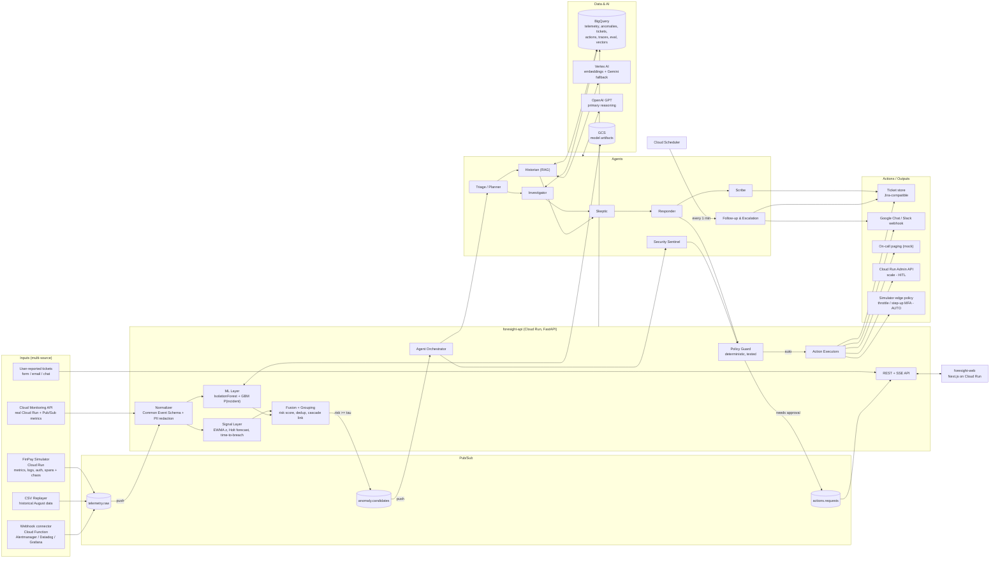
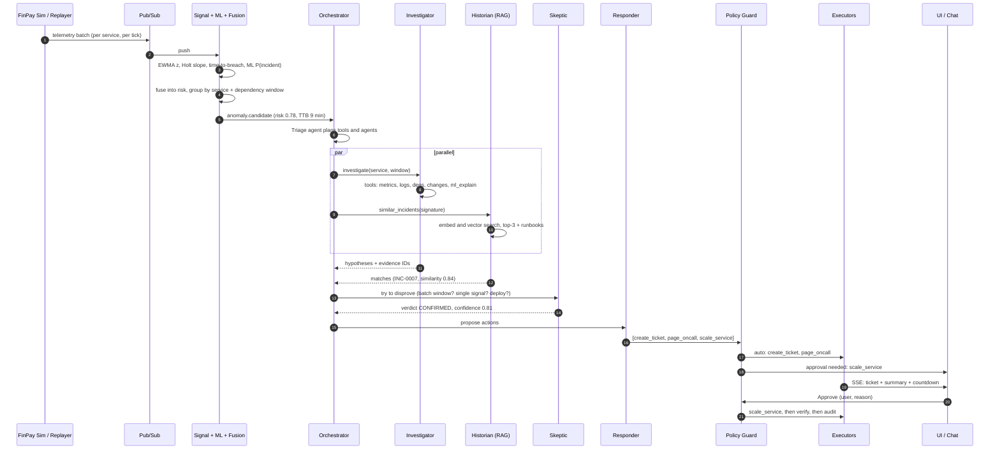

# Foresight: blueprint for a proactive AIOps agent platform (fintech)

> **Status:** v0.1 draft blueprint for a 4-hour build. Refine before coding.
> **Stack in repo:** Next.js (App Router, TypeScript) in `frontend/`, FastAPI (Python 3.12, uv) in `backend/`.
> **Target cloud:** Google Cloud Platform. Development is done in Google Antigravity.

---

## 0. TL;DR

**Foresight** watches a fintech platform's telemetry (metrics, logs, auth events, traces) and **predicts incidents before they happen**. A team of specialised agents checks each prediction: one investigates, one recalls similar past incidents, and one tries to disprove the alert. The system then acts:

- **Autonomously** for safe, reversible actions: opening pre-emptive tickets, paging on-call, sending reminders and escalations, plus two **non-breaking security containments** (throttling a credential-stuffing source and forcing step-up MFA, both with automatic expiry).
- **With a human in the loop** for anything that could break production, such as scaling, restarts, rollbacks or feature-flag changes.

**One-line pitch:** *"Static thresholds fire with 0 minutes of warning, and 44% of their pages are false alarms. Foresight warns you minutes earlier, filters out the noise, and arrives with the root cause and the fix."*

---

## 1. Problem, users, outcome

### 1.1 Problem
Fintech support and SRE teams work reactively. A failing payment flow, slow transaction search or broken OTP delivery usually surfaces when customers complain, and by then money and trust are already lost. The early signals exist (connection-pool creep, latency drift, failed-login bursts), but they sit in dashboards nobody watches, or they fire as threshold alerts so noisy that people stop reading them.

### 1.2 Primary users (personas)

| Persona | Needs | Foresight gives them |
|---|---|---|
| **On-call SRE / platform engineer** | Know what is about to break, why, and what to do, at 3 a.m. | A countdown alert, a ranked root-cause list with evidence, runbook steps, and one-click approval for fixes |
| **Support lead / service desk manager** | Fewer surprise tickets and no forgotten ones | Pre-emptive tickets, automatic follow-ups and escalation, and links between customer reports and incidents already open |
| **Security analyst (Identity & Fraud)** | Stop credential stuffing and brute force without locking out real customers | Autonomous, reversible containment with an audit trail and one-click rollback |
| **Department head / CTO** | Reliability posture across the organisation and per department | Analytics on MTTD, MTTR, pre-emptive ratio, SLA breaches and noise |

### 1.3 Outcome (what success looks like)
1. Incidents are flagged **before** the threshold breach, with a measurable **lead time**.
2. **False positives** are cut sharply compared with static-threshold alerting.
3. Every alert arrives with a **grounded root-cause summary** that an engineer can act on in under a minute.
4. No ticket goes stale: follow-ups and escalations run automatically.

---

## 2. What the dataset actually tells us (drives the design)

Profiled from `docs/ps02_system_telemetry.csv`:

| Fact | Implication |
|---|---|
| 500 rows, 8 services, 7 metric types, 2026-08-01 → 2026-08-30 | Small and generic: needs densifying and a fintech mapping |
| `alert_level` is purely `value/threshold`: NORMAL < 0.75, WARNING 0.75–0.95, CRITICAL ≥ 0.95 | The label is a static threshold, which makes it our **baseline** |
| 50 CRITICAL rows, 28 incidents, every incident is CRITICAL | **Baseline precision 56%: 22 of 50 pages are false (44%). Lead time 0.** This is the number we beat. |
| Only 3–15 points per service×metric over 30 days | Not a usable time series, so we **synthesise dense series anchored on the real rows** (allowed as a "minor adjustment") |
| Among CRITICAL rows, incidents have higher response time (median 2080 ms vs 1596 ms) and fewer active users (2401 vs 2942) | Weak but real multivariate signal, useful as ML features |
| `memory_usage` CRITICAL rows are mostly non-incidents (6 of 8) | Per-metric priors matter; the Skeptic agent and the ML model should learn this |
| Clustered incidents: AuthService `connection_pool` at 08-01 10:38, then PaymentGateway `connection_pool` at 10:59; SearchAPI `cpu` at 08-16 06:20, then UserProfileService `disk_io` at 06:32 | Seeds for **cross-service cascade correlation** and the history corpus |
| No logs, traces or auth events | Synthesise them with templates tied to the injected root cause |

> **Transparency rule for judges:** the original 500 rows are kept as anchors and never altered. Everything between them is generated by a seeded, committed script (`scripts/generate_timeseries.py`). We say this on stage.

---

## 3. Domain mapping (generic → fintech)

Applied in `backend/data/services.yaml`. Names change; the data doesn't.

| CSV service | Fintech service | Department (owner) | Business criticality | Depends on |
|---|---|---|---|---|
| PaymentGateway | **PaymentGateway** (card and wallet payments) | Payments | Tier 0 | AuthService, LedgerSync, NotificationHub |
| AuthService | **AuthService** (login, sessions, tokens) | Identity & Security | Tier 0 | CustomerProfile |
| UserProfileService | **CustomerProfile / KYC** | Customer Onboarding | Tier 1 | — |
| SearchAPI | **TransactionSearchAPI** | Digital Channels | Tier 1 | LedgerSync |
| NotificationHub | **OTP & NotificationHub** (SMS, push, email OTP) | Digital Channels | Tier 0 (OTP blocks payments) | external SMS provider |
| DataPipeline | **LedgerSync / SettlementPipeline** | Core Banking Ops | Tier 0 | — |
| ReportGenerator | **RegulatoryReporting** | Risk & Compliance | Tier 2 | LedgerSync |
| AnalyticsDashboard | **FraudRiskAnalytics** | Risk & Compliance | Tier 1 | LedgerSync |

**Fintech impact model** (shown on every incident):
`estimated value at risk per minute ≈ TPS × average transaction value × predicted failure rate`, plus `customers affected ≈ user_count_active × blast-radius factor`.

**Root-cause taxonomy** (the label space for RCA scoring):

| Code | Root cause | Typical precursor |
|---|---|---|
| RC-DBPOOL | DB connection-pool exhaustion / leak | `connection_pool` rises steadily, then latency, then errors |
| RC-MEMLEAK | Memory leak / GC thrash | `memory_usage` saw-tooth trending up |
| RC-DISKIO | Ledger write amplification / batch I/O saturation | `disk_io` + `queue_depth` |
| RC-CPU | Traffic surge (salary day, Eid, sale) / hot loop | `cpu_usage` + `user_count_active` |
| RC-QUEUE | Downstream bank/processor slowness, so backlog | `queue_depth` grows, then latency |
| RC-3P-LATENCY | Card network / third-party processor degradation | `latency_p99` drift with flat CPU |
| RC-BADDEPLOY | Bad deploy / config / expired certificate | step change in `error_rate` right after a change event |
| RC-AUTH-ATTACK | Credential stuffing / brute force | auth-failure burst across many accounts from few IPs |
| RC-OTP-PROVIDER | SMS/OTP provider outage | NotificationHub `error_rate` + `queue_depth` |
| RC-BENIGN | Known batch window / maintenance / one-off spike | single point, no ramp, no corroboration (false-positive trap) |

---

## 4. Scope

### 4.1 In scope for the 4-hour hackathon (MVP)

| # | Feature | Must / Should |
|---|---|---|
| F1 | **Multi-input ingestion**: CSV replay, live FinPay simulator, generic webhook connector, Cloud Monitoring API pull, user-reported ticket form | Must (replay + simulator + form); Should (webhook + Cloud Monitoring) |
| F2 | **Statistical detection**: EWMA z-score, Holt trend forecast and **time-to-breach**, persistence/hysteresis | Must |
| F3 | **ML pipeline input**: Isolation Forest (multivariate) + gradient-boosted incident classifier, trained offline, served in-process | Must (one model); Should (both) |
| F4 | **Agentic investigation**: Triage → (Investigator ∥ Historian) → Skeptic → Responder → Scribe | Must |
| F5 | **RAG similarity index** over past incidents and runbooks (embeddings + vector search) | Must |
| F6 | **Autonomous actions**: tickets, alerts/paging, reminders, escalation, **2 security containments** | Must |
| F7 | **Human-in-the-loop actions**: scale a Cloud Run service (real), restart, rollback (simulated) | Must (scale); Should (others) |
| F8 | **Natural-language summaries**: technical (on-call) and business (support/management) versions | Must |
| F9 | **Follow-up and escalation agent** on a schedule, SLA-driven, with time compression for the demo | Must |
| F10 | **Ticket analytics**, organisation-wide and per department | Should |
| F11 | **Platform ops dashboard**: routing accuracy, throughput, queue depth (required by the brief) | Must |
| F12 | **Evaluation scorecard**: lead time, false-positive rate, precision/recall, RCA quality, baseline vs Foresight | Must (the key differentiator) |
| F13 | **Feedback loop**: 👍/👎 on alerts adjusts per-signal sensitivity within bounds | Should |
| F14 | Demo control panel: chaos buttons, replay speed, time-scale | Must |

### 4.2 Out of scope (say so explicitly in the pitch)
- Multi-tenancy, SSO and RBAC beyond a demo role switch.
- Real Jira/ServiceNow/PagerDuty write-back (we ship Jira-compatible payloads and a mock sink).
- Real Cloud Armor / IdP enforcement (enforced inside the FinPay simulator's edge layer; production adapters are listed in §13).
- Full distributed tracing (we keep a service dependency graph plus synthetic spans).

### 4.3 Explicit non-goals
- Not a chatbot. The agents run unattended, triggered by events, and humans approve or reject actions instead of chatting.
- No autonomous action that can deny service to a legitimate customer or change money movement.

---

## 5. High-level design

### 5.1 Architecture diagram



### 5.2 Deployable units (kept small on purpose: fewer things to break in 4 hours)

| Unit | GCP service | Responsibility |
|---|---|---|
| `foresight-api` | Cloud Run (min 1, **max 1** for the demo, so hot state stays consistent) | Ingest push endpoint, detection, ML scoring, orchestrator and agents, policy guard, executors, REST + SSE |
| `foresight-web` | Cloud Run | Next.js UI |
| `finpay-sim` | Cloud Run | Mock fintech app (`/pay`, `/login`, `/search`), telemetry emitter, chaos endpoints, edge policy enforcement. Its own Cloud Run metrics are **real** and pulled via the Cloud Monitoring API |
| `connector-webhook` | Cloud Functions (2nd gen) | Normalises third-party alert payloads into Pub/Sub |
| `followup-tick` | Cloud Scheduler → HTTP `foresight-api /jobs/followups` | Drives the follow-up agent |
| Pub/Sub topics | Pub/Sub | `telemetry.raw`, `anomaly.candidates`, `actions.requests` (push subscriptions, dead-letter topic `*.dlq`) |
| BigQuery dataset `foresight` | BigQuery | System of record and analytics; `VECTOR_SEARCH` for RAG |
| Secrets | Secret Manager | `OPENAI_API_KEY`, webhook URLs |
| Models | GCS + Vertex AI (scale path: Model Registry) | `iforest.joblib`, `gbm.joblib` |

### 5.3 End-to-end flow (sequence)



### 5.4 Common Event Schema (CES)
Every input is normalised to this before anything else touches it.

```json
{
  "event_id": "uuid (idempotency key)",
  "ts": "2026-08-01T10:31:00Z",
  "source": "finpay-sim | replay | cloud-monitoring | webhook:alertmanager | user-ticket",
  "kind": "metric | log | auth | span | change | ticket | ml_score",
  "service": "PaymentGateway",
  "department": "Payments",
  "attributes": {
    "metric_type": "connection_pool", "value": 76.8, "threshold": 79.7,
    "user_count_active": 4057, "error_count_last_hour": 29, "response_time_ms": 2329
  },
  "severity_hint": "WARNING",
  "raw_ref": "gs://... or bq row id",
  "redacted": true
}
```

**Batching:** the replayer and simulator publish **one message per service per tick** containing all metrics, which keeps Pub/Sub message counts and push overhead low.

---

## 6. Detection design (lead time + low false positives)

### 6.1 Three-layer signal stack

| Layer | Method | Output | Why |
|---|---|---|---|
| **L1 Statistical** | Per (service, metric): EWMA mean/var of `ratio = value/threshold`; z-score; persistence = N of last M points above band | `z`, `persist` | Cheap, explainable, runs on every event |
| **L2 Forecast** | Holt linear (level + trend) on `ratio`; `TTB = (0.95 − ratio_now) / slope` if `slope > 0` and trend R² ≥ 0.6 over the last k points | `ttb_minutes`, `slope` | **This is what produces lead time.** We alert on the predicted breach, not the breach itself |
| **L3 ML** | (a) IsolationForest on multivariate feature vector; (b) GradientBoosting `P(incident)` trained on the train split | `anomaly_score`, `p_incident`, top features (SHAP-lite via feature importances) | Captures the multivariate signal (response time ↑, users ↓, per-metric priors) |

**Features for ML:** `ratio`, `Δratio_5`, `Δratio_15`, `slope`, `z`, `metric_type` one-hot, `service` one-hot, `response_time_ms` (and its z), `error_count_last_hour` (and its Δ), `user_count_active` (and its Δ), `hour_of_day`, `is_batch_window`, `dependent_service_max_ratio`.

### 6.2 Fusion and gating

```
urgency   = clamp(1 − ttb_minutes / HORIZON_MIN, 0, 1)     # HORIZON_MIN = 30
risk      = 0.35·urgency + 0.30·p_incident + 0.20·norm(z) + 0.15·corroboration
corroboration = fraction of {latency, errors, dependent service, logs} also abnormal
candidate if  risk ≥ τ (default 0.55)  AND  persist ≥ 2 of 3
```

- **Grouping:** candidates on the same service, or on services linked in the dependency graph, within a 10-minute window merge into **one incident candidate**, so an alert storm becomes one ticket.
- **Cascade link:** if an upstream dependency has an open candidate, the downstream one is attached as a symptom. This is what makes routing go to the root-cause team.
- **Cost control:** LLM agents only run on candidates (expected < 1% of events after grouping).

### 6.3 False-positive defences (in order)
1. Persistence and hysteresis (no single-point alerts).
2. Known-pattern suppression: batch windows (e.g. RegulatoryReporting `disk_io` 01:00–03:00), maintenance calendar, deploy freeze.
3. **Skeptic agent** (LLM + tools) argues against the alert using evidence.
4. Feedback loop: 👎 raises that signal's τ by +0.05 (capped at +0.15, decays over 24h).
5. **Safety override:** the Skeptic can downgrade but **cannot suppress** a candidate with `risk ≥ 0.85` on a Tier-0 service. It is still sent, flagged "low confidence". We would rather explain one extra alert than miss a payment outage.

### 6.4 Metric definitions (put these on the scorecard verbatim)
- **Lead time** for an incident at `t_inc` = `t_inc − t_first_alert` for the first Foresight alert on the root-cause service or its dependents within `[t_inc − 60 min, t_inc]`. Report median and p10. No alert means a missed incident.
- **False-positive rate (alert-level)** = alerts with no ground-truth incident within 60 min ÷ total alerts. Also report **false alerts per day**.
- **Precision / recall / F1** at incident level.
- **Baseline** = static threshold (alert when `ratio ≥ 0.95`), which is exactly the CSV's `CRITICAL` label. On raw data: precision 56%, FP 44%, lead time 0.
- **Evaluation split:** tune on Aug 1–20, **report on Aug 21–30 only** (held out). Say this when asked "did you overfit?".

---

## 7. Agent design

### 7.1 Orchestration choice
**Recommendation: a hand-rolled async orchestrator (~250 lines) with OpenAI function calling.** It is the lowest-risk option for a 4-hour build and fully debuggable. Each agent is `{system prompt, allowed tools, output JSON schema, step budget}`. Google ADK is the scale path (§13). Use it from the start only if someone on the team already knows it well.

**Guardrails on every agent run:** max 6 tool calls, 20 s timeout per LLM call, 45 s total budget, temperature 0.2, JSON-schema structured output, and a fallback to a deterministic template summary if the LLM fails. Every step is persisted to `agent_traces`.

### 7.2 Agent roster

| Agent | Type | Trigger | Tools | Output |
|---|---|---|---|---|
| **Triage / Planner** | LLM | `anomaly.candidate` | `get_candidate`, `get_service_meta`, `list_open_incidents` | Plan: which agents and tools, severity guess, dedupe decision (`new` / `attach_to INC-x`) |
| **Investigator** | LLM + tools | plan | `query_metrics(svc, metric, window)`, `get_logs(svc, window, level)`, `get_dependencies(svc)`, `get_recent_changes(svc)`, `get_ml_explanation(candidate_id)`, `get_auth_stats(window)` | Ranked hypotheses `[{root_cause_code, confidence, evidence_ids[], reasoning}]` |
| **Historian** | RAG | plan (parallel with Investigator) | `search_similar_incidents(signature_text, k=3, filters)`, `get_runbook(root_cause_code)` | Matches with similarity, past fix, time-to-resolve, runbook steps |
| **Skeptic** | LLM + tools | after Investigator + Historian | `is_batch_window`, `get_maintenance_calendar`, `get_seasonal_baseline`, `count_corroborating_signals`, `get_feedback_history` | `{verdict: CONFIRMED / DOWNGRADE / DISMISS, confidence, counter_evidence[]}` |
| **Responder** | LLM, constrained | after Skeptic | `list_allowed_actions(severity, service)`, `get_oncall(team)`, `estimate_impact(svc)` | Proposed actions, each with rationale and expected effect (passed to the Policy Guard, never executed directly) |
| **Security Sentinel** | Rules + ML first, LLM explains | auth-event anomaly | `get_auth_stats`, `get_ip_reputation` (mock), `check_allowlist`, `apply_throttle`, `apply_step_up`, `verify_containment`, `rollback_containment` | Containment actions + explanation |
| **Scribe** | LLM | after decisions | `render_ticket`, `post_chat` | Ticket body, **technical summary** (on-call), **business summary** (support/management), timeline |
| **Follow-up & Escalation** | Scheduled agent (rules decide, LLM writes) | Cloud Scheduler every 1 min | `list_open_tickets`, `get_sla_status`, `get_current_metrics`, `send_reminder`, `escalate`, `propose_resolution` | Reminders, escalations, "looks resolved, verify and close?" proposals |

### 7.3 RCA output contract (forces grounded summaries)

```json
{
  "incident_id": "INC-2026-0831-004",
  "headline": "PaymentGateway DB connection pool will saturate in ~9 min",
  "severity": "P1",
  "root_cause_service": "AuthService",
  "hypotheses": [
    {
      "code": "RC-DBPOOL",
      "confidence": 0.78,
      "statement": "AuthService connection pool leak is cascading into PaymentGateway token validation.",
      "evidence_ids": ["m:AuthService:connection_pool:10:20-10:38", "log:auth:HikariPool timeout x142", "dep:PaymentGateway->AuthService"]
    }
  ],
  "similar_incidents": [{"id": "INC-0007", "similarity": 0.84, "fix": "Recycle pool, raise maxPoolSize 20→40"}],
  "runbook_steps": ["...", "..."],
  "impact": {"customers_at_risk": 4057, "value_at_risk_per_min": "PKR 1.2M (est.)"},
  "if_ignored": "Projected breach at 10:47, then payment auth failures at an estimated 30%.",
  "skeptic": {"verdict": "CONFIRMED", "confidence": 0.81}
}
```

**Grounding rule (validated in code):** every `evidence_id` must exist in the evidence store for that run. Hypotheses with no valid evidence are dropped before the ticket is rendered.

---

## 8. Actions and autonomy policy

### 8.1 Autonomy matrix

| Action | Mode | Guard conditions | Reversible | Real or simulated in demo |
|---|---|---|---|---|
| Create pre-emptive ticket (routed to root-cause team) | **AUTO** | candidate confirmed or downgraded | yes | real (ticket store) |
| Post alert to team channel | **AUTO** | P1–P3 | n/a | real (Google Chat/Slack webhook) |
| Page on-call | **AUTO** | P1/P2, max 6/hour/team | n/a | mock pager + Chat |
| Attach RCA + runbook to ticket | **AUTO** | always | yes | real |
| Reminders and escalations | **AUTO** | SLA policy | n/a | real |
| Link user-reported ticket to an open incident | **AUTO** | similarity ≥ 0.8 | yes | real |
| 🔐 **Throttle suspicious login source** | **AUTO (security)** | see §8.2 | yes, TTL 15 min | enforced in `finpay-sim` edge |
| 🔐 **Force step-up MFA on targeted accounts** | **AUTO (security)** | see §8.2 | yes, TTL 30 min | enforced in `finpay-sim` auth |
| Scale service (Cloud Run min/max instances) | **HITL** | P1/P2 capacity root cause | yes | **real** Cloud Run Admin API on `finpay-sim` |
| Restart / recycle connection pool | **HITL** | — | partly | simulated |
| Roll back last deploy | **HITL** | change event within 30 min | yes | simulated |
| Disable feature flag | **HITL** | — | yes | simulated |
| Close ticket | **HITL** | Follow-up agent proposes it, human confirms | yes | real |
| Block all logins, delete data, change payment routing or limits | **FORBIDDEN** | — | — | — |

### 8.2 The two autonomous security actions: why they can't break anything

The design choice that matters: **deterministic rules decide whether to act. The LLM only explains.** No LLM output can trigger a containment on its own.

**A. Throttle source (rate-limit, not block)**
- **Trigger, all of:** auth-failure rate z ≥ 4; at least 20 distinct accounts tried per source IP/ASN in 5 min; ML `p_attack ≥ 0.8`.
- **Effect:** limit matching sources to 3 login attempts per minute. A real user behind a shared NAT can still log in.
- **Scope caps:** at most 50 sources and at most 2% of login traffic affected. If the cap is exceeded, the action escalates to a human instead.
- **Never applied to:** corporate ranges, partner banks, payment processors, health-check IPs (allowlist).

**B. Step-up MFA on targeted accounts**
- **Trigger:** an account receives at least 5 failed logins from at least 3 distinct sources in 10 min.
- **Effect:** the next login requires OTP. Nothing is locked and no session is killed.
- **Dependency check:** skipped, with a page to a human instead, if NotificationHub (OTP) is degraded. Step-up MFA must never lock users out because OTP delivery is down.

**Reliability envelope (shared by both):**

| Guard | Detail |
|---|---|
| Shadow mode | `SECURITY_AUTONOMY=shadow` logs what it *would* do. Turned on in the demo to show it, then switched to `enforce` |
| Idempotency | action key = hash(type, scope, window), so a repeated event cannot double-apply |
| TTL auto-expiry | expiry is stored with the action; a sweeper removes it even if the agent crashes |
| Post-action verification | after 60 s: failure rate must drop ≥ 50% **and** legitimate login success must stay ≥ baseline − 1%. Otherwise **auto-rollback** and page a human |
| Circuit breaker | max 5 autonomous security actions per hour; then it falls back to HITL |
| Kill switch | one toggle in the UI plus an env var disables all autonomy instantly |
| Audit | who/what/why/evidence/rollback-at in `actions` table, visible in the UI with a **Rollback now** button |
| Tests | Policy Guard has unit tests for every rule. **This is the one module that must be tested** |

### 8.3 Policy as config (`backend/data/policies.yaml`)

```yaml
kill_switch: false
security_autonomy: enforce        # off | shadow | enforce
limits: { autonomous_security_per_hour: 5, pages_per_team_per_hour: 6 }

auto:
  - create_ticket
  - notify_channel
  - page_oncall:        { severities: [P1, P2] }
  - send_reminder
  - escalate
  - link_user_ticket:   { min_similarity: 0.8 }
  - security.throttle_source:
      when: { auth_fail_z_gte: 4, distinct_accounts_per_src_gte: 20, p_attack_gte: 0.8 }
      caps: { max_sources: 50, max_traffic_share: 0.02 }
      never: [allowlist.corporate, allowlist.partner_banks, allowlist.processors]
      ttl_min: 15
      verify: { after_s: 60, fail_rate_drop_gte: 0.5, legit_success_drop_lte: 0.01 }
  - security.step_up_mfa:
      when: { fails_per_account_gte: 5, distinct_srcs_gte: 3, window_min: 10 }
      require_healthy: [NotificationHub]
      ttl_min: 30

hitl:
  - scale_service:      { max_instances_cap: 5, approval_expires_min: 10 }
  - restart_service
  - rollback_deploy
  - disable_feature_flag
  - close_ticket

forbidden: [block_all_logins, delete_data, modify_payment_routing, change_limits]
```

---

## 9. Ticketing, follow-ups and escalation

### 9.1 Routing
1. Deterministic: `root_cause_service → department → on-call team` from `services.yaml`.
2. Agent override: if the Investigator attributes the root cause to an **upstream** service, the ticket goes to that service's team, and the symptom team is CC'd.
3. **Routing accuracy** = tickets whose first assignee team owns the ground-truth root-cause service ÷ all tickets. Ground truth comes from injected scenarios, plus human re-routes as corrections.

### 9.2 SLA and escalation ladder

| Severity | Ack SLA | Resolve SLA | Reminder | Escalation chain |
|---|---|---|---|---|
| P1 | 5 min | 1 h | at 50% of SLA | Primary on-call → secondary on-call (100%) → engineering manager (200%) → incident commander + war-room channel |
| P2 | 15 min | 4 h | at 50% | Primary → secondary → manager |
| P3 | 1 h | 1 business day | at 75% | Primary → team lead |
| P4 | 1 business day | 5 business days | daily digest | none |

- **Demo time compression:** `TIME_SCALE=30`, so a 5-minute SLA plays out in 10 seconds.
- **Context-aware reminders:** the LLM writes them from current telemetry, e.g. *"Still unacknowledged. Pool usage rose from 82% to 91% since the last reminder. Forecast breach in 4 min."*
- **Auto-resolution proposal:** if metrics stay in band for 15 minutes, the Follow-up agent proposes closing with a resolution note, and a human confirms.
- **User-reported tickets:** classified, embedded, and matched against open incidents. A match shows *"Foresight raised this 12 minutes before the first customer report"*. That feeds the **pre-emptive ratio** KPI.

### 9.3 Ticket analytics (organisation-wide and per department)
- Tickets by severity, department, service and status; trend per day.
- **MTTD, MTTA, MTTR**; SLA breach rate; escalations per ticket.
- **Pre-emptive ratio** = incidents ticketed by Foresight before any user report ÷ all incidents. This is the headline business KPI.
- Noise: alerts per incident, 👎 rate, Skeptic dismiss rate.
- Top recurring root causes (by taxonomy code), with "repeat offender" services.
- Department filter at the top of the page; organisation view is the default.

---

## 10. RAG similarity index

| Aspect | Decision |
|---|---|
| Corpus | (1) **Past incidents**: the train-split incidents (Aug 1–20) become `INC-0001…`, each a short post-mortem (symptoms, root cause code, fix, time to resolve), generated **once** by a seeded script and skimmed by a human. (2) **Runbooks**: about 10 markdown runbooks, one per root-cause code. (3) Resolved Foresight tickets are appended live, so the system learns. |
| Document text for embedding | `"{service} {department} | signals: {metric↑ list} | logs: {top error templates} | cause: {code} | fix: {fix}"` |
| Query text | The same template, built from the live candidate (cause/fix left empty) |
| Embeddings | Vertex AI `text-embedding-005` (keeps Vertex AI in the stack); OpenAI embeddings as fallback |
| Store / search | BigQuery table `incident_vectors` + `VECTOR_SEARCH` (no index needed at this size). In-memory cosine fallback |
| Retrieval | Hybrid: metadata pre-filter (same service **or** same metric family **or** dependency neighbour), then top-k=3 by cosine, then a ≥ 0.70 cut-off |
| Leakage control | Test-split incidents are **never** in the corpus during evaluation |

---

## 11. ML pipeline (an input to the agents, not a replacement for them)

```
generate_timeseries.py → features.py → train_model.py → models/*.joblib (GCS) → served in foresight-api
                                     ↘ eval_report.json (AUC, PR, threshold)
```

- **Offline (hour 1):** train IsolationForest + GradientBoostingClassifier on the train split; pick the threshold that maximises F1 on the train split; save artifacts and a JSON report.
- **Online:** score every grouped feature vector in the API process (< 2 ms). Output `p_incident`, `anomaly_score` and `top_features`, which the Investigator calls through `get_ml_explanation`.
- **Agents treat ML as evidence, not as the verdict**, and cite it as `ml:gbm:p=0.83:top=[slope,response_time_z]`.
- **Retraining (scale path):** nightly Vertex AI custom training job or BigQuery ML (`ARIMA_PLUS` for seasonal baselines, `BOOSTED_TREE_CLASSIFIER`), using 👍/👎 feedback as labels and Vertex AI Model Registry for versioning.

---

## 12. Data generation and demo scenarios

### 12.1 `scripts/generate_timeseries.py` (seeded, committed)
1. Per (service, metric): threshold = median CSV threshold; baseline `ratio ~ N(0.68, 0.03)` + diurnal curve (fintech peak 09:00–14:00, salary-day surge on the 1st and 25th).
2. **5-minute resolution** for the historical 30 days (≈ 8,640 ticks × 56 series ≈ 484k points). Live simulator ticks every 5 s.
3. Each original CSV row is pinned at its timestamp with its exact value.
4. For each `is_incident=1` row: inject a **precursor ramp** starting 15–45 min earlier, rising from baseline to the anchor value. `response_time_ms` and `error_count` rise with it; matching log templates begin 10–20 min earlier; dependent services get a lagged sympathetic ramp. Recovery decays over 10–30 min. Assign a root-cause code by metric type plus the cascade rule.
5. For each `CRITICAL` row with `is_incident=0`: inject a **FP trap**, either a 1–2 point spike with no ramp, no logs and no corroboration, or a spike placed inside a known batch window. Label it `RC-BENIGN`.
6. Add 3 synthetic credential-stuffing episodes to the auth stream (labelled).
7. Write `metrics.parquet`, `logs.parquet`, `auth.parquet`, `ground_truth.json`, then load them to BigQuery.

### 12.2 Live chaos scenarios (`finpay-sim` endpoints, buttons in the UI)

| Button | What it does | Expected Foresight behaviour |
|---|---|---|
| **Leak DB pool** (PaymentGateway) | Pool usage climbs ~2%/tick, latency follows | Countdown alert → P1 ticket to Payments → Historian matches a past pool incident → HITL **scale** approval → real Cloud Run scale → follow-up confirms recovery |
| **Credential stuffing** (AuthService) | 200 failed logins/min across 300 accounts from 25 IPs | Security Sentinel **autonomously** throttles + steps up MFA → verification passes → TTL countdown + Rollback button |
| **Nightly report batch** (RegulatoryReporting) | `disk_io` spike at a known batch hour | Skeptic **dismisses** with reasoning, shown as a "false positive avoided" counter |
| **Upstream cascade** (AuthService → PaymentGateway) | AuthService pool ramp, then PaymentGateway latency | One grouped incident, routed to **Identity & Security**, not Payments (routing accuracy) |
| **OTP provider outage** (NotificationHub) | SMS errors + queue depth climb | P1. Step-up MFA auto-disabled by its dependency check |

---

## 13. Non-functional requirements

| Category | Requirement (hackathon target) | How |
|---|---|---|
| **Latency** | Event → candidate < 5 s p95; candidate → ticket on screen < 30 s p95 | In-process detection; parallel Investigator ∥ Historian; streaming SSE to the UI; the ticket shell renders immediately and the summary streams in |
| **Throughput** | ≥ 200 events/s sustained (replay at 20 ticks/s × 8 services × 7 metrics plus logs) | Batched messages; async FastAPI; BigQuery streaming insert in micro-batches every 2 s |
| **Availability / resilience** | Demo survives LLM, BigQuery or Pub/Sub hiccups | Pub/Sub at-least-once + `event_id` dedupe; DLQ topics; LLM fallback chain GPT → Gemini → deterministic template; BigQuery write-behind buffer; Cloud Run min-instances=1 (no cold start on stage) |
| **Reliability of autonomy** | Zero breaking autonomous actions | §8.2 envelope; Policy Guard unit-tested; shadow mode; TTL; verification + auto-rollback; kill switch |
| **Security** | Least privilege, no secrets in code | Secret Manager; one service account per Cloud Run service with minimal roles (Pub/Sub publisher/subscriber, BigQuery dataEditor on one dataset, `run.developer` scoped to `finpay-sim` only); webhook HMAC signature check; CORS locked to the web origin |
| **Privacy / fintech compliance** | No PII or PCI data to the LLM | Redactor before any prompt: PAN (Luhn-checked 13–19 digits), IBAN/account numbers, CNIC/national IDs, emails, phones, IPs hashed; prompts and outputs logged in redacted form; data stays in one region; retention policy on raw logs. Aligned with PCI-DSS and central-bank tech-risk expectations |
| **Auditability / explainability** | Every decision traceable | `agent_traces` (input, tool calls, output, model, tokens, latency) and `actions` (who, why, evidence, rollback); "Why?" timeline in the UI; evidence IDs on every claim |
| **Cost** | Under ~$5 for the whole hackathon | LLM only on grouped candidates; a small/fast model tier for Triage, Skeptic and Scribe, a stronger tier for the Investigator; embedding cache; BigQuery partitioned by date and clustered by service |
| **Scalability** | Stateless path to horizontal scale | Detection is keyed by `service`, so it partitions cleanly. Hot state sits behind an interface (`store/memory.py` now, Firestore or Memorystore later) |
| **Observability of Foresight itself** | We watch the watcher | Platform ops page: throughput, Pub/Sub backlog (`num_undelivered_messages` via Cloud Monitoring API), agent latency, LLM errors, routing accuracy |
| **Usability** | A new on-call engineer acts in < 60 s without training | §14 |
| **Accessibility** | Usable under stress | Severity by colour **and** icon/text; keyboard approve/reject; plain-language first, details on expand |

---

## 14. UX and user-friendliness

**Principles:** push, don't make people pull (alerts come to Chat with the summary, so nobody needs to watch a dashboard); conclusion first, evidence on demand; every action one click away and always reversible; show the agents' reasoning so people learn to trust it.

### 14.1 Screens (MVP in **bold**)

| Screen | Content |
|---|---|
| **Command Center** (home) | KPI strip (pre-empted incidents today, median lead time, false-positive rate, open P1/P2, autonomy status). **"Incidents in the making"** feed with live countdowns ("PaymentGateway pool saturates in ~8 min"). Service health map with dependency edges coloured by risk. Approvals inbox badge |
| **Incident detail** | Headline + severity + countdown. Business summary / technical summary toggle. Ranked hypotheses with confidence bars and clickable evidence (inline sparkline, log excerpt). Similar past incidents (similarity %, past fix). Runbook checklist. Proposed actions with **Approve / Reject (reason)**. Agent trace timeline ("Why did Foresight think this?"). 👍/👎 |
| **Approvals** | Pending HITL actions with expiry timer, impact estimate, approve/reject |
| **Security** | Auth failure chart, active containments with TTL countdown + **Rollback**, shadow/enforce toggle, kill switch |
| **Analytics** | Organisation / department switcher; MTTD/MTTA/MTTR, pre-emptive ratio, SLA breaches, escalations, top root causes |
| **Platform Ops** | **Routing accuracy, throughput (events/s, candidates/min, tickets/min), queue depth** (Pub/Sub backlog, agent work queue, pending approvals), agent latency p50/p95, LLM error rate |
| **Scorecard** | Baseline vs Foresight on held-out days: lead time (median/p10), FPR, precision/recall/F1, RCA top-1 accuracy, groundedness %, judge score. Toggle "Skeptic on/off" to show its contribution |
| **Connectors & Demo** | Connector status (last event, events/min), chaos buttons, replay speed, `TIME_SCALE`, policy view |

### 14.2 Notification format (Google Chat card)
```
🔴 P1 · PaymentGateway · breach predicted in ~9 min
Cause (78%): AuthService DB pool leak cascading to payments
Seen before: INC-0007 (84% similar), fixed by recycling the pool
Impact: ~4,000 customers, est. PKR 1.2M/min at risk
Done automatically: ticket PAY-142 opened, on-call paged
Needs you: [Approve scale-out]  [Open incident]  [Not useful]
```

---

## 15. RCA quality evaluation (the third judging criterion)

| Measure | How | Shown as |
|---|---|---|
| Root-cause accuracy | Top-1 / top-3 `code` vs injected ground truth on the held-out split | % |
| Routing accuracy | First team = owner of the ground-truth root-cause service | % |
| Groundedness | Share of claims whose `evidence_ids` resolve (checked automatically) | % (target 100%) |
| Judge score | LLM-as-judge rubric (1–5: correctness, specificity, actionability, concision) using a different model from the generator (GPT generates, Gemini judges) | mean |
| Human signal | 👍 rate on summaries | % |

`scripts/run_eval.py` replays the held-out days at max speed, writes `eval_results` to BigQuery, and the Scorecard reads them. **Run it before the demo and show the numbers. Never hard-code them.**

---

## 16. Data model (BigQuery dataset `foresight`)

| Table | Key columns | Partition / cluster |
|---|---|---|
| `events_raw` | event_id, ts, source, kind, service, attributes JSON | day / service, kind |
| `metrics` | ts, service, metric_type, value, threshold, ratio, users, errors, rt_ms | day / service |
| `logs` | ts, service, level, template_id, message (redacted) | day / service |
| `auth_events` | ts, account_hash, src_hash, outcome | day |
| `anomalies` | candidate_id, ts, service, z, slope, ttb, p_incident, risk, status, group_id | day / service |
| `incidents` | incident_id, opened_ts, root_cause_service, code, severity, skeptic_verdict, lead_time_s | — |
| `incident_vectors` | doc_id, kind (incident/runbook), text, embedding ARRAY<FLOAT64>, metadata | — |
| `tickets` | ticket_id, incident_id, dept, team, assignee, severity, status, preemptive BOOL, created_by, sla_ack_due, sla_resolve_due, rerouted BOOL | day / dept |
| `ticket_events` | ticket_id, ts, type (reminder/escalation/comment/state), actor, payload | day |
| `actions` | action_id, incident_id, type, mode (auto/hitl), status, approved_by, reason, ttl_until, verified BOOL, rolled_back BOOL, idempotency_key | day |
| `agent_traces` | run_id, incident_id, agent, step, tool, input, output, model, tokens, latency_ms | day |
| `feedback` | target_id, kind, vote, user, ts | — |
| `eval_results` | run_id, split, metric, value, baseline_value | — |

**Hot state:** an in-memory store in `foresight-api` (single instance), written through to BigQuery and rehydrated from it on startup. Swapping to Firestore is the first scale step.

---

## 17. API surface (`foresight-api`)

| Method | Path | Purpose |
|---|---|---|
| POST | `/ingest/pubsub` | Pub/Sub push endpoint (telemetry batches) |
| POST | `/ingest/webhook/{vendor}` | Direct webhook (also used by the Cloud Function) |
| POST | `/tickets/user` | User-reported ticket intake |
| GET | `/stream` | SSE: candidates, incidents, actions, ticket events, ops metrics |
| GET | `/incidents`, `/incidents/{id}` | List / detail (includes trace + evidence) |
| POST | `/actions/{id}/approve`, `/actions/{id}/reject`, `/actions/{id}/rollback` | HITL + rollback |
| GET | `/tickets`, PATCH `/tickets/{id}` | Ticket list / ack / resolve |
| POST | `/feedback` | 👍/👎 |
| GET | `/analytics/tickets?scope=org\|dept&dept=` | Analytics |
| GET | `/ops/metrics` | Routing accuracy, throughput, queue depth |
| GET | `/eval/scorecard` | Scorecard |
| POST | `/jobs/followups` | Cloud Scheduler target (OIDC-authenticated) |
| POST | `/demo/replay`, `/demo/chaos/{scenario}`, `/demo/settings` | Demo control |
| GET/PUT | `/policy` | View policy / toggle kill switch and security mode |

---

## 18. Repository layout

```
backend/
  main.py                      # FastAPI app factory, routers
  app/
    api/                       # ingest, incidents, actions, tickets, analytics, ops, eval, stream, demo, policy
    ingest/                    # normalizer.py, redact.py, connectors/{replay,cloud_monitoring,webhook}.py
    detection/                 # ewma.py, forecast.py, features.py, ml.py, fusion.py, grouping.py
    agents/                    # orchestrator.py, base.py, triage.py, investigator.py, historian.py,
                               # skeptic.py, responder.py, security.py, scribe.py, followup.py
      tools/                   # metrics.py, logs.py, deps.py, changes.py, rag.py, auth.py, tickets.py
    actions/                   # policy_guard.py (+ tests), executors/{ticket,notify,page,cloudrun_scale,throttle,step_up}.py, audit.py
    rag/                       # embed.py, store.py (bq VECTOR_SEARCH + in-memory fallback)
    llm/                       # provider.py (openai → vertex gemini → template), schemas.py
    store/                     # memory.py, bigquery.py
    eval/                      # scorecard.py, rca_judge.py
  data/                        # services.yaml, policies.yaml, runbooks/*.md, incidents_seed.json, allowlists.yaml
  prompts/                     # one .md per agent (versioned with the code)
  scripts/                     # generate_timeseries.py, train_model.py, build_corpus.py, build_embeddings.py, run_eval.py
  tests/                       # test_policy_guard.py, test_forecast.py, test_redact.py
sim/                           # finpay-sim FastAPI app: /pay /login /search, emitter, /chaos/*, /policy/*
functions/connector_webhook/   # Cloud Function (Python)
frontend/src/app/              # / (command center), /incidents/[id], /approvals, /security, /analytics, /ops, /scorecard, /settings
infra/                         # deploy.sh (gcloud), bq_schema/*.json, pubsub.sh, scheduler.sh
```

---

## 19. 4-hour execution plan

Assumes **3 builders**: **A** = data/ML/detection, **B** = agents/actions/LLM, **C** = frontend/deploy. With a 4th person, give them connectors, analytics and pitch from 1:00. With 2 people, merge A and C's deploy tasks into one lane and drop the Should items.

| Time | A — Data / ML / Detection | B — Agents / Actions | C — Frontend / Deploy |
|---|---|---|---|
| **0:00–0:20** | **Together:** freeze CES, RCA JSON and ticket schemas (copy from this doc); create GCP project, enable APIs (Run, Pub/Sub, BigQuery, Vertex AI, Secret Manager, Scheduler, Functions, Monitoring); store the OpenAI key in Secret Manager | same | **Deploy hello-world `foresight-api` and `foresight-web` to Cloud Run now** (de-risks deploy early) |
| **0:20–1:20** | `generate_timeseries.py` + ground truth; load to BigQuery; EWMA + Holt + TTB; fusion + grouping, emitting candidates | LLM provider + redactor; orchestrator; Triage, Investigator, Skeptic, Scribe with tools against **fixture candidates** | UI shell: Command Center + Incident detail against mock JSON; SSE client |
| **1:20–2:20** | Train IF + GBM, serve in-process; `build_corpus.py` + embeddings + VECTOR_SEARCH; replayer → Pub/Sub | Historian (RAG), Responder, **Policy Guard + tests**, executors (ticket, Chat, page, Cloud Run scale), Security Sentinel + throttle/step-up | `finpay-sim` + chaos endpoints deployed; Approvals + Security pages; wire to real API |
| **2:20–3:00** | `run_eval.py` + scorecard endpoint; tune τ on the **train split only** | Follow-up & Escalation agent + Cloud Scheduler; user-ticket linking | Scorecard, Platform Ops (routing accuracy, throughput, queue depth), Analytics (org/dept) |
| **3:00–3:15** | **End-to-end on live Cloud Run URLs:** run all 5 chaos scenarios, fix the top 3 bugs | | |
| **3:15** | 🧊 **Feature freeze** | | |
| **3:15–3:40** | Final eval run on held-out split; record numbers | Tighten prompts on the 5 scenarios; verify fallbacks (kill the OpenAI key and confirm the demo still works) | README, architecture diagram (export the mermaid), slides, **backup screen recording (labelled as a recording)** |
| **3:40–4:00** | **Rehearse the demo twice** and submit | | |

**Cut order if behind** (cut from the top): Cloud Monitoring connector → webhook Cloud Function → Analytics page → feedback loop → IsolationForest (keep the GBM) → restart/rollback simulations.
**Never cut:** forecast/TTB (lead time), Skeptic (FPR), grounded RCA + Historian (summary quality), Scorecard, one autonomous security action, one real HITL action, deployment on GCP.

**Development practice:** build in Google Antigravity; keep prompts in `backend/prompts/`; commit at least every 30 minutes with meaningful messages; `.env` stays local and secrets live in Secret Manager.

---

## 20. Demo script (≈ 5 min)

1. **(30 s) Hook:** Scorecard. *"On this dataset, static thresholds give 0 minutes of warning and 44% of their pages are false alarms. Here's Foresight on held-out days."* Point at lead time and FPR, baseline vs Foresight.
2. **(90 s) Predict and act:** click **Leak DB pool**. Countdown appears, agent trace streams, the P1 ticket lands in Payments with grounded RCA and a similar past incident, and the Chat card arrives. Approve the **scale-out** and the real Cloud Run instance count changes.
3. **(60 s) Safe autonomy:** click **Credential stuffing**. Security Sentinel throttles and forces step-up MFA **without a human**, verification passes, the TTL counts down, and the Rollback button is visible. Say the line: *"Rules decide, the LLM explains. Nothing it does can lock out a real customer."*
4. **(30 s) Noise killed:** click **Nightly report batch**. The Skeptic dismisses it with reasons, and the "false positives avoided" counter goes up.
5. **(30 s) Never forgotten:** the unacknowledged ticket triggers a reminder, then an escalation to the secondary (time-compressed). A user-reported ticket is auto-linked: *"Foresight raised this 12 min before the customer did."*
6. **(30 s) Org view:** Analytics (department switch) and Platform Ops (routing accuracy, throughput, queue depth).
7. **(30 s) Scale story** (§21).

**Q&A prep:** how lead time is measured (§6.4); why the Skeptic can't hide real outages (safety override §6.3); overfitting (held-out split); synthetic data honesty (§2); LLM cost (agents only on grouped candidates); what if OpenAI is down (fallback chain, shown live).

---

## 21. Scalability: hackathon → MVP → market-ready

| Dimension | Hackathon (today) | Pilot MVP (1–3 months) | Market-ready product |
|---|---|---|---|
| Ingestion | Pub/Sub push to one Cloud Run service | Pub/Sub + **Dataflow** streaming (windowing, exactly-once) | Multi-region Pub/Sub, per-tenant topics, OpenTelemetry collector as the standard intake |
| Detection | In-process EWMA/Holt + GBM | Detector as its own autoscaled service, partitioned by service; BigQuery ML `ARIMA_PLUS` seasonal baselines | Per-tenant, per-service auto-tuned models; Vertex AI Pipelines retraining from feedback |
| Agents | Custom orchestrator, single instance | **Google ADK** on Vertex AI Agent Engine; durable runs (Cloud Tasks / Workflows) | Agent marketplace (domain packs: payments, lending, crypto); per-tenant prompt/policy versions with A/B tests |
| State | In-memory + BigQuery | Firestore (operational) + BigQuery (analytics) + Memorystore (hot windows) | Same, sharded by tenant; AlloyDB if relational needs grow |
| RAG | BigQuery `VECTOR_SEARCH` | Vertex AI Vector Search | Per-tenant indexes + cross-tenant anonymised pattern library ("this pattern hit 14 other fintechs") |
| Connectors | Replay, simulator, Cloud Monitoring, generic webhook | Prometheus/Alertmanager, Grafana, Datadog, Elastic, CloudWatch, Azure Monitor, Jira, ServiceNow, PagerDuty, Opsgenie, Slack, Teams | Connector SDK + marketplace; core-banking and card-switch adapters |
| Security actions | Simulator edge | Cloud Armor rate-based rules, Identity Platform / Okta / Keycloak step-up APIs | Policy-as-code (OPA), customer-defined autonomy levels, signed action receipts |
| Tenancy and access | Single tenant, demo roles | Multi-tenant (tenant_id on every row, row-level security), SSO (OIDC/SAML), RBAC | SOC 2 Type II, PCI-DSS scope minimisation, data residency per region, BYO-LLM / private endpoints |
| Throughput target | ~200 events/s | ~10k events/s | ~500k events/s per region |

**Business model:** SaaS priced **per monitored service per month**, plus seats for analytics and a premium tier for autonomous security. **Value story:** for a payment platform, one minute of checkout downtime is a direct revenue loss plus regulatory exposure. Foresight's KPIs (lead time, pre-emptive ratio, MTTR reduction) map straight to avoided loss.

---

## 22. Risks and mitigations

| Risk | Mitigation |
|---|---|
| Deploy fails late | Deploy hello-world at 0:20; deploy after every merge; `infra/deploy.sh` one-liner |
| LLM latency or outage on stage | Parallel agents, streaming UI, fallback chain to a deterministic template; tested at 3:15 |
| Synthetic data looks fake to judges | Say it up front, show anchors preserved, seeded script in repo, held-out evaluation |
| Overfitting thresholds | Tune on Aug 1–20 only; report Aug 21–30 |
| Autonomous action misfires | Shadow mode first, caps, allowlists, verification + auto-rollback, kill switch, unit tests |
| Single-instance hot state lost on restart | min-instances=1; rehydrate from BigQuery on startup |
| Venue network | Backup recording (labelled), local fallback run with `docker compose` |
| Scope creep | §4 Must list + §19 cut order; freeze at 3:15, no exceptions |

---

## 23. Requirement traceability

| Requirement | Where it's met | Demo moment |
|---|---|---|
| Real-time ingestion of metrics, logs, event streams | §5, F1, Pub/Sub + simulator + replay + webhook | Ops page throughput, live feed |
| Statistical + LLM-based detection | §6 (L1–L3), Skeptic + Investigator §7 | Agent trace on incident detail |
| Autonomous actions (alerting, tickets, runbooks) | §8, §9 | Ticket + Chat card + runbook |
| NL incident summaries | Scribe, §7.3, §14.2 | Business/technical toggle |
| Historical pattern correlation | Historian + RAG §10 | "84% like INC-0007" |
| Dashboard: routing accuracy, throughput, queue depth | Platform Ops §14.1, §9.1 | Ops page |
| Lead time / FPR / RCA quality | §6.4, §15, Scorecard | Opening + closing slide |
| Agentic AI (plan, tools, actions) | §7 (planner, tool-using agents, policy-gated actions) | Trace timeline |
| Deployed on GCP | §5.2 | Live URL |
| Scalability | §21 | Closing |
| Working live demo | §12.2, §20 | Chaos buttons |
| Your modules: multi-input, ticket analytics (org/dept), connectors, follow-ups/escalation, RAG, ML input, safe autonomy | F1, §9.3, F1/§21, §9.2, §10, §11, §8.2 | Throughout |

---

## 24. Open questions to settle while refining

1. Team size and who owns which lane (adjust §19).
2. LLM split: keep GPT primary (key in hand) with Vertex Gemini as fallback/judge, or go Gemini-first to lean harder into the "GCP stack" score?
3. Currency/region for the impact model (PKR used as placeholder; change if needed) and GCP region (`us-central1` has the widest Vertex AI model availability).
4. Chat target: Google Chat webhook (GCP-native) or Slack?
5. Use Google ADK from the start, or the custom orchestrator (recommended for 4 hours)?
6. Product name: "Foresight" is a placeholder.
