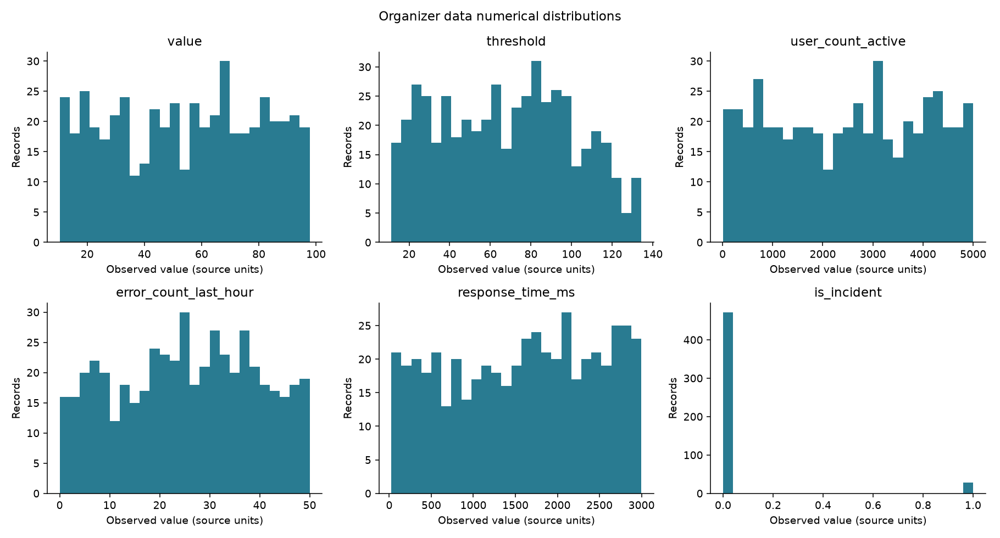
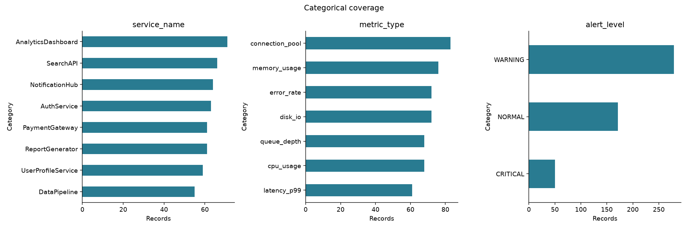
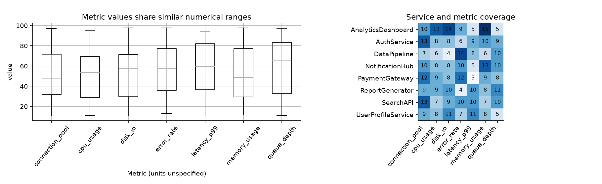
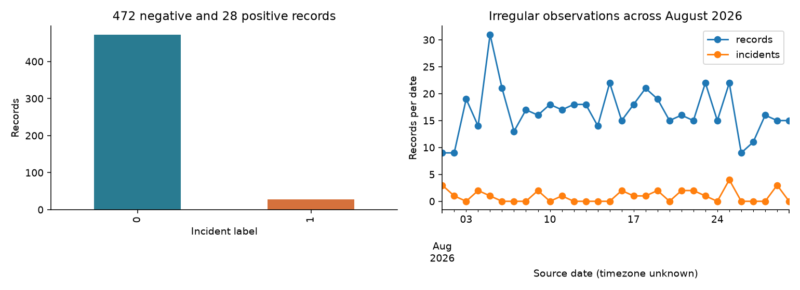
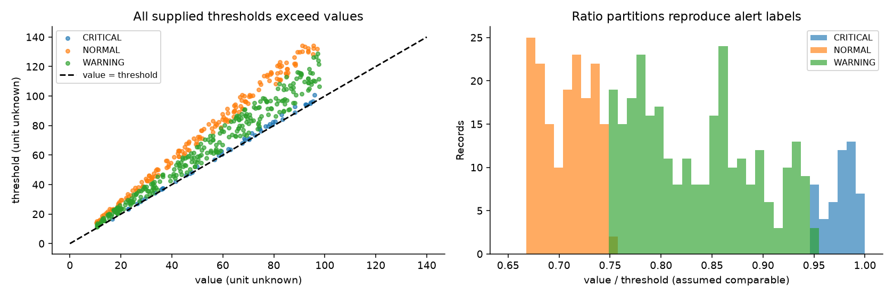
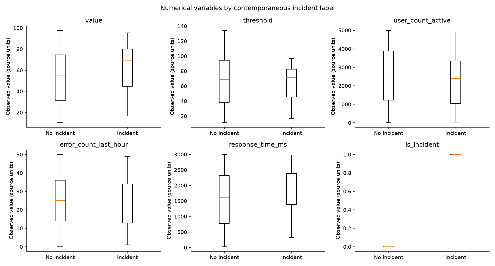
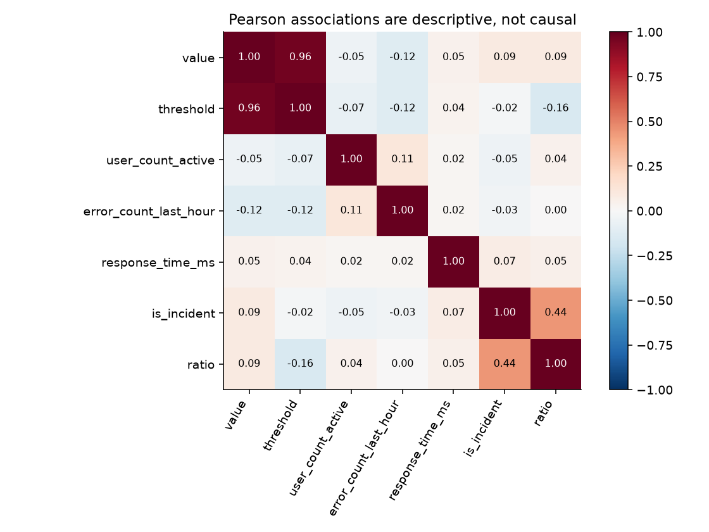

# PS 02 exploratory data analysis

## Conclusions

The supplied file is structurally clean but unsuitable as standalone evidence for proactive incident prediction. It contains **500 rows, 10 columns, eight services, seven metric types and 28 incident-positive rows (5.6%)**. The brief explicitly calls it synthetic. No missing cells, duplicate rows or timestamp parse failures were found. Units, incident onset and causal/history records are absent. Use it for descriptive/point-label baselines and organizer replay, then evaluate temporal prevention in a separate labeled simulation.

## Inventory and numerical distributions

Source SHA-256: `39dab9c508042cf577776b73e3f4044fa4093acd1ab5412e3e9faafef0bb4cfa`. Parsed types and semantics are in [data dictionary](data_dictionary.md). `value` and `threshold` are floats; active users, error count, response time and target are integers; the remaining fields are strings before timestamp parsing. Timestamp has 500 unique values. Service/metric/alert cardinalities are 8/7/3. Other cardinalities are recorded in `schema_inventory.csv`.

| column | count | mean | std | min | 25% | 50% | 75% | 95% | 99% | max | skewness | iqr_outliers |
|---|---|---|---|---|---|---|---|---|---|---|---|---|
| value | 500 | 54.265 | 25.529 | 10.38 | 31.777 | 56.01 | 75.873 | 93.522 | 96.993 | 97.76 | -0.05852 | 0 |
| threshold | 500 | 67.945 | 32.572 | 11.29 | 38.358 | 68.93 | 93.185 | 120.39 | 132.11 | 134.29 | 0.055176 | 0 |
| user_count_active | 500 | 2515.4 | 1476.8 | 10 | 1180 | 2607.5 | 3855.5 | 4748.7 | 4952.2 | 4998 | -0.033682 | 0 |
| error_count_last_hour | 500 | 25.026 | 13.814 | 0 | 14 | 25 | 36 | 47 | 50 | 50 | -0.067184 | 0 |
| response_time_ms | 500 | 1578.2 | 872.64 | 25 | 796.75 | 1642.5 | 2323.8 | 2861.1 | 2979 | 2998 | -0.13009 | 0 |
| is_incident | 500 | 0.056 | 0.23015 | 0 | 0 | 0 | 0 | 1 | 1 | 1 | 3.8738 | 28 |

Percentiles 1/5/25/50/75/95/99 and validity/missingness are in `column_statistics.csv`. Non-target numerical skewness is small (about −0.13 to +0.06); no 1.5-IQR outliers occur in those variables. The binary target has zero IQR, so the rule labels all 28 positive flags as “outliers”; these are valid minority outcomes, not corrupt data. Global means of `value` and `threshold` pool unknown units and are inventory summaries only.

The broad, roughly flat ranges and weak context associations are compatible with synthetic independent sampling. Distribution appearance does not establish the exact generation process or independence.

## Categorical and service coverage

| service_name | records | incidents |
|---|---|---|
| AnalyticsDashboard | 71 | 4 |
| AuthService | 63 | 2 |
| DataPipeline | 55 | 4 |
| NotificationHub | 64 | 2 |
| PaymentGateway | 61 | 4 |
| ReportGenerator | 61 | 2 |
| SearchAPI | 66 | 6 |
| UserProfileService | 59 | 4 |

| metric_type | records | incidents |
|---|---|---|
| connection_pool | 83 | 6 |
| cpu_usage | 68 | 3 |
| disk_io | 72 | 4 |
| error_rate | 72 | 3 |
| latency_p99 | 61 | 5 |
| memory_usage | 76 | 2 |
| queue_depth | 68 | 5 |

Alerts: NORMAL 171 (34.2%), WARNING 279 (55.8%), CRITICAL 50 (10%). PaymentGateway supplies only 61 records/four positive flags. All 56 service/metric combinations exist, each with 3–15 observations (mean 8.93). No service-specific model is justified by a few incident points. Full category proportions and Wilson incident-rate intervals are saved in `categorical_distributions.csv` and `incident_analysis.csv`.

Coverage is spread across services and metrics, but comparable categorical coverage does not imply adequate time-series density.

Metric values share broadly similar numerical ranges; that is a reason to question units rather than assume disk I/O, queue depth, CPU and error rate are physically interchangeable.

## Temporal analysis

Coverage: **2026-08-01 00:34:35 through 2026-08-30 23:15:33**, source timezone unspecified. Source row order is not chronological. Sorted global gaps have median 3456 s (57.6 min), mean 5184.9 s, minimum 15 s and maximum 49702 s (13.81 h). No fixed sampling interval is established. The median across the 56 service/metric median gaps is **50.7225 h**. Detailed gaps and daily incident counts are saved separately.

There is no simultaneous multimetric snapshot or dense repeated service sequence. Daily counts can describe observation frequency; apparent spikes cannot be attributed to production demand. Thirty days of irregular, mixed observations do not establish seasonality. Pre/post-incident windows cannot be aligned to real episode onset. Chronological slicing is mechanically possible, but does not transform these point labels into forecast labels. Resampling/interpolation would manufacture unobserved signals.

The positive minority is small and scattered across source dates. Replaying these timestamps can demonstrate event processing only; it cannot prove live-data performance or warning lead time.

## Thresholds, labels and leakage investigation

All 500 values are **below** their supplied threshold. Pearson(value,threshold) = **0.964372**. This strong positive relationship occurs within each metric as well; it is compatible with thresholds generated from values, but generator code is unavailable. Their status as ex-ante operating limits is unproven.

| alert_level | min | max | mean |
|---|---|---|---|
| CRITICAL | 0.95015 | 0.99578 | 0.97611 |
| NORMAL | 0.66886 | 0.74993 | 0.70774 |
| WARNING | 0.75077 | 0.94945 | 0.83514 |

The following rules exactly reproduce every observed alert label: ratio <0.75 → NORMAL; 0.75≤ratio<0.95 → WARNING; ratio≥0.95 → CRITICAL. All 28 incidents fall among 50 CRITICAL records, while 22 CRITICAL records are negative. Alert bands are empirically deterministic in this sample; exact label-generation rules are still unknown. Do not train on `alert_level` then present its performance as advance prediction. Ratio/threshold can retain indirect synthetic-label structure even after dropping that column.

This figure explains why threshold exceedance produces no detections and why a near-threshold ratio performs strongly on point labels. Neither pattern establishes causality or lead time.

Checks for post-incident features: the dataset does not state when `alert_level`, thresholds, hourly errors or context fields become available relative to the incident. Leakage cannot be fully excluded. Use event-time provenance and rolling windows ending before a defined prediction horizon in any later supervised dataset.

Exact duplicate rows, duplicate timestamps, duplicates after dropping timestamp, and coarsened near-duplicates all number zero. Near-duplicate definition: remove timestamp, round value/threshold to whole units, active users/response time to bins of 100 and hourly errors to bins of five, retaining categories/target. This rules out this particular overlap definition, not all semantic duplicates or shared generator templates across splits.

## Associations and incident comparisons

| feature | chi_square | p_value | cramers_v | minimum_expected |
|---|---|---|---|---|
| service_name | 4.1382 | 0.76373 | 0.090975 | 3.08 |
| metric_type | 3.3184 | 0.76795 | 0.081467 | 3.416 |
| alert_level | 266.95 | 1.0783e-58 | 0.73068 | 2.8 |

Chi-square/Cramér V are descriptive. Several expected positive-class cell counts are <5; asymptotic service/metric p-values are weak evidence and cannot establish absence of association. Alert association is strong and consistent with label construction. There is no validated service or metric ranking for incident risk.

| feature | positive_mean | negative_mean | positive_median | negative_median | cohens_d | rank_biserial | mw_p |
|---|---|---|---|---|---|---|---|
| value | 63.469 | 53.719 | 69.415 | 55.205 | 0.38301 | 0.22208 | 0.048276 |
| threshold | 65.159 | 68.11 | 71.3 | 68.715 | -0.09053 | -0.048048 | 0.66956 |
| user_count_active | 2210.1 | 2533.5 | 2401 | 2632 | -0.21903 | -0.12848 | 0.25334 |
| error_count_last_hour | 23.214 | 25.133 | 21.5 | 25 | -0.13886 | -0.088756 | 0.43005 |
| response_time_ms | 1830.9 | 1563.2 | 2079.5 | 1619.5 | 0.3072 | 0.176 | 0.11758 |
| ratio | 0.97497 | 0.79563 | 0.97689 | 0.78125 | 2.1307 | 0.94734 | 3.5532e-17 |

Value and response duration have positive mean differences (Cohen d about 0.38 and 0.31); error count and active users do not rise with the incident flag in this sample. Ratio has a much larger effect (d about 2.13) reflecting its label association. The value Mann–Whitney p≈0.048 is one of multiple exploratory comparisons and is not robust evidence by itself. P-values are unadjusted; no confirmatory statistical claims are made.

Broad overlap persists for ordinary context variables; boxes for only 28 positives should not be overinterpreted.

Pearson response time/error count correlation is about 0.0185, inconsistent with assuming a useful joint causal outage pattern here. Similar weak relationships do not prove randomized independence. `correlation_analysis.csv` includes Pearson and Spearman coefficients/p-values for every numeric pair including ratio; treat correlations with binary target as point-biserial associations.

## Executed fixed baselines

| detector | tp | fp | fn | tn | precision | recall | f1 | fpr |
|---|---|---|---|---|---|---|---|---|
| exceed_supplied_threshold | 0 | 0 | 28 | 472 | NA | 0 | 0 | 0 |
| ratio_ge_0.75 | 28 | 301 | 0 | 171 | 0.085106 | 1 | 0.15686 | 0.63771 |
| ratio_ge_0.90 | 28 | 67 | 0 | 405 | 0.29474 | 1 | 0.45528 | 0.14195 |
| ratio_ge_0.95 | 28 | 22 | 0 | 450 | 0.56 | 1 | 0.71795 | 0.04661 |
| ratio_ge_0.98 | 12 | 10 | 16 | 462 | 0.54545 | 0.42857 | 0.48 | 0.021186 |
| critical_label_diagnostic | 28 | 22 | 0 | 450 | 0.56 | 1 | 0.71795 | 0.04661 |

FPR uses 472 negative rows. Undefined precision for no positive predictions is saved as null, not 100%. Ratio≥0.95 yields precision 56%, recall 100%, F1 0.7179, FPR 4.661%. Its full-sample Wilson recall interval is approximately 87.9–100%, reflecting only 28 positives; this is not generalization uncertainty under synthetic dependence. All-data and chronological 60/20/20 slice results are saved under `reports/evaluation`. The full file was explored before describing the ratio rule, so the last slice is not a pristine discovery holdout.

## Recommendations

Retain the threshold and ratio diagnostic, organizer sample lane and data-quality limits. Do not fit a deep forecast, supervised deployment model or financial-loss estimator on these records. Generate independent, labeled temporal scenarios for mechanism experiments; evaluate root-cause summaries against known controlled fault evidence rather than pretending these rows contain root causes. See [fitness assessment](data_quality_report.md), [data strategy](../../docs/data_strategy.md) and [evaluation](../evaluation/evaluation_report.md).
