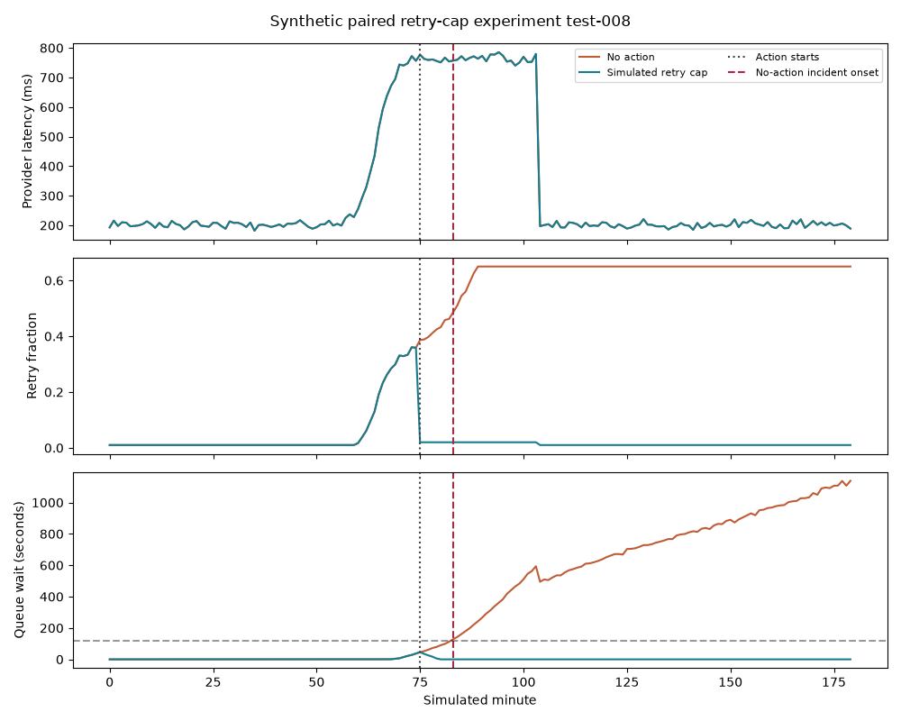
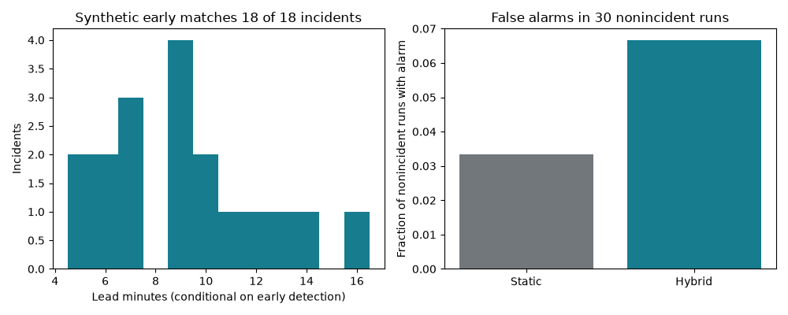

# Executed evaluation and remaining gates

## Evidence boundaries

Executed: original descriptive/fixed-rule analysis; causal synthetic generation; validation-only z sweep; frozen final-seed statistical detector comparison; paired retry-cap simulation; artifact/invariant validation. Not executed: LLM API calls, summary quality scoring, retrieval benchmark, actual agent tools, live alerts/tickets, real remediation, GCP deployment/load testing. The statistical “hybrid” is not a measured LLM hybrid. No benchmark on real payment production data is claimed.

## Organizer point baseline

| detector | tp | fp | fn | tn | precision | recall | f1 | fpr |
|---|---|---|---|---|---|---|---|---|
| exceed_supplied_threshold | 0 | 0 | 28 | 472 | NA | 0 | 0 | 0 |
| ratio_ge_0.75 | 28 | 301 | 0 | 171 | 0.085106 | 1 | 0.15686 | 0.63771 |
| ratio_ge_0.90 | 28 | 67 | 0 | 405 | 0.29474 | 1 | 0.45528 | 0.14195 |
| ratio_ge_0.95 | 28 | 22 | 0 | 450 | 0.56 | 1 | 0.71795 | 0.04661 |
| ratio_ge_0.98 | 12 | 10 | 16 | 462 | 0.54545 | 0.42857 | 0.48 | 0.021186 |
| critical_label_diagnostic | 28 | 22 | 0 | 450 | 0.56 | 1 | 0.71795 | 0.04661 |

Source lead time is unavailable. Ratio≥0.95 reproduces CRITICAL, so treat it as a descriptive synthetic-label diagnostic. Chronological slices and grouped detection counts are saved; the full source was inspected, preventing a pristine predictive holdout claim.

## Synthetic final experiment

Version 1.1, 48 final-test runs / 8,640 one-minute windows, with 18 incident-bearing runs and 30 runs without the defined incident. z=6 selected on 24 validation runs from four candidates. Final seeds 9000+ are disjoint from the exploratory pilot's inspected seeds 3000+. The revision added backlog gating and fault-to-throughput coupling; this was developmental intervention on the detector and simulator, not evidence that only an algorithm changed on a fixed production workload. Final test was not used to choose further settings.

| detector | incident_runs | early_recall | event_precision | late | missed | window_fpr | negative_run_alarm_rate | lead_median |
|---|---|---|---|---|---|---|---|---|
| static | 18 | 0.055556 | 0.94737 | 17 | 0 | 0.00014665 | 0.033333 | 7 |
| hybrid | 18 | 1 | 0.9 | 0 | 0 | 0.002493 | 0.066667 | 9 |

Hybrid window confusion: TP1590/FP17/FN231/TN6802; FPR 17/6819 = 0.2493%, precision 98.942%, recall 87.315%, F1 0.9277. Static: TP1451/FP1/FN370/TN6818; FPR 1/6819 = 0.01466%, precision 99.931%, recall 79.681%, F1 0.8866. Window targets include the 20-minute pre-onset horizon through incident end; these are not contemporaneous fraud or payment labels.

Hybrid early matches **18/18**, static **1/18**, with static 17 late detections. Hybrid has no late-only or missed incident in this test. Hybrid lead min/Q1/median/Q3/max = **5 / 7 / 9 / 10.75 / 16 minutes**, conditional on early matches. Static's only early match has seven-minute lead. Hybrid raises two unmatched alarm episodes, both in nonincident runs; static raises one. Event precision is 18/(18+2)=90% versus 18/(18+1)=94.737%. Negative-run false-alarm rate is 2/30=6.667% versus 1/30=3.333%. The earlier detector therefore trades more false alarms for lead time; do not claim it dominates every quality measure.

Wilson 95% interval for 18/18 early recall: 0.824–1.000. For 2/30 negative-run alarms: 0.018–0.213. Event-bootstrap median-lead interval: 7.00–10.50 min. These reflect finite runs under this one generator, not real-world performance confidence.

| method | kind | runs | incident_runs | early | late | missed | unmatched_episodes |
|---|---|---|---|---|---|---|---|
| hybrid | capacity_loss | 8 | 5 | 5 | 0 | 0 | 0 |
| hybrid | healthy | 8 | 0 | 0 | 0 | 0 | 0 |
| hybrid | normal_surge | 8 | 0 | 0 | 0 | 0 | 0 |
| hybrid | provider_slow | 8 | 5 | 5 | 0 | 0 | 2 |
| hybrid | retry_storm | 8 | 8 | 8 | 0 | 0 | 0 |
| hybrid | transient_spike | 8 | 0 | 0 | 0 | 0 | 0 |
| static | capacity_loss | 8 | 5 | 0 | 5 | 0 | 0 |
| static | healthy | 8 | 0 | 0 | 0 | 0 | 0 |
| static | normal_surge | 8 | 0 | 0 | 0 | 0 | 0 |
| static | provider_slow | 8 | 5 | 0 | 5 | 0 | 0 |
| static | retry_storm | 8 | 8 | 1 | 7 | 0 | 0 |
| static | transient_spike | 8 | 0 | 0 | 0 | 0 | 1 |

## Error analysis and pilot

Final hybrid unmatched alarms:

| run_key | kind | has_incident | alarm_episodes | unmatched_episodes |
|---|---|---|---|---|
| test-000 | provider_slow | 0 | 1 | 1 |
| test-006 | provider_slow | 0 | 1 | 1 |

These runs developed enough queue risk for the warning rule but did not meet the configured incident boundary. A warning can be operationally useful yet still count as a false alarm under this frozen evaluation definition. Do not reclassify it after seeing results. Inspect persistence, horizon and ticket severity in later validation, not on this final set. All normal-surge, transient-spike and healthy final runs remain negative and quiet. Limited fault diversity can make that easier than production.

Exploratory v0 had only seven test incidents; its hybrid negative-run alarm rate was about 36.6% and one incident was missed within the specified horizon. Those results exposed over-alerting and motivated a backlog gate. Files under `exploratory_pilot` preserve the original algorithm, results and scenario metrics; they are development evidence, not a second untouched test. Generator and gate both changed before final evaluation. Neither version proves performance on an independent external dataset.

## Paired intervention simulation

Retry fraction is capped at 0.02 one step after the first hybrid alarm; the comparison uses identical exogenous demand, latency and capacity noise. Across 48 test runs, the action branch is invoked in 20 runs. Aggregate modeled breach minutes fall from **1461 to 89**, a reduction of **1372**. Incident-bearing runs under the same retrospective criterion fall from 18 to 4. These are model outcomes; no real payments were processed or saved.

| kind | before_breach_minutes | after_breach_minutes | breach_minutes_reduced |
|---|---|---|---|
| capacity_loss | 418 | 89 | 329 |
| healthy | 0 | 0 | 0 |
| normal_surge | 0 | 0 | 0 |
| provider_slow | 396 | 0 | 396 |
| retry_storm | 647 | 0 | 647 |
| transient_spike | 0 | 0 | 0 |

Some capacity-loss cases retain breaches because retry control cannot restore missing capacity. The agent must inspect the primary fault and escalate rather than infer success from a cap receipt. Applying the cap on every statistical alarm is an experiment shortcut: it does not establish appropriate-action rate, human approval logic, unsafe-action rate or duplicate action behavior. No policy engine or live tool effect was evaluated.

Demo fixture **test-008**, paired breach minutes 97→0, action at simulated step 75. `demo_no_action.csv` and `demo_with_retry_cap.csv` provide the exact curves. Expected failed-attempt estimates in the paired result CSV count attempts, not unique transactions, customers, fraud or money.

## Latency and reproducibility

`synthetic_results.json` stores local vectorized detector timing per 180-row run. It excludes window accumulation, transport, storage, model calls and UI, and is not a streaming latency or throughput benchmark. Repeated runs can differ in timing while producing identical predictions/data. Dataset/software hashes and checks are saved alongside the package. Full cloud system metrics remain unmeasured.

## Remaining submission gates

Root-cause/historical retrieval quality: not run, because no model/history implementation exists. Agent tool use/self-correction: not run. Safe action idempotency/approval tests: not run. GCP source-to-detection/action latency, tokens, actual cost and throughput: not run. [Evaluation plan](../../docs/evaluation_plan.md) gives test cases and acceptance gates. The recommended product is credible only if those application milestones are completed before claiming an end-to-end MVP.

The provider remains slow in both worlds; only the retry-cap branch changes, reducing queue pressure under the modeled equations.

Earlier warnings have a higher negative-run false-alarm rate in this final synthetic test.
